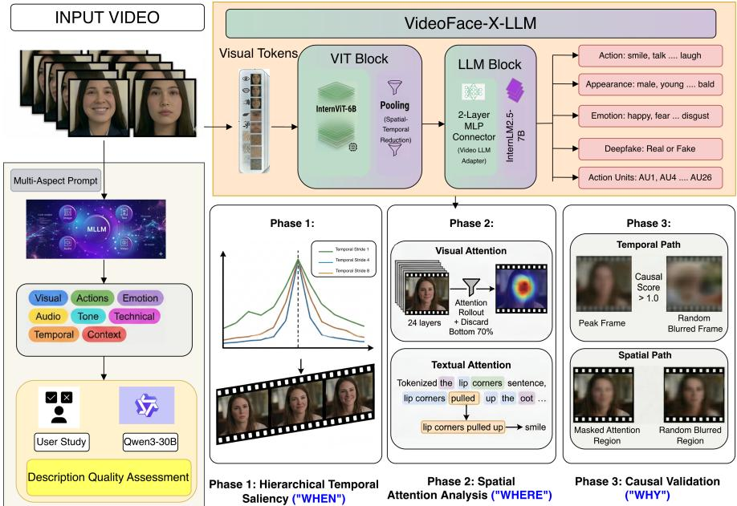
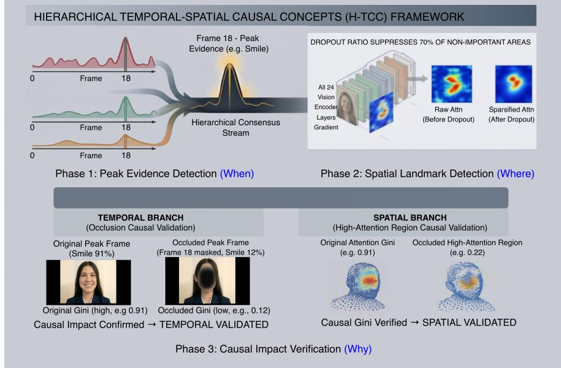
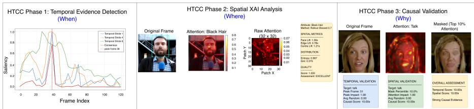

# When, Where, and Why: Hierarchical Causal Explainability for Video Face Understanding with MLLMs

Anubhav Kataria1, Shreya Ghosh2, Jingwen Ye1, and Abhinav Dhall1

1 Monash University, Melbourne, Australia 2 Indian Institute of Technology Kharagpur, Kharagpur, India

Abstract. Understanding facial behaviour in video requires answering three fundamental questions: when a key facial expression occurs, where the model attends on the face at that moment, and why that evidence is necessary rather than merely correlated. Today’s multimodal large language models (MLLMs) can label and describe video, but they rarely provide faithful explanations, especially for small facial movements that change over time. We present VideoFace-X-LLM, a framework for explainable facial video understanding comprising two key components. First, we introduce ExplainFace, a weakly supervised video-text corpus for facial behaviour understanding, automatically constructed from CelebV-HQ videos and validated through human evaluation and a twomodel audit (at most 2.3% contradictions), demonstrating consistent gains across two backbone architectures. Second, H-TCC (Hierarchical Temporal Spatial Causal Concepts), which finds the key temporal moments (When), the facial regions (Where), and verifies its causal necessity (Why) through targeted occlusion. Fine-tuning on ExplainFace raises appearance Macro F1 from 19.48% to 32.87% (+13.39), with gains of +4.38 on actions, +6.77 on temporal emotion, and +11.84 F1 on deepfake detection. We also measure the explanations pointing lift, face/edge lift, stability, an Adebayo sanity check, and a necessity test rather than only showing examples. Our models, code, and corpus are available on request for research use.

Keywords: Facial Foundational Model · Explainability · Spatio-Temporal Analysis

## 1 Introduction

Faces in motion are one of the richest signals of human behaviour. A raised brow becomes surprise only when we see it change over time; a smile becomes warmth or sarcasm depending on the gaze, head motion, voice, and context around it. Such behaviour is temporal, multimodal, and causal: meaning comes not from single frames, but from how visual and audio signals change together. To understand it well, a model should answer three questions: when a key event happens, where it shows on the face at that moment, and why that region is needed and not just present by chance. The three are linked: a good explanation must find the right moment and region, then confirm that this evidence drives the output.

  
Fig. 1: Overview of VideoFace-X-LLM. Left: the ExplainFace corpus is built by prompting Gemini for multi-aspect video descriptions, then auditing them for quality and bias. Top: the MLLM is fine-tuned on this corpus. Right: H-TCC explains each prediction by finding when the key moment occurs, where the model looks on the face, and why that evidence is needed.

Multimodal large language models (MLLMs) have improved fast on general vision language tasks, but they are still weak at fine-grained facial behaviour. Existing MLLMs [18, 39] are trained on broad data and lack the priors needed to read small facial motions, micro-expression changes, and cues that depend on time but they remain strong at open-ended video description and soft-labeling. This is even harder for explanation, where a model must justify a prediction over time, not just describe a still image.

Recent models such as InternVideo2.5 [38], GPT-4o [26], and Qwen3-VL [39] are strong at captioning, VQA, and general video analysis, yet they struggle with human-centric reasoning. Their training data is broad but thin on detailed labels for expressions, afect, body language, and temporal change. The real problem is not the models but the data: there is no large video-text dataset that describes faces in detail and lines up those descriptions with time. Weakly supervised, language-model-based dataset building has been tried for still images (for example FaceLLM’s FairFaceGPT [33]), but not for video. Moving from images to video is harder, because it needs grounding of facial attributes in both space and time, plus reasoning over small changes that unfold over time.

We address this with VideoFace-X-LLM, a model for explainable facial behaviour in video. We build ExplainFace, a weakly supervised video text corpus generated with Gemini [18], giving time-aligned descriptions of facial attributes, expression dynamics, and audio visual context. To explain predictions, we introduce H-TCC (Hierarchical Temporal Spatial Causal Concepts), which finds when key events occur, where the model looks on the face, and why that evidence is needed, using hierarchical temporal saliency, spatial attribution, and a targeted occlusion test that confirms the identified evidence is necessary for the prediction. Importantly, fine-tuning on ExplainFace helps two diferent backbones, and we measure the explanations rather than only showing examples. Our main contributions are:

ExplainFace: a checked, weakly-labeled dataset. We label CelebV-HQ videos using Gemini instead of expensive frame-by-frame human labeling. We test how good these labels are with two human studies and a two-model check for bias, and show the labels still work well when used with two diferent model backbones.

– H-TCC: a when/where/why framework that we actually measure. Every step of H-TCC is defined with clear equations, and we score the explanations with quantitative faithfulness metrics (pointing/face/edge lifts, stability, a sanity check, and a necessity test), not just example cases.

VideoFace-X-LLM. A video-understanding model for faces that explains its answers by pointing to the exact moments and regions that led to its decision.

## 2 Related Work

MLLMs for Vision Language Understanding. Recent MLLMs such as GPT-4o [26], InternVideo2.5 [38], LLaVA-NeXT [46], and Qwen3-VL [39] have pushed general image and video reasoning, but lack the domain priors and timealigned supervision needed for subtle facial behaviour, motivating our specialised corpus and adapted MLLM.

Human-Centric Facial Behaviour Understanding. Many works apply MLLMs and foundation models to faces: recognition [13], attribute analysis [23], understanding [9], and multimodal reasoning [11]. A recent survey [34] reviews how foundation models and LLMs are used for biometric security. Beyond CLIP, selfsupervised methods learn facial representations, such as the masked-autoencoder MARLIN [8], FaRL [49], DINO-style distillation [6], and ComFace [4]. Multitask models [25] jointly do face parsing, landmarks, pose, and attributes. HumanOmni [47] uses a dedicated face branch and does well on expression and emotion. Still, no existing work gives both time-aligned video labels and clear, trustworthy explanations which is what VideoFace-X-LLM sets out to do.

Bias and Explainability for Facial Behaviour Understanding. Facial datasets carry demographic imbalance that flows into predictions, with uneven results across gender, race, and age [14]. LLMs can amplify such bias when describing faces [17], and bias checks for video face descriptions are still missing.

1) Temporal Explainability (When). Several methods [20, 41, 43] find key moments in video. TimeSuite [43] adds temporal grounding, SeViLA [41] picks keyframes, and VTimeLLM [20] and TimeChat [30] encode timestamps as text. Grounded-VideoLLM [36] splits video into spatial and temporal tokens. However, looking at only one time scale can miss events that overlap.

2) Spatial Explainability (Where). Grad-CAM [32] makes spatial heatmaps from gradients but does not suit transformer encoders or video. For vision transformers, attention rollout [1] traces information across layers, with refinements that mix gradients and attention [10]. GMAR [21] reweights heads by gradient importance, and LVLM-Interpret [35] extends rollout to large models. However, these maps do not line up with time.

3) Causal Validation (Why). Occlusion methods test whether evidence is needed by masking inputs and watching the output change. Zeiler and Fergus [42] used systematic occlusion for CNNs, RISE [28] uses random masks, and Fong and Vedaldi [16] frame it as finding the smallest change that flips the output. The problem is that they perturb blindly, without knowing when or where to look, which is slow and hard to read. They are also not built for video MLLMs, where masks must cover both time and space.

Existing methods usually answer only one of when, where, or why, each with limits that our H-TCC addresses together.

## 3 ExplainFace Corpus

Most MLLMs [38, 39] are trained on broad data with little human-centric detail, so they miss subtle facial behaviour and afect over time. We close this gap with ExplainFace, a video text corpus for detailed analysis of faces over time. We use videos from CelebV-HQ [50] and generate descriptions with the Gemini API [18]. The pipeline has two stages: a system prompt for video analysis (Prompt 3.1) followed by a multi-aspect description prompt; then a bias audit of those descriptions (Prompt 3.2). Fig. 1 shows the pipeline on the left.

## 3.1 Prompting for ExplainFace Corpus

System Prompt. Because the model can answer in diferent ways for diferent videos, we use a fixed system prompt (Prompt 3.1) so the output stays detailed and structured.

Multi-Aspect Description Generation. For each video we generate descriptions over eight aspects: theme & narrative, visual elements, actions & movements, audio components, emotional tone, technical aspects, temporal flow, and context & relationships. These cover both still details and change over time. We use markdown headings so the format is consistent. Unlike FaceLLM [33], which uses FairFace metadata to guide generation, we give Gemini no prior information about the video, because temporal content is hard to summarise in metadata. We let the model watch the video and extract the details itself. Linking aspects to tasks. Each description aspect supervises a downstream task, as shown in

## Prompt 3.1: System Prompt for Video Analysis

System: You are an AI assistant specialized in analyzing video content with high accuracy and detail, suitable for multimodal video understanding and emotional analysis applications. Your task is to analyze and describe videos comprehensively, including visual elements, audio components, temporal dynamics, and emotional content. As an assistant, you should always analyze given video content thoroughly and provide objective, detailed descriptions based on observable information.

Do not make assumptions beyond visible and audible traits. When analyzing a video, consider visual elements (scenes, objects, people, actions, lighting, camera movements, visual efects), audio components (speech, music, sound efects, ambient noise), temporal dynamics (sequence of events, transitions, pacing, duration), emotional expressions and behaviors (facial expressions, body language, vocal tone, emotional states), contextual information (setting, relationships between subjects, narrative flow), and technical aspects (video quality, editing techniques, production values).

I may provide you with additional context about the video content, duration, or specific aspects to focus on. If you are asked for specific features or attributes, only describe what is asked in the question. Never say “I’m unable to analyze” instead, provide detailed descriptions based on the visual and auditory information available. Your answers should be comprehensive text descriptions (one or multiple paragraphs) that paint a clear picture of the video’s content and emotional landscape.

Tab. 1. For example, “Visual Elements” teaches appearance, “Actions” teaches action labels, and “Emotional Tone” teaches emotion and Action Units. This is why a general description corpus can train fine-grained facial tasks.

Quality Analysis for ExplainFace Corpus. AI-generated text can hallucinate, so we check the corpus with a ‘human-in-the-loop’ study. To test whether humans can match the AI descriptions to the videos, we ran two user studies with 10 participants who have computer-vision experience. The authors did not take part3.

User study 1 (Description quality): We randomly pick videos from the Explain-Face corpus and split them across 10 participants. After dropping incomplete answers, 531 pairs are left. Each participant gets the same instructions as Gemini and writes their own eight-aspect description, without seeing Gemini’s text. We then compare human and Gemini descriptions with semantic and lexical

3 All procedures followed the afiliated University’s Human Research Ethics Committee approval.

Table 1: How each ExplainFace description aspect supervises a downstream task.
<table><tr><td>Description aspect</td><td>Task it mainly supervises</td></tr><tr><td>Visual Elements</td><td>Appearance attributes</td></tr><tr><td>Actions &amp; Interaction</td><td>Action recognition</td></tr><tr><td>Emotional Tone &amp; Expressions Emotion recognition, Action Units</td><td></td></tr><tr><td>Temporal Flow</td><td>Temporal emotion, deepfake (motion cues)</td></tr><tr><td>Audio Components</td><td>Multimodal context (speech, affect)</td></tr><tr><td>Technical Aspects</td><td>Manipulation /deepfake artifacts</td></tr></table>

Table 2: User Study 1: human vs. Gemini descriptions (531 videos). SBERT measures meaning; BLEU and ROUGE measure word overlap. High SBERT with low BLEU/ROUGE means both describe the same content in diferent words.
<table><tr><td>Aspect</td><td>SBERT ↑BLEU-1 ↑ROUGE-L ↑</td><td></td></tr><tr><td>Theme &amp; Narrative</td><td>0.46</td><td>0.06 0.13</td></tr><tr><td>Visual Elements</td><td>0.43</td><td>0.05 0.14</td></tr><tr><td>Actions &amp; Movements</td><td>0.46</td><td>0.06 0.14</td></tr><tr><td>Audio Components</td><td>0.45</td><td>0.08 0.17</td></tr><tr><td>Emotional Tone</td><td>0.44</td><td>0.04 0.11</td></tr><tr><td>Technical Aspects</td><td>0.54</td><td>0.06 0.16</td></tr><tr><td>Temporal Flow</td><td>0.46</td><td>0.07 0.14</td></tr><tr><td>Context &amp; Relationships</td><td>0.33</td><td>0.04 0.10</td></tr><tr><td>Overall</td><td>0.45</td><td>0.06 0.14</td></tr></table>

metrics. The goal is to check whether humans and Gemini describe the same content, not the same words.

User study 1 Results: Tab. 2 compares human and Gemini descriptions across 531 videos and eight aspects, using SBERT [29] cosine similarity for meaning and BLEU [27]/ROUGE [22] for word overlap. Semantic similarity is high while lexical overlap is low: SBERT averages 0.45, against BLEU-1 0.06 and ROUGE-L 0.14. For reference, two humans describing the same video reach only 0.38, and a human and Gemini describing diferent videos 0.30, so 0.45 exceeds both. This is exactly what we want: it shows humans and Gemini say the same thing in diferent words. Gemini writes longer, structured text; humans write short, informal notes. The pattern holds across aspects: Technical Aspects is highest (SBERT 0.54, shared vocabulary), while Emotional Tone (0.44) and Context (0.33) are lower, since they are more subjective.

User study 2 (Video retrieval from description): Here we test whether the descriptions are detailed enough to point to one exact video. We pick 1000 descriptions and split them across 10 participants. After dropping incomplete trials, 917 are left. Each participant reads a description and picks the matching video from four candidates. If a description is accurate and specific, the participant should beat the 25% chance baseline. We use three dificulty levels. i) Easy: the three wrong candidates are random, so they usually show diferent scenes; this tests if the description is factually correct. ii) Medium: the wrong candidates are chosen to be highly similar in description embedding space (for example, all show a person speaking to camera), so a generic line like ‘a man talks’ is not enough; the description must capture clothing, expression, or background. iii) Hard: all four candidates are diferent time segments of the same video (using CelebV-HQ metadata). They share the same context, so the only way to pick the right one is fine temporal detail: which expression appears when, and in what order events happen.

User study 2 Results: Tab. 3 shows 99.18% on easy, 94.55% on medium, and 91.24% on hard, all far above the 25% baseline. Even on the hard, same-clip task, people pick correctly 91% of the time, which shows the descriptions capture temporal detail: expression changes, emotional shifts, and event order.

Table 3: User Study 2: human video retrieval accuracy. A participant reads a description and picks the matching video from four options. Chance accuracy is 25%.
<table><tr><td>Level</td><td>|What varies</td><td>[Samples Human Acc.</td></tr><tr><td>Easy Medium</td><td>Random videos</td><td>368 99.18%</td></tr><tr><td>Hard</td><td>[Similar content</td><td>275 94.55%</td></tr><tr><td>Overall</td><td>Same-clip segments</td><td>274 91.24%</td></tr><tr><td></td><td></td><td>917 95.42%</td></tr></table>

## 3.2 Bias Analysis of ExplainFace Corpus

MLLM descriptions can be biased, often through stereotypes or guesses from appearance [14]. So we add a bias-audit stage that checks each description. A separate prompt asks the model to flag biased language and suggest a neutral version grounded in what is visible. This makes the descriptions both detailed and objective.

Subjectivity Audit. Descriptions can go beyond what is visible. A model might call a neutral face ‘reserved’, or read ‘frustration’ from a raised brow. These are not wrong, but they are interpretations shaped by priors. To measure how much interpretive language is in ExplainFace, we use a two-stage audit.

Stage 1: A prompt (Prompt 3.2) reviews each description with its video. For every interpretive statement, the model returns: (i) the exact phrase, (ii) why it goes beyond what is seen, and (iii) a more grounded alternative. If nothing is flagged, it says the description is purely observational.

Example flagged pair. For one clip, the draft said the person “looks aggressive.” The audit flagged this as a guess about character and suggested “the brows are drawn together and the jaw is tense” - keeping the visible cue but dropping the assumption.

Observations from Stage 1: We run the audit with two models: Gemini 2.5 Flash [18] and Qwen3-30B-Instruct [39]. Gemini calls about 70% of descriptions observational and 30% interpretive; Qwen3 calls about 60% observational and 40% interpretive. The gap shows the task is fuzzy: even two LLMs disagree on where observation ends and interpretation begins. This supports our view that objectivity in facial description is a spectrum, not a yes/no.

Stage 2: Next we compare each flagged phrase with its suggested alternative. The two should keep the same meaning but change the framing. To test this, we use four metrics: i) Cosine similarity on MiniLM-L6-v2 embeddings [37]; ii) BERTScore [45] for meaning (should stay high); iii) BLEU [27] for word overlap (should drop if wording changed); and iv) NLI with DeBERTa [19] to label each pair as entailment, neutral, or contradiction (high entailment means the revision follows from the original).

Observations from Stage 2: Tab. 4 reports two auditors over 31,128 and 33,008 pairs. When a flagged sentence is rewritten to be more objective, the meaning stays the same: BERTScore F1 is 0.93 for both Gemini and Qwen3. At the same time, BLEU is low (0.21 and 0.20), so the wording changed a lot but the meaning did not. The audit changes how something is said, not what is said. Contradiction rates are very low: only 2.3% (Gemini) and 1.6% (Qwen3), so over 97% of pairs stay factually consistent. Reaching this at scale, with no human annotation, shows the corpus is robust. Neutral cases (43.9% for Gemini, 61.5% for Qwen3) are usually extra hedging or detail, not errors. The two auditors disagree on how much is subjective, yet they give almost the same similarity and contradiction numbers, so our conclusion does not depend on the auditor. Together, this shows ExplainFace is accurate and rich, and its interpretive language links low-level cues to human-level meaning.

<table><tr><td>Prompt 3.2: Bias Analysis</td></tr><tr><td>System: You are an AI ethics assistant. Review the following video and its accom- panying text description for potential biases. Human: Does the description use stereotypical language related to gender, ethnicity, or age? Does it make unwarranted assumptions about emotion, intent, or character based on appearance? Your task is to: - Analyze both the video and the text description provided below. - Identify any specific phrases or sentences in the description that could be consid-</td></tr><tr><td>ered biased, stereotypical, or make unsupported assumptions. - For each identified statement, explain why it is potentially problematic. – Suggest a more neutral, objective alternative for each flagged statement, grounding your suggestion in observable facts from the video. If no biased statements are found, state that the description appears to be objec- tive and free of bias. Your response must be structured using the exact following</td></tr><tr><td>markdown headings: Overall Assessment (Provide a one-sentence summary of your findings.) Bias Analysis (If biased statements are identified, list each one as follows:) Problem Statement 1: [The exact quote from the description] Explanation 1: [Why it is potentially problematic] Suggested Alternative 1: [A more neutral, objective rephrasing] Final Conclusion (A brief concluding thought on the description&#x27;s overall objectiv- ity.) Video Description to Analyze:</td></tr></table>

Final Conclusion: After the audit we keep the full corpus, including interpretive descriptions: facial behaviour is naturally subjective, and this interpretive layer matters for emotion and attribute prediction removing it would leave only anatomy. As our results show, these descriptions help rather than hurt.

## 4 VideoFace-X-LLM

We propose VideoFace-X-LLM, a video language model fine-tuned for facial video understanding. We build on InternVideo2.5 [38] and adapt it to the face domain by fine-tuning on ExplainFace with Fully Sharded Data Parallel (FSDP) training. Fig. 1 shows the architecture.

Base Model Details. InternVideo2.5 [38] has three parts: a vision encoder, a vision language connector, and a language decoder. The vision encoder follows InternViT: 24 transformer layers, hidden size 1024, 16 heads. It reads frames at 448 × 448 with patch size 14, and uses Flash Attention [12] for speed. The connector is a two-layer MLP with 0.5 downsampling that maps visual features into the language space. The decoder is InternLM2.5-7B [7]: 32 layers, hidden size 4096, group-query attention with 32 heads and 8 key/value heads.

Fine-tuning Details. We train on the question answer pairs from ExplainFace (Sec. 3) with the matching CelebV-HQ videos. We fine-tune end-to-end to predict the answer, using FSDP [48].

## 5 Explainability: Hierarchical Temporal-Spatial Causal Concepts (H-TCC)

Video language models [18, 39] are strong, but their deep encoders and crossmodal attention make it hard to say which region or moment drove a prediction. We address this with H-TCC, which finds when a key event happens, where the model looks, and why that evidence is needed $\left( \mathrm { F i g . ~ 2 } \right)$

Problem definition. Given a video $V = \{ f _ { 1 } , \ldots , f _ { T } \}$ and a predicted attribute $^ { a , }$ H-TCC returns a temporal peak $t ^ { \star } ~ ( W h e n )$ , a spatial attention map R over image patches (Where), and a necessity decision $( W h y )$ . We call an explanation faithful if perturbing the identified evidence changes the prediction more than perturbing random evidence.

Phase 1: Hierarchical Temporal Saliency (When). Phase 1 finds the moments that matter most for a prediction. First, we measure how strongly the model supports a target label a, using a margin between a and its best competing label:

$$
m = g ( a ) \ : - \ : \operatorname* { m a x } _ { c \neq a } g ( c ) ,\tag{1}
$$

where g is the model’s score for a label. For appearance and action, g is a binary Yes/No presence probe, so $m = \mathrm { m a x } _ { i \in \mathrm { Y e s } } z _ { i } - \mathrm { m a x } _ { j \in \mathrm { N o } } z _ { j }$ over the next-token logits z. For emotion, $g ( c )$ is the length-normalised sequence log-likelihood of label c under the carrier “the dominant emotion is $\begin{array} { r } { c ^ { \prime \prime } , \ g ( c ) = \ \frac { 1 } { \left| c \right| } \sum _ { k } \log p \big ( \boldsymbol { y } _ { k } ^ { c } \ | } \end{array}$ $y _ { < k } ^ { c } , V )$ , and the competitors are the other emotion classes. We use a margin, not a probability, because it does not saturate near 1.0 and so still moves when evidence is removed. Next, for each frame f with visual tokens $\mathcal { T } _ { f }$ (embeddings $\mathbf { e } _ { t } )$ , we measure how much the frame pushes the attribute logit $y _ { a }$ , using the gradient times the token value:

Table 4: Semantic similarity between flagged (interpretive) statements and their suggested observational alternatives. Semantic: meaning; Lexical: word overlap; NLI: Natural Language Inference; Ent: Entailment, Neu.: Neutral, Con.: Contradiction.
<table><tr><td>Auditor (Pair)</td><td colspan="3">Semantic ↑ BERT Cosine Score Sim.</td><td>Lexical ↓ BLEU ROUGE-L</td><td colspan="3"> $N L I \ ( \% )$  Ent. ↑ Neu. Con. ↓ 2.30</td></tr><tr><td>Gemini 31,128</td><td colspan="3">0.93</td><td>0.21 0.48</td><td colspan="3">53.8 43.9</td></tr><tr><td>Qwen3 33,008</td><td>0.93</td><td>0.74</td><td>0.20</td><td>0.46</td><td>36.9</td><td>61.5</td><td>1.60</td></tr></table>

  
Fig. 2: Overview of H-TCC. Phase 1 detects the peak moment (When); Phase 2 localises where the model attends on the face (Where); Phase 3 tests whether that evidence is needed (Why). See Sec. 5.

$$
s _ { f } \ = \ \sum _ { t \in \mathcal { T } _ { f } } \left| \left. \nabla _ { \mathbf { e } _ { t } } y _ { a } , \ \mathbf { e } _ { t } \right. \right| .\tag{2}
$$

We then smooth these scores at three time scales (strides 1, 4, 8), normalise each, and multiply them. A frame becomes a peak only if it is important at all three scales, which removes noise:

$$
\hat { s } ^ { ( r ) } = \mathrm { n o r m } \big ( \mathrm { A v g P o o l } _ { r } ( s ) \big ) , \qquad C _ { f } = \prod _ { r \in \{ 1 , 4 , 8 \} } \hat { s } _ { f } ^ { ( r ) } , \qquad t ^ { \star } = \arg \operatorname* { m a x } _ { f } C _ { f } .\tag{3}
$$

We also report how stable the saliency is across scales, as the mean pairwise Spearman correlation $\rho _ { S }$ between the per-stride curves:

$$
\mathrm { S t a b } = \frac { 1 } { \vert \mathcal { R } \vert } \sum _ { r < r ^ { \prime } } \rho _ { S } \big ( \hat { s } ^ { ( r ) } , \hat { s } ^ { ( r ^ { \prime } ) } \big ) .\tag{4}
$$

To confirm the saliency comes from learned knowledge, not a fixed pattern, we apply cascading model randomization [3]: we randomize the top-k decoder layers cumulatively, recompute the consensus $\bar { C } ^ { ( k ) }$ , and correlate it with the original. A faithful map collapses to about zero as k grows:

$$
\rho _ { k } = \rho _ { S } \bigl ( C ^ { ( 0 ) } , C ^ { ( k ) } \bigr ) , \qquad \rho _ { 0 } = 1 , \qquad \rho _ { k } \to 0 .\tag{5}
$$

Phase 2: Spatial Attention Analysis (Where). Phase 2 shows where the model looks at the peak moment. We give two views: visual attention from the vision encoder and textual attention from the language model. Visual Attention: we read attention from all 24 encoder layers at the peak frame (each emotion segment is handled separately). For each layer we average the heads, zero the lowest 70% of values (those at or below the 0.7 quantile $\theta _ { 0 . 7 } ^ { ( l ) }$ , to remove edge noise), add a residual, normalise, and multiply across layers [1]:

$$
\begin{array} { r } { \hat { A } _ { i j } ^ { ( l ) } = A _ { i j } ^ { ( l ) } \mathcal { k } \big [ A _ { i j } ^ { ( l ) } > \theta _ { 0 . 7 } ^ { ( l ) } \big ] , \quad \tilde { A } ^ { ( l ) } = \mathrm { r o w n o r m } \big ( \hat { A } ^ { ( l ) } + I \big ) , \quad R = \Big ( \prod _ { l = L } ^ { 1 } \tilde { A } ^ { ( l ) } \Big ) _ { 0 . 1 } . } \end{array}\tag{6}
$$

The $3 2 \times 3 2$ map R is the class-token row over the patch tokens, normalised by its max, and overlaid on the frame. We localise the face with MTCNN (Multi-Task Cascaded CNN) [44], or a central crop if no face is found. With N=1024 patches, face region $F ,$ and a two-patch-wide strip $E$ along one image border $( | E | = 2 \times 3 2 { = } 6 4 )$ , we measure whether attention concentrates on the face and avoids the background border, against a uniform baseline:

$$
\mathrm { F a c e L i f t } = \frac { \sum _ { p \in F } R _ { p } \big / \sum _ { p } R _ { p } } { | F | / N } , \qquad \mathrm { E d g e L i f t } = \frac { \sum _ { p \in E } R _ { p } \big / \sum _ { p } R _ { p } } { | E | / N } .\tag{7}
$$

We also run a pointing game: does the most-attended patch fall on the face, above chance?

$$
\mathrm { P o i n t L i f t } = \frac { \frac { 1 } { K } \sum _ { k } { \mathcal { H } } \big [ \arg \operatorname* { m a x } _ { p } R _ { p } ^ { ( k ) } \in F \big ] } { | F | / N } .\tag{8}
$$

Here FaceLift, PointLift > 1 mean the model looks at the face, and EdgeLift $<$ 1 means it avoids borders. Textual Attention: we read the model’s naturallanguage explanation, run symmetric rollout over the language layers, and find attribute-specific phrases from a small evidence vocabulary. Their influence on the attribute token gives a ranked list of supporting evidence. For emotion, we do this per segment with segment-specific text.

Phase 3: Necessity Validation via Targeted Occlusion (Why). The first two phases tell us when and where the model’s evidence lies; Phase 3 confirms that this evidence is actually necessary for the prediction, rather than merely present alongside it. We test necessity directly through targeted occlusion: we apply a strong Gaussian blur to the specific evidence identified by Phases 1 and 2, and use VideoFace-X-LLM itself to check whether the target attribute is still detected after masking. Because the evidence is already localised in time and space, the test is far cheaper and easier to read than blind occlusion over the whole input. Temporal validation. For each predicted attribute, we take the peak frame identified in Phase 1, apply a strong blur to it, and check whether the model still predicts the attribute. We repeat this for randomly selected frames from the same clip. A peak frame is judged causally important if blurring it changes the prediction more often than blurring a random frame. We summarise this as a causal score: the ratio of the peak-frame impact to the average randomframe impact, where a score above 1.0 means the identified moment matters more than chance.

Spatial validation. We validate the Phase 2 attention regions the same way. We blur the top 10% highest-attention patches in the peak frame and check whether the attribute prediction changes, then blur random regions of equal area for comparison. A causal score above 1.0 indicates the highlighted region is necessary rather than incidental.

  
Fig. 3: Qualitative H-TCC results. Phase 1 shows the temporal saliency at diferent time windows. Phase 2 shows where the model looks for the attribute black hair. Phase 3 shows the necessity test.

We use the term causal in the sense of a controlled intervention test, blur the evidence and measure the efect which establishes that the identified evidence is needed for the prediction; it confirms necessity rather than recovering the model’s full internal reasoning.

## 6 Experiments

Tasks, Datasets, and Metrics. We evaluate VideoFace-X-LLM on six tasks. Appearance Attributes: the model predicts visual attributes such as facial features, hair, and accessories. This uses CelebV-HQ [50] as a 40-class multi-label task. We report Mean Accuracy (mA) and Macro F1. mA averages per-attribute accuracy; Macro F1 handles the imbalance of rare attributes.

Action Attributes: the model predicts facial actions such as talking, laughing, or singing, on CelebV-HQ [50] as a 35-class multi-label task. We report mA and Macro F1, as for appearance.

Emotion Recognition: we use two settings. At the video level the model predicts the dominant emotion over the whole clip from eight classes (neutral, happy, sad, anger, fear, disgust, surprise, contempt). We report accuracy and Macro F1 for both the video and temporal settings.

Facial Deepfake: the model predicts whether a face is real or manipulated, on FaceForensics++ [31]. This is binary; we report accuracy and F1.

Action Units (AUs): Action Units are the basic facial-muscle movements defined by the Facial Action Coding System (FACS) [15]. We evaluate on DISFA [24], which gives frame-level intensity for eight AUs; we treat an AU as active if intensity ≥ 2. We report Macro F1 at clip and frame level, plus mA at clip level. Note on data. We fine-tune on CelebV-HQ videos paired with Gemini descriptions. As CelebV-HQ has no oficial train/test split, we build an identityindependent one by grouping clips by face identity (ArcFace [13] embeddings) and by source YouTube video and assigning whole groups to one split (80% train, 20% test), so all CelebV-HQ evaluations are on unseen identities and videos. Deepfake (FaceForensics++) and Action Units (DISFA) are entirely separate datasets, so they test cross-dataset transfer.

Training Configurations. We try two settings. ViT-Only: we freeze the language model, and train only the vision encoder and the connector, so the encoder

Table 5: Results on six tasks. Appearance/Action/Emotion on CelebV-HQ (identityindependent test split, 6,923 clips), Deepfake on FaceForensics++, Action Units on DISFA. Temporal emotion is frame-by-frame at 10 Hz. mA = Mean Accuracy, F1mac = Macro F1 (primary metric, robust to imbalance). $" \mathrm { Q } \mathrm { w e n 3 - } \mathrm { V L } + \mathrm { E F " } = \mathrm { Q } \mathrm { w e n 3 - } \mathrm { V L }$ fine-tuned on ExplainFace. Bold = best.
<table><tr><td rowspan="3">Model</td><td colspan="2">Appearance</td><td colspan="2">Action</td><td colspan="4">Emotion</td><td rowspan="2" colspan="2">Deepfake</td><td colspan="4">Action Units</td></tr><tr><td colspan="2"> $\mathrm { m A } \uparrow \mathrm { F 1 } _ { \mathrm { m a c } } \uparrow$ </td><td colspan="2"></td><td colspan="2">Video-Level Acc ↑ F1mac ↑</td><td colspan="2">Temporal Acc ↑ F1mac ↑</td><td colspan="2"> $\operatorname { A c c } \uparrow \operatorname { F 1 } _ { \operatorname* { m a c } } \uparrow$ </td><td colspan="2">mA ↑ Frame F1</td></tr><tr><td></td><td></td><td>mA ↑</td><td> $\mathrm { F 1 _ { m a c } \uparrow }$ </td><td></td><td></td><td></td><td></td><td></td><td></td><td></td><td></td><td></td><td> $\underline { { \mathrm { C l i p ~ F 1 } } }$ </td></tr><tr><td>InternVideo2.5 (Base)</td><td>88.10</td><td>19.48</td><td>93.69</td><td>16.44</td><td>82.06</td><td>21.96</td><td>84.04</td><td>20.04</td><td></td><td>51.01 33.96</td><td></td><td>88.3</td><td>21.1</td><td>21.6</td></tr><tr><td>Ours (ViT-Only)</td><td>86.16</td><td>26.29</td><td>94.50</td><td>17.88</td><td>55.61</td><td>22.00</td><td>71.47</td><td>23.83</td><td></td><td>50.00 35.23</td><td></td><td>71.0</td><td>16.7</td><td>16.8</td></tr><tr><td>Ours (ViT+LLM)</td><td>86.36</td><td>32.87</td><td>94.80</td><td>20.82</td><td>60.57</td><td>25.68</td><td>74.84</td><td>26.81</td><td>56.32</td><td>45.80</td><td></td><td>79.2</td><td>31.6</td><td>32.2</td></tr><tr><td>Qwen3-VL</td><td>89.19</td><td>36.85</td><td>95.32</td><td>23.22</td><td>81.09</td><td>26.11</td><td>85.88</td><td>13.06</td><td>56.07</td><td>47.88</td><td></td><td>88.9</td><td>37.7</td><td>38.2</td></tr><tr><td>Qwen3-VL + EF</td><td>86.35</td><td>39.99</td><td>94.19</td><td>23.20</td><td>78.02</td><td>27.47</td><td>83.47</td><td>23.28</td><td>55.71</td><td>47.63</td><td></td><td>87.9</td><td>34.3</td><td>34.7</td></tr><tr><td>Qwen2.5-VL</td><td>87.65</td><td>28.62</td><td>95.13</td><td>18.01</td><td>81.33</td><td>24.64</td><td>85.18</td><td>21.37</td><td>50.00</td><td>33.96</td><td></td><td>86.2</td><td>23.7</td><td>24.2</td></tr><tr><td>Llava-Next</td><td>67.91</td><td>18.45</td><td>70.22</td><td>7.88</td><td>84.42</td><td>12.22</td><td>86.29</td><td>9.70</td><td>50.60</td><td>33.60</td><td></td><td>11.8</td><td>18.5</td><td>18.1</td></tr><tr><td>Phi-4 MiniCPM</td><td>71.99</td><td>15.60</td><td>91.68</td><td>7.53</td><td>84.41</td><td>11.70</td><td>86.18 71.09</td><td>11.66 0.41</td><td>50.00 50.00</td><td>33.33 33.33</td><td></td><td>37.0</td><td>20.4</td><td>20.0</td></tr><tr><td></td><td>85.41</td><td>19.07</td><td>93.09</td><td>14.22</td><td>39.36</td><td>0.98</td><td></td><td></td><td></td><td></td><td></td><td>67.7</td><td>13.8</td><td>13.7</td></tr></table>

adapts to faces while the language model stays fixed. $\underline { { L L M + V i T } } \mathrm { . }$ we train all parts (encoder, connector, language model) together.

Implementation Details. We use the XTuner framework on PyTorch, with 2 NVIDIA A100 GPUs and FSDP full sharding. Each GPU uses micro-batch size 1 with gradient accumulation. We train for 1 epoch, global batch size 16, learning rate $4 \times 1 0 ^ { - 5 }$ for all parts, weight decay 0.01, 3% linear warmup then cosine decay, AdamW with gradient clipping at norm 1.0, and 8 frames per video. For all tasks the model returns structured JSON, compared against CelebV-HQ ground truth. We compare against of-the-shelf MLLMs (MiniCPM-V [40], InternVL, Qwen-VL [5,39], LLaVA-NeXT [46], Phi-4 [2]) using their public code.

## 7 Results

We report quantitative results, explainability results, and qualitative analysis. Quantitative Results. Tab. 5 reports all tasks; every number below is taken directly from it. Appearance. Fine-tuning on ExplainFace raises Macro F1 from 19.48% to 32.87% (+13.39). The base model’s slightly higher mA (88.10% vs. 86.36%) comes from mA being dominated by easy majority-negative attributes; Macro F1, which weights rare attributes equally, is the reliable measure and improves clearly. Action. Macro F1 rises from 16.44% to 20.82% (+4.38), and mA also improves (93.69%→94.80%). The ViT-Only setting gains less (17.88% F1), which shows language-model adaptation matters for actions. Emotion. Macro F1 rises from 21.96% to 25.68% (+3.72) at the video level and from 20.04% to 26.81% (+6.77) for temporal emotion, the best temporal F1 of all models. Deepfake. On the held-out FaceForensics++ set we reach 56.32% accuracy, the best of all models, and 45.80% F1 (33.96%→45.80% over the base). Action Units. On held-out DISFA, ViT+LLM raises Macro F1 over base (clip 21.6%→32.2%; frame 21.1% → 31.6%) but lowers mA (88.3% → 79.2%). ExplainFace transfers across backbones. ExplainFace is a transferable supervision signal, not a single-model trick. Fine-tuning on it raises appearance Macro F1 on two backbones: InternVideo2.5 (19.48% → 32.87%) and Qwen3-VL (36.85% → 39.99%), and it raises Qwen3-VL temporal-emotion Macro F1 (13.06% → 23.28%). We do not claim to beat every model on every task: strong general MLLMs such as Qwen3-VL lead on some tasks. The value of this work is the corpus and the explainability framework, not a leaderboard win.

Table 6: Faithfulness of H-TCC explanations. Higher is better for lifts, stability and causal scores; edge lift should be < 1; the Adebayo endpoint should fall to about 0 or below.
<table><tr><td>Metric Emotion Appearance Action</td></tr><tr><td>Multi-stride stability (↑)</td><td>0.39 0.41</td></tr><tr><td>Adebayo endpoint (→ 0)</td><td>0.46 -0.12</td></tr><tr><td>1.42×</td><td>-0.22 -0.13 1.40×</td></tr><tr><td>Spatial pointing lift (↑, chance = 1) Face lift (↑, uniform = 1)</td><td>1.40×</td></tr><tr><td>1.23× 1.24× 0.80× 0.80×</td><td>1.23× 0.80×</td></tr></table>

Explainability Results. Tab. 6 reports the faithfulness of H-TCC’s explanations, and together with the Phase 3 necessity test it answers the central question: are the explanations faithful, and is the highlighted evidence actually needed? The spatial pointing lift (1.40-1.42×) shows the most-attended patch lands on the face about 1.4× more often than chance, so the model looks at the right place; face lift (1.23-1.24×) shows the explanation mass sits inside the face rather than the background, and edge lift $( 0 . 8 0 < 1 )$ shows it avoids image borders, so it is not exploiting border artifacts. The Adebayo check drives explanation agreement from 1.0 to below 0 $\left( - 0 . 1 2 \ \mathrm { t o \ - } 0 . 2 2 \right)$ : when the model is randomized the explanations collapse, so they come from learned knowledge, not a fixed prior. Multi-stride stability (0.39-0.46) shows the chosen moments are consistent across time scales. Crucially, the Phase 3 necessity test then verifies that this evidence drives the prediction: blurring the peak frame and the top-attention region flips the model’s decision more often than blurring random frames or regions, giving temporal (1.28-1.76) and spatial (1.44-1.93) causal scores above chance (1.0).

Qualitative Analysis. Fig. 3 shows the three phases on an example. In Phase 1, the saliency is high only in a few short time windows, not spread over the whole video, so the model picks out the moments that matter. In Phase 2 (target black hair), the model looks at the hair region and ignores the background. In Phase 3, blurring this evidence drops the prediction; blurring other parts does not.

## 8 Conclusion

We introduce VideoFace-X-LLM, a facial video language model fine-tuned on the weakly labeled ExplainFace corpus, learning spatio-temporal features that transfer to emotion, deepfake, Action Unit, and attribute tasks. Broader Impact. It can serve as a base model for facial video analysis in afective computing, HCI, and behaviour understanding. Limitations. The model can inherit demographic bias from CelebV-HQ and preprocessing, and MLLMs can hallucinate; future work will add more diverse data. Acknowledgements. Abhinav Dhall’s research was partially supported by the Australian Research Council under Grant DP260100218.

## References

1. Abnar, S., Zuidema, W.: Quantifying attention flow in transformers. In: Proceedings of the 58th annual meeting of the association for computational linguistics. pp. 4190–4197 (2020)

2. Abouelenin, A., Ashfaq, A., Atkinson, A., Aly, H., Bao, J., Bajaj, G., Benhaim, A., Cai, M., Chaudhary, V., et al.: Phi-4-Mini technical report: Compact yet powerful multimodal language models via mixture-of-LoRAs. arXiv preprint arXiv:2503.01743 (2025)

3. Adebayo, J., Gilmer, J., Muelly, M., Goodfellow, I., Hardt, M., Kim, B.: Sanity checks for saliency maps. In: Advances in Neural Information Processing Systems (NeurIPS) (2018)

4. Akamatsu, Y., Umematsu, T., Imaoka, H., Gomi, S., Tsurushima, H.: Comface: Facial representation learning with synthetic data for comparing faces. In: 2025 IEEE/CVF Winter Conference on Applications of Computer Vision (WACV). pp. 5263–5273. IEEE (2025)

5. Bai, S., Chen, K., Liu, X., Wang, J., Ge, W., Song, S., Dang, K., Wang, P., Wang, S., Tang, J., et al.: Qwen2.5-VL technical report. arXiv preprint arXiv:2502.13923 (2025)

6. Bulat, A., Cheng, S., Yang, J., Garbett, A., Sanchez, E., Tzimiropoulos, G.: Pretraining strategies and datasets for facial representation learning. In: European Conference on Computer Vision. pp. 107–125. Springer (2022)

7. Cai, Z., Cao, M., Chen, H., Chen, K., Chen, K., Chen, X., et al.: Internlm2 technical report. arXiv preprint arXiv:2403.17297 (2024)

8. Cai, Z., Ghosh, S., Stefanov, K., Dhall, A., Cai, J., Rezatofighi, H., Hafari, R., Hayat, M.: Marlin: Masked autoencoder for facial video representation learning. In: Proceedings of the IEEE/CVF conference on computer vision and pattern recognition. pp. 1493–1504 (2023)

9. Chaubey, A., Guan, X., Soleymani, M.: Face-llava: Facial expression and attribute understanding through instruction tuning. In: Proceedings of the IEEE/CVF Winter Conference on Applications of Computer Vision. pp. 2648–2660 (2026)

10. Chefer, H., Gur, S., Wolf, L.: Transformer interpretability beyond attention visualization. In: Proceedings of the IEEE/CVF conference on computer vision and pattern recognition. pp. 782–791 (2021)

11. Cheng, Z., Cheng, Z.Q., He, J.Y., Sun, J., Wang, K., Lin, Y., Lian, Z., Peng, X., Hauptmann, A.G.: Emotion-llama: Multimodal emotion recognition and reasoning with instruction tuning. Advances in Neural Information Processing Systems 37, 110805–110853 (2024)

12. Dao, T.: Flashattention-2: Faster attention with better parallelism and work partitioning. arXiv preprint arXiv:2307.08691 (2023)

13. Deng, J., Guo, J., Xue, N., Zafeiriou, S.: Arcface: Additive angular margin loss for deep face recognition. In: Proceedings of the IEEE/CVF conference on computer vision and pattern recognition. pp. 4690–4699 (2019)

14. Dominguez-Catena, I., Paternain, D., Galar, M.: Metrics for dataset demographic bias: A case study on facial expression recognition. IEEE Transactions on Pattern Analysis and Machine Intelligence 46(8), 5209–5226 (2024)

15. Ekman, P., Friesen, W.V.: Facial action coding system. Environmental Psychology & Nonverbal Behavior (1978)

16. Fong, R.C., Vedaldi, A.: Interpretable explanations of black boxes by meaningful perturbation. In: Proceedings of the IEEE International Conference on Computer Vision (ICCV). pp. 3429–3437 (2017)

17. Gallegos, I.O., Rossi, R.A., Barrow, J., Tanjim, M.M., Kim, S., Dernoncourt, F., Yu, T., Zhang, R., Ahmed, N.K.: Bias and fairness in large language models: A survey. Computational linguistics 50(3), 1097–1179 (2024)

18. Gemini Team, G.: Gemini 2.5: Pushing the frontier with advanced reasoning, multimodality, long context, and next generation agentic capabilities (2025), https: //arxiv.org/abs/2507.06261

19. He, P., Liu, X., Gao, J., Chen, W.: Deberta: Decoding-enhanced bert with disentangled attention. arXiv preprint arXiv:2006.03654 (2020)

20. Huang, B., Wang, X., Chen, H., Song, Y., Zhu, W.: Vtimellm: Empower llm to grasp video moments. In: Proceedings of the IEEE/CVF Conference on Computer Vision and Pattern Recognition (CVPR) (2024)

21. Jo, S., Jang, G., Park, H.: Gmar: gradient-driven multi-head attention rollout for vision transformer interpretability. In: 2025 IEEE International Conference on Image Processing (ICIP). pp. 582–587. IEEE (2025)

22. Lin, C.Y.: ROUGE: A package for automatic evaluation of summaries. In: Text Summarization Branches Out. pp. 74–81 (2004)

23. Liu, Z., Luo, P., Wang, X., Tang, X.: Deep learning face attributes in the wild. In: Proceedings of the IEEE international conference on computer vision. pp. 3730– 3738 (2015)

24. Mavadati, S.M., Mahoor, M.H., Bartlett, K., Trinh, P., Cohn, J.F.: Disfa: A spontaneous facial action intensity database. IEEE Transactions on Afective Computing 4(2), 151–160 (2013)

25. Narayan, K., VS, V., Chellappa, R., Patel, V.M.: Facexformer: A unified transformer for facial analysis. In: Proceedings of the IEEE/CVF International Conference on Computer Vision. pp. 11369–11382 (2025)

26. OpenAI: Gpt-4o system card (2024), https://arxiv.org/abs/2410.21276

27. Papineni, K., Roukos, S., Ward, T., Zhu, W.J.: BLEU: a method for automatic evaluation of machine translation. In: Proceedings of the 40th Annual Meeting of the Association for Computational Linguistics. pp. 311–318 (2002)

28. Petsiuk, V., Das, A., Saenko, K.: Rise: Randomized input sampling for explanation of black-box models. In: British Machine Vision Conference (BMVC) (2018)

29. Reimers, N., Gurevych, I.: Sentence-BERT: Sentence embeddings using siamese BERT-networks. In: Proceedings of the 2019 Conference on Empirical Methods in Natural Language Processing and the 9th International Joint Conference on Natural Language Processing (EMNLP-IJCNLP). pp. 3982–3992 (2019)

30. Ren, S., Yao, L., Li, S., Xu, S., Sun, L., Lu, Z., Hou, Y., Liu, Y.: Timechat: A time-sensitive multimodal large language model for long video understanding. In: Proceedings of the IEEE/CVF Conference on Computer Vision and Pattern Recognition (CVPR) (2024)

31. Rossler, A., Cozzolino, D., Verdoliva, L., Riess, C., Thies, J., Nießner, M.: Faceforensics++: Learning to detect manipulated facial images. In: Proceedings of the IEEE/CVF international conference on computer vision. pp. 1–11 (2019)

32. Selvaraju, R.R., Cogswell, M., Das, A., Vedantam, R., Parikh, D., Batra, D.: Gradcam: Visual explanations from deep networks via gradient-based localization. In: Proceedings of the IEEE International Conference on Computer Vision (ICCV). pp. 618–626 (2017)

33. Shahreza, H.O., Marcel, S.: Facellm: A multimodal large language model for face understanding. In: Proceedings of the IEEE/CVF International Conference on Computer Vision. pp. 3677–3687 (2025)

34. Shahreza, H.O., Marcel, S.: Foundation models and biometrics: A survey and outlook. IEEE Transactions on Information Forensics and Security (2025)

35. Stan, G.B.M., Aflalo, E., Ayyubi, H., Darrell, T., Kira, Z., Shtedritski, A.: Lvlminterpret: An interpretability tool for large vision-language models. In: Proceedings of the IEEE/CVF Conference on Computer Vision and Pattern Recognition Workshops (CVPRW) (2024)

36. Wang, H., et al.: Grounded-videollm: Sharpening fine-grained temporal grounding in video large language models. In: Findings of the Association for Computational Linguistics: EMNLP (2025)

37. Wang, W., Bao, H., Huang, S., Dong, L., Wei, F.: Minilmv2: Multi-head selfattention relation distillation for compressing pretrained transformers. In: Findings of the Association for Computational Linguistics: ACL-IJCNLP 2021. pp. 2140– 2151 (2021)

38. Wang, Y., Li, X., Yan, Z., He, Y., Yu, J., Zeng, X., Wang, C., Ma, C., Huang, H., Gao, J., et al.: Internvideo2. 5: Empowering video mllms with long and rich context modeling. arXiv preprint arXiv:2501.12386 (2025)

39. Yang, A., Li, A., Yang, B., Zhang, B., Hui, B., Zheng, B., Yu, B., Gao, C., Huang, C., Lv, C., et al.: Qwen3 technical report. arXiv preprint arXiv:2505.09388 (2025)

40. Yao, Y., Yu, T., Zhang, A., Wang, C., Cui, J., Zhu, H., Cai, T., Li, H., Zhao, W., He, Z., et al.: MiniCPM-V: A GPT-4V level MLLM on your phone. arXiv preprint arXiv:2408.01800 (2024)

41. Yu, S., Cho, J., Yadav, P., Bansal, M.: Self-chained image-language model for video localization and question answering. In: Advances in Neural Information Processing Systems (NeurIPS) (2023)

42. Zeiler, M.D., Fergus, R.: Visualizing and understanding convolutional networks. In: European Conference on Computer Vision (ECCV). pp. 818–833 (2014)

43. Zeng, X., Li, K., Wang, C., Li, X., Jiang, T., Yan, Z., Li, S., Shi, Y., Yue, Z., Wang, Y., et al.: Timesuite: Improving mllms for long video understanding via grounded tuning. arXiv preprint arXiv:2410.19702 (2024)

44. Zhang, K., Zhang, Z., Li, Z., Qiao, Y.: Joint face detection and alignment using multitask cascaded convolutional networks. IEEE Signal Processing Letters 23(10), 1499–1503 (2016)

45. Zhang, T., Kishore, V., Wu, F., Weinberger, K.Q., Artzi, Y.: BERTScore: Evaluating text generation with BERT. In: International Conference on Learning Representations (2020)

46. Zhang, Y., Wu, J., Li, W., Li, B., Ma, Z., Liu, Z., Li, C.: Llava-video: Video instruction tuning with synthetic data. arXiv preprint arXiv:2410.02713 (2024)

47. Zhao, J., Yang, Q., Peng, Y., Bai, D., Yao, S., Sun, B., Chen, X., Fu, S., Wei, X., Bo, L., et al.: Humanomni: A large vision-speech language model for human-centric video understanding. arXiv preprint arXiv:2501.15111 (2025)

48. Zhao, Y., Gu, A., Varma, R., Luo, L., Huang, C.C., Xu, M., Wright, L., Shojanazeri, H., Ott, M., Shleifer, S., Desmaison, A., Bousquet, C., Krishnan, S., Ananthanarayanan, R., Bastian, P., et al.: Pytorch fsdp: Experiences on scaling fully sharded data parallel. In: Proceedings of the VLDB Endowment. vol. 16, pp. 3848–3860 (2023)

49. Zheng, Y., Yang, H., Zhang, T., Bao, J., Chen, D., Huang, Y., Yuan, L., Chen, D., Zeng, M., Wen, F.: General facial representation learning in a visual-linguistic manner. In: Proceedings of the IEEE/CVF conference on computer vision and pattern recognition. pp. 18697–18709 (2022)

50. Zhu, H., Wu, W., Zhu, W., Jiang, L., Tang, S., Zhang, L., Liu, Z., Loy, C.C.: Celebv-hq: A large-scale video facial attributes dataset. In: European conference on computer vision. pp. 650–667. Springer (2022)