Radar: higher is better; music uses 100 − CER.

# Youtu-Parsing-Omni: One Encoder, One Schema, All Modalities

Youtu-Parsing-Omni Team

We present Youtu-Parsing-Omni, an omni-modal parser that converts documents, images, audio, and video into structured records grounded in space and time, providing a perception layer for agents that read, locate, and cite evidence across modalities. Its design rests on one encoder for every modality and one schema for every task. Youtu-Omni-Encoder, initialized from a pre-trained language model to strengthen text reading, encodes all modalities with shared weights in a unified space-time coordinate system, and a few fusion layers let video frames attend to concurrent audio, bringing cross-modal fusion and temporal alignment into perception itself. OmniSchema unifies the outputs of all ten parsing tasks, allowing a single self-evolving post-training procedure, OmniSchema-Aware On-Policy Distillation (OSAD), to provide a shared token-role-based objective across tasks. In each round, the model is trained on its own rollouts against token-level targets from a reference-conditioned copy of itself, which is then refreshed with the trained weights, so that the parser and its supervision co-evolve. With a single 5 B-parameter checkpoint, Youtu-Parsing-Omni achieves state-of-the-art performance on OmniDocBench v1.6 (96.96 Overall) and leads all open-weight models on OmniParsingBench (75.08 Avg.), with its advantage concentrated on audio and video. It also achieves the best overall chart-parsing score (95.02) and the highest exact chemical-fingerprint agreement among compared systems, and matches a dedicated optical-music model in character-level transcription of typeset sheet music while staying far ahead of general-purpose systems. Code and model weights are publicly available.

Code: https://github.com/TencentCloudADP/youtu-parsing Model: https://huggingface.co/tencent/Youtu-Parsing-Omni

(a) OmniDocBench v1.6  
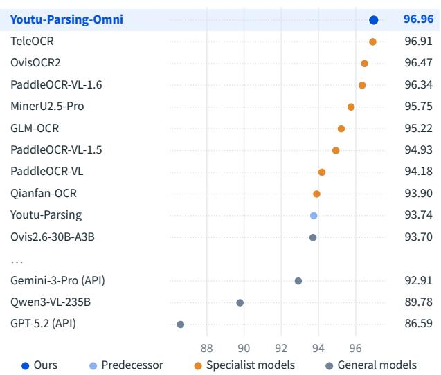

(b) OmniParsingBench  
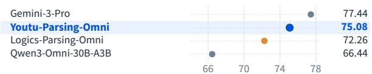  
(c) Domain-specific benchmarks

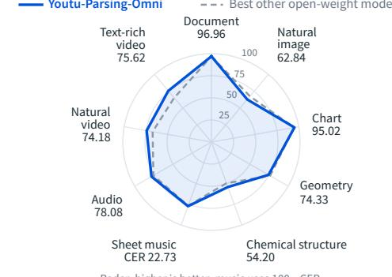  
Figure 1. Youtu-Parsing-Omni ranks first on OmniDocBench v1.6 (a), is the strongest open-weight model on OmniPars ingBench (b), and also leads on most domain-specific benchmarks (c).

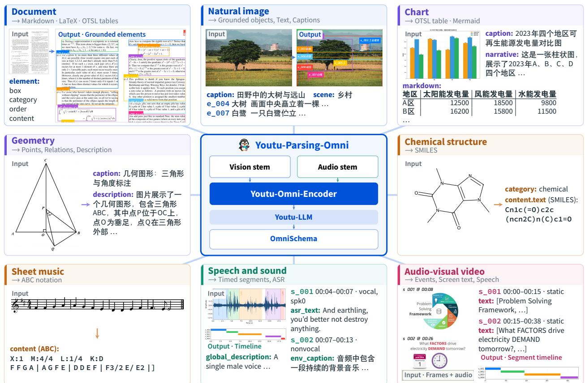  
Figure 2. Omni-modal parsing with one encoder and one schema. Youtu-Parsing-Omni parses documents, natural images, audio, and video with Youtu-Omni-Encoder shared across all modalities, and unifies their parsing tasks in OmniSchema.

## 1 Introduction

Large language model (LLM) agents increasingly act on information beyond their own parameters: they retrieve evidence before answering [1], call tools during reasoning [2], and operate computers through the screen [3]. Much of this information arrives not as plain text but as documents, images, audio, and video. Having the model that drives the agent consume such inputs directly is both costly and hard to audit: each time the agent revisits the material, that model must re-encode long sequences of visual and acoustic tokens, and an answer drawn from raw pixels or waveforms does not by itself indicate which region or interval supports it. Omni-modal parsing addresses both issues by converting each input once into a structured text record of what it contains and where or when each part occurs. Any LLM, including a text-only one, can then read and act on this record and trace a claim back to its source through the anchors it cites; parsing thus provides a perception layer between non-text inputs and language-model reasoning.

Current parsers, however, cover this range of inputs only partially. Document parsers have become strong on standard pages [4, 5, 6], but symbolic content such as chemical structures and sheet music is still left largely to domain-specific models [7, 8]. Beyond documents, parsing is even less mature. Omni-modal models are built mainly for captioning and question answering rather than for grounded, structured output [9, 10], and parsing across images, audio, and video has only recently been formulated as a task with a dedicated benchmark [11]. As a result, diferent input types are typically served by diferent models with diferent output formats. Yet the target output is the same across input types, namely a structured record whose units are anchored in space or time, which suggests building a single parser with one output schema rather than one specialist per input type.

Building such a parser raises two challenges. (C1) Joint perception across modalities. Omni-modal models [10, 12] and the omni-modal parser Logics-Parsing-Omni [11] pair two separately pre-trained encoders, one for vision and one for audio, an arrangement with three consequences. First, each modality is encoded in isolation: no cross-modal fusion takes place during perception, and the language model must infer cross-modal relations from separate representations. Second, the two encoders index time independently, so a frame and the sound of the same instant do not share temporal positions within perception; temporal alignment, where modeled, is deferred to the language model [9]. Third, each encoder requires its own architecture, training objective, and pre-training, so perception parameters are not shared across modalities and each new modality requires another tower. The first two consequences weigh more on parsing than on captioning or question answering, because a structured parse must state explicitly which content co-occurs across modalities and when. Encoders shared across vision and audio have been explored [13, 14, 15], but, to our knowledge, not for grounded parsing. (C2) Joint optimization across tasks. The same model must also be optimized jointly for content accuracy, spatial and temporal grounding, and schema validity across ten tasks whose output fields difer. Supervised fine-tuning (SFT) trains only on reference prefixes, never on the prefixes the model itself produces at inference [16, 17]. Reinforcement learning with verifiable rewards (RLVR), including Group Relative Policy Optimization (GRPO) [18], is increasingly used in document parsing [19, 20, 6]; it trains on the model’s own outputs but requires a scalar reward that is hard to define across such heterogeneous criteria and provides only sequence-level feedback. On-policy distillation supplies token-level targets on the model’s own outputs using accessible teacher distributions [21]. Reference-conditioned self-distillation can instead obtain these targets from the same model under an enriched context [22]; the remaining question is how to adapt this supervision to heterogeneous schema roles and refresh it as the parser learns.

To address both challenges, we present Youtu-Parsing-Omni, an omni-modal parser built on one encoderfor every modality and one schemafor every task (Fig. 2). For C1, a unified perception encoder, Youtu-Omni-Encoder, replaces the two towers with one shared Transformer initialized from a pre-trained text language model to strengthen text reading. Only lightweight input stems and output projectors remain modality-specific, so almost all perception parameters are shared across modalities. Visual and acoustic tokens share one space-time positional encoding and interact in a few fusion layers, so a frame and the sound of the same instant are aligned and fused within short audio-visual windows inside perception, leaving only dependencies across windows to the language model. For C2, the shared schema allows a single self-evolving post-training procedure, OmniSchema-Aware On-Policy Distillation (OSAD), to use the same token-role-based objective across tasks after SFT and schema-routed RLVR. Instead of a sequence-level reward, the model learns from token-level targets on its own parses, provided by a frozen copy of itself that additionally conditions on the reference parse [22, 23]. Because every output follows OmniSchema, each token can be identified as content or structure and supervised with an objective suited to its role. After each round, the trained student becomes the next teacher, so the supervision evolves with the parser; OSAD itself thus requires neither a hand-designed reward nor a separately trained teacher.

With this design, a single 5 B-parameter Youtu-Parsing-Omni checkpoint serves all ten parsing tasks and achieves state-of-the-art document parsing, scoring 96.96 on OmniDocBench v1.6 (Fig. 1a). On OmniParsing-Bench, it leads open-weight models with a score of 75.08, surpassing Logics-Parsing-Omni (72.26), with its largest gains on audio and video (Fig. 1b). The same checkpoint also excels at symbolic transcription (Fig. 1c). On chemical structures, it reaches an exact fingerprint-match rate (Tani@1.0) of 54.2, outperforming DeepSeek-OCR 2 [24] (49.6). On typeset sheet music, it achieves a character error rate (CER) of 22.73, on par with the specialist LEGATO [8] (23.30, as reported in its original paper). Together, these results show that one encoder and one schema can support broad multimodal parsing while retaining the precision of specialized models.

(a) Two‑tower omni‑modal parser  
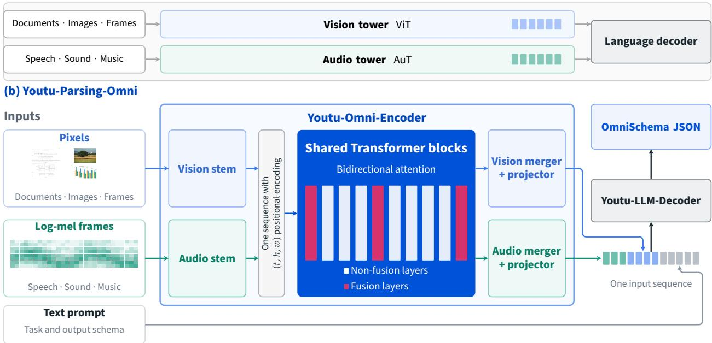  
Figure 3. Overview of omni-modal parsing architectures. We compare how visual and audio inputs are encoded before reaching the language model in the conventional design and in Youtu-Parsing-Omni. (a) Existing omni-modal parsers encode pixels and audio with two separately pre-trained towers, whose streams first meet inside the language model. (b) Youtu-Parsing-Omni replaces both towers with a single encoder, Youtu-Omni-Encoder. Thin modality-specific stems map pixels and log-mel frames to tokens; a shared bidirectional block then contextualizes an arbitrary packed mix of images, audio chunks, and videos under one �, ℎ, � positional encoding; and a few of its layers (red) attend across modalities within short audio-visual windows (Fig. 4). As a result, pixels and sound share weights and positional encoding, and interact already inside the encoder.

## 2 Model

Youtu-Parsing-Omni is a decoder-only language model fed by one perception encoder (Fig. 3). It accepts text, images, audio, and video (with its audio track when present) and emits text only. The decoder is a dense text language model pre-trained following the recipe of Youtu-LLM-2B [25]; it keeps 1D rotary positions, since spatial and temporal structure is already resolved inside the encoder (App. B.3). Further architectural details, including the variants that the final model does not use, are given in App. B, and the complete configuration in Tab. 17. Two principles shape the encoder. First, every modality is read by the same weights with the same space-time positional encoding (Subsec. 2.1–2.2). Second, these weights start from a model that already maps context to symbols (Subsec. 5.7). The first principle thus amortizes perception capacity across modalities rather than duplicating it in one tower per modality.

## 2.1 Youtu-Omni-Encoder

Vision and audio inputs pass through a three-part pipeline whose middle part is shared: a modality-specific stem turns raw input into �-dimensional tokens, a shared Transformer contextualizes them, and a modalityspecific merger and projector down-sample the result and map it to the decoder width. Only the stems and the merger–projector heads depend on the modality; together they hold a small fraction of the encoder’s parameters (App. B.2.1), so most of the encoder is shared. Architecturally, adding a modality therefore requires a new stem and projector rather than a second tower with its own pre-training lineage, although the shared weights must still be trained on the new input.

Stems. The two stems convert raw signals into tokens with minimal machinery. Images and video frames are cut into fixed-size patches at their native resolution under a token budget [26], and a single linear map turns each patch into one token; no further convolution, absolute position table, or class token is used. Audio is converted to a log-mel spectrogram, and a few strided convolutions down-sample it in time before a linear map to width �, giving a fixed audio token rate of $r _ { a }$ tokens per second.

Shared Transformer blocks. The shared Transformer is a stack of standard pre-norm blocks with RM-SNorm [27], SwiGLU [28], grouped-query attention [29], and QK-Norm [30]. Attention is bidirectional. Rotary position embeddings (RoPE) [31] are applied from a matrix of per-token rotation angles rather than read from one position table shared by the whole sequence; this is what makes the axis-factorized positional encoding of Subsec. 2.2 expressible. Any mix of images, audio chunks, and videos is packed into one variable-length sequence whose attention windows are given by a cumulative-length vector c [32], so one encoder pass handles the whole mix without padding.

Token merger and projector. After the shared Transformer, neighboring vision tokens within a frame are concatenated along the feature axis into one token, and adjacent audio tokens are merged in the same way along time. Each modality then passes through an RMSNorm and a two-layer MLP that projects it to the decoder width.

## 2.2 Unified Positional Encoding and Audio-Visual Fusion

One positional encoding for all modalities. Sharing one Transformer across modalities makes positional encoding the central design question: one rotary budget of frequency slots has to express 2D layout, 1D time, and the correspondence between the two. We partition the budget into contiguous segments of near-equal size, one for each axis �, �, and �, each with its own inverse-frequency table normalized by its own width, so every axis spans the full frequency range regardless of how many slots it receives (Equ. 7, App. B.2.3). A vision token takes � from its frame index and $( \check { h } , w )$ from its patch position; an audio token takes � from its time ofset and sets $h = w = 0$ . Both modalities therefore write into the same � segment, expressing their temporal positions on a common time scale. Modality identity is left to the features: the two stems produce readily separable feature distributions.

The shared timeline makes frame and audio positions comparable, but it does not by itself let them interact. Fusion provides this interaction by letting the two attend to each other, so that the correspondence a video parse must output (for instance, which words are spoken while a given slide is on screen) is computed in perception rather than reconstructed by the decoder.

Fused and independent routes. A video reaches the encoder by either of two routes that share all weights and return outputs of identical shape. On the independent route, each frame and each audio chunk forms its own attention window, as if the input were a burst of images and an unrelated recording. On the fused route, the frames and audio chunks of one video are packed in temporal order, and in the fusion layers audio-visual windows let a frame attend to the sound of the same instant; the other layers keep one window per frame or chunk. During training, a video takes the fused route with probability $p _ { \mathrm { f u s } } ,$ set below 1 from Stage 2 on (Sec. 4), which keeps both routes usable at inference.

Windows and time alignment. On the fused route, the packed event list $( \mathrm { e } . \mathrm { g } . , [ \mathrm { I } _ { 1 } , \mathrm { I } _ { 2 } , \mathrm { A } _ { 1 } , \mathrm { I } _ { 3 } , \dots ] )$ is cut into $\left( \mathrm { I ^ { + } } \mathrm { A ^ { * } } \right)$ groups, i.e., one or more frames followed by the audio chunks that precede the next frame, with a new group starting at every audio-to-frame boundary; in the fusion layers, each group becomes one attention window (Fig. 4a). Inside a group, vision and audio advance on a common time scale tied to the audio token rate,

$$
\Delta t _ { \mathrm { a u d i o } } = 1 \mathrm { p e r t o k e n } , \qquad \Delta t _ { \mathrm { v i s i o n } } = { \frac { r _ { a } } { \mathrm { f p s } } } \mathrm { p e r f r a m e } ,\tag{1}
$$

<sup>Vision</sup> <sup>patch</sup> (<sup>� ,</sup> <sup>ℎ,</sup> <sup>�</sup>)

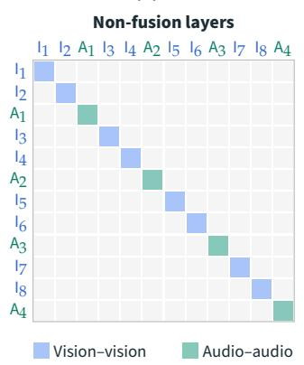

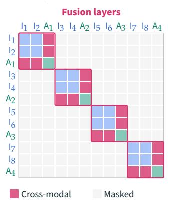

(b) One temporal positional encoding for both modalities  
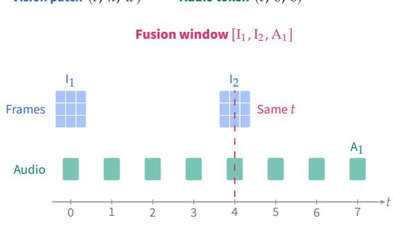  
Figure 4. Concurrent visual and audio content share fusion windows and a common temporal coordinate system. (a) A video with eight frames (I) and four audio chunks (A), packed in temporal order, with each chunk placed after the frames it overlaps. A non-fusion layer gives every frame and every chunk its own window; a fusion layer starts a new window at every audio-to-frame boundary, so the video forms four I+A∗ windows; red cells mark the cross-modal pairs, and of-diagonal blue cells the frame-to-frame pairs, that only fusion layers admit. (b) Vision tokens take � from the frame index and (<sup>ℎ,</sup> <sup>�</sup>) from the patch grid; audio tokens take <sup>�</sup> from their ofset and write into the same temporal rotary slots. Inside a fusion window both advance on the common time scale of Equ. 1.

where fps is the sampled video frame rate and $r _ { a }$ is the audio token rate of the audio stem, before merging. This places frames and audio tokens on a common time scale, without requiring every sampled frame to coincide with a discrete audio-token position (Fig. 4b).

Sparse fusion. Because windows are specified only by c, fusion is a per-layer choice: the same packed features carry a per-group segmentation $\bar { \mathbf { c } } ^ { \mathrm { { f u s } } }$ and a per-event (non-fusion) segmentation $\mathbf { c } ^ { \mathrm { n o f } }$ , and each layer uses one of them. The two segmentations assign diferent time origins to the same token, which is harmless because a rotary attention score depends only on the ofset $t _ { q } - t _ { k }$ between query and key positions, and queries never meet keys from another window.

## 3 Omni-Modal Parsing Schema

As discussed in Sec. 1, parsing results of diferent modalities share a common form: a set of units, each localized in space or time and paired with the content extracted from the corresponding region or interval. Motivated by this observation, we design a unified output schema, OmniSchema, which covers ten parsing tasks across three modalities: images (document pages and natural images), audio, and video. Because every element or segment is localized by an explicit spatial or temporal anchor, each parsed result is traceable to its source region or time interval.

Schema structure. Lst. 1 gives an overview of the schema. Each output is serialized as a JSON object with three common required fields: modality, a list of localized units with their content (elements for images, segments for audio and video), and a global description of the input (global\_description). Additional fields depend on the task: subtype and reading\_order are included where applicable, and video outputs contain structured\_report, populated for text-rich video and left empty for natural video. The unit type depends on the modality. For images, the unit is an element, a spatial region delimited by a bounding box <box><x\_1><y\_1><x\_2><y\_2></box> whose coordinates are normalized to 0–1,000 relative to the image width and height; for audio and video, it is a segment, a time interval delimited by start and end timestamps (HH:MM:SS, i.e., at one-second resolution, relative to the input onset), and each speech segment additionally includes one speaker identifier that is consistent across the input. The content fields of each unit contain the information extracted from the corresponding region or interval. For example, text contains the recognized text of a text element, otsl encodes the structure and cell content of a table, and asr\_text contains the speech transcript of an audio or video segment.

```json
{
"modality": "image | audio | video",
"subtype": "document | natural_image // image, video
| natural_video | text_rich_video",
"elements": [ // image inputs
{
"id": "e1",
"category": "text | title | header | footer | caption | code | formula
| table | chart | flowchart | figure | geometric | chemical
| seal | score | entity",
"bbox": "<box><x_1><y_1><x_2><y_2></box>",
"tag": "...", // natural image
"content": {
"text": ". // text, SMILES, ABC, in-box OCR
"latex": // formula
"otsl": " // table
"markdown": // chart
"mermaid": " // flowchart
"geometric": // geometric figure
"caption": "... // visual element, image region
},
"attributes": {"language": "zh | en | ..."} // documents
}
],
"segments": [ // audio, video inputs
{
"id": "s_001",
"kind": "vocal | nonvocal", // audio
"start_timestamp": "HH:MM:SS",
"end_timestamp": "HH:MM:SS",
"visual": { // video
"elements": [{"category": "object | text", "ocr_type": "title | ... | null",
"content": {"text": "..."}}],
"atomic_actions": ["..."],
"object_actor_interactions": ["..."],
"camera_motion": {"l1": "...", "l2": "..."},
"event_description": "..."
},
"audio": {
"speaker_id": "spk1", // vocal audio, video
"asr_text": "...", // vocal audio, video
"timbre_caption": "..." // audio, vocal
"instruct_caption": "...", // audio, vocal
"scene_caption": "...", // audio, vocal
"env_caption": "...", // audio, nonvocal
"mode": "asr", // video
"acoustic_events": ["..."]
},
"language": "zh | en | unk" // audio, vocal
}
],
"reading_order": ["e1"], // documents
"global_description": {
"caption": "...", "narrative": "...", "scene": "...",
"language": "...", "tag": "..."
},
"structured_report": "..." // text-rich video; empty for natural video
}
```  
Listing 1. Overview of the OmniSchema output. The listing is schematic: | separates alternative values, "..." stands for elided content, and comments (//) are annotations rather than part of the output. Each task uses the subset of fields it needs; comments mark the inputs that use a field, and an unmarked field applies to every input that uses its enclosing field. Every output has modality, a list of elements or segments, and global\_description.

Multi-task parsing. Youtu-Parsing-Omni supports ten parsing tasks: on images, document parsing, chemical structure recognition, sheet music recognition, chart parsing, flowchart parsing, geometric figure parsing, and natural image parsing; on audio, audio parsing; and on video, natural video parsing and text-rich video parsing. In the image tasks, each parsed region is an element delimited by a bounding box. In document parsing, each element on the page is labeled with a layout category, placed in the reading order, and transcribed according to its category, e.g., as plain text, a LAT X formula, or a table serialized in Optimized Table Structure Language (OTSL). In chemical structure recognition, a molecule is parsed as a document element whose content is a SMILES [33] string. In sheet music recognition, a musical score is parsed as a document element whose content is ABC [34] notation. In chart parsing,flowchart parsing, and geometric figure parsing, the whole figure forms a single element whose content is its underlying data as a Markdown table, its nodes and edges as a Mermaid graph, or its geometric primitives and their relations as a geometry string, respectively; the element also contains a caption. In natural image parsing, each salient object forms an element with a bounding box, a tag naming the object, the text inside the box, and a region caption, and the global description adds an image caption, a narrative, and a scene description. In the audio and video tasks, the input is divided into a sequence of time segments. Each audio segment is labeled as vocal or nonvocal: a vocal segment contains a speaker identifier, a transcript, the language of the speech, acoustic-event labels, and captions of timbre, delivery, and scene, whereas a nonvocal segment contains acoustic-event labels and a caption of the acoustic environment. Each video segment contains the objects and on-screen text visible in its frames, where each text item is labeled with an optical character recognition (OCR) type such as title. It also contains atomic actions, actor-object interactions, camera motion at a coarse and a fine level, an event description, and the speaker identifier, transcript, and acoustic-event labels of the accompanying audio. Natural video parsing and text-rich video parsing share this segment structure; the output of text-rich video parsing additionally contains a structured report in Markdown that summarizes the whole video, a field left empty for natural video. Full example outputs for each input type are given in App. F.

Token roles. Because every output follows OmniSchema, each token of a serialized output can be assigned one of two roles, which OSAD supervises with diferent objectives (Subsec. 4.2.3). Structure tokens belong to the JSON syntax, namely keys and punctuation such as braces, brackets, colons, and commas, and follow a constrained grammar; content tokens belong to field values, which can admit multiple valid continuations.

## 4 Training

Training first develops unified perception through four pre-training stages and then refines structured parsing through three post-training stages (Fig. 5). Supervised fine-tuning establishes the output format and instruction following; two subsequent on-policy stages refine the model’s own parses using verifiable rewards and then reference-conditioned token-level supervision.

## 4.1 Pre-Training

Pre-training turns a text-only decoder and a text-initialized encoder into an omni-modal perceiver, which raises three coupled problems. First, the randomly initialized stems and projectors must learn to map pixels and mel frames into a representation that the pre-trained Transformer weights can read. Second, the model must acquire dense, native-resolution perception of images, audio, and video without eroding the decoder’s language ability. Third, it must handle long inputs such as multi-page documents and long videos. Addressing all three at once is both costly and unstable: gradients through randomly initialized projectors would perturb the pre-trained decoder, and long native-resolution sequences are expensive to train on before the features are aligned. We therefore adopt a staged curriculum, and progressively expand four axes across Stages 0–3 (Fig. 5): the trainable parameters (encoder only, then all parameters); the input scale (from 4 k-token sequences with at most 256 tokens per image to 128 k-token sequences with up to 512 video frames); cross-modal interaction (from no fusion layers to four); and input perturbation (from none to stochastic routing and augmentation).

<table><tr><td rowspan="2"></td><td colspan="4">Pre-training, 2.24T tokens</td><td colspan="3">Post-training</td></tr><tr><td>Stage 0 Perception alignment</td><td>Stage 1 Omni-modal pre-training</td><td>Stage 2 Annealing</td><td>Stage 3 Long-context extension</td><td>SFT Format and instructions</td><td>RLVR Schema- routed</td><td>OSAD On-policy distillation</td></tr><tr><td>Tokens</td><td>320B</td><td>1.28T</td><td>512B</td><td>128B</td><td>16B</td><td>0.6B</td><td>0.6B</td></tr><tr><td>Trainable</td><td>Encoder</td><td>All</td><td>All</td><td>All</td><td>All</td><td>All</td><td>LoRA</td></tr><tr><td>Sequence</td><td>4k</td><td>8-32k</td><td>32k</td><td>128k</td><td>32k</td><td>128k</td><td>128k</td></tr><tr><td>Fusion layers</td><td>0</td><td>4</td><td>4</td><td>4</td><td>4</td><td>4</td><td>4</td></tr><tr><td>Max frames</td><td>16</td><td>64</td><td>64</td><td>512</td><td>64</td><td>64</td><td>64</td></tr></table>

Figure 5. Perception first, output format second, on-policy refinement last. Four pre-training stages (Stage 0: perception alignment; Stage 1: omni-modal pre-training; Stage 2: annealing; Stage 3: long-context extension) are followed by three post-training stages: supervised fine-tuning, schema-routed RLVR, and OSAD. Rows give each stage’s token budget, trainable parameters, sequence-length limit, number of encoder fusion layers, and maximum frames per training video. Stage 1 uses sequence lengths of 8 k–32 k. LoRA denotes low-rank adaptation of frozen base weights.

We initialize the decoder from our text-only checkpoint and the shared encoder block from Qwen3-0.6B-Base [35] without its embedding layer and LM head; stems and projectors are randomly initialized.

Stage 0: Perception Alignment. The first stage bridges the randomly initialized stems and projectors to the pre-trained weights on either side of them. Only the encoder (stems, shared block, and projectors) is trained, while the decoder stays frozen. Freezing the decoder serves two purposes: it shields the language model from the noisy gradients of the new projectors, and it forces the encoder to produce features in the input space that the fixed language model already interprets. The supervision is dense: captions and transcripts describe the whole input, so every region of an image and every second of a recording contributes to the loss, whereas a short answer about one region, as in visual question answering, would provide little supervision for the remaining content. Inputs are kept small (at most 256 tokens per image, 16 frames per video, and 4 k tokens per sequence) and no fusion layer is enabled, so that alignment is learned cheaply over a large token budget before native-resolution inputs make each step expensive.

Stage 1: Omni-Modal Pre-Training. Once the encoder emits features that the decoder can read, the bottleneck shifts from alignment to capacity: a frozen decoder cannot learn to emit the long, dense symbol sequences required by parsing. Stage 1 therefore unfreezes all parameters and is the largest stage, consuming 1.28 T tokens. The image budget grows from 256 to 20 k tokens so that the model sees pages at native resolution, videos grow to 64 frames of up to 512 tokens each, and sequence lengths range from 8 k to 32 k tokens. Four fusion layers are enabled at this point, so that frames attend to the co-occurring audio (Subsec. 2.2) only after each modality has been aligned on its own. Text-only data are mixed in to limit catastrophic forgetting of the decoder’s language ability. The learning rate is held constant so the total budget need not be fixed in advance and any checkpoint can be handed to the decay stage.

Stage 2: Annealing. Under a constant learning rate, the loss plateaus above the level that a subsequent learning-rate decay reaches, and annealing is a standard final phase of large-scale pre-training. Stage 2 decays the learning rate from $1 0 ^ { - 4 } \mathrm { t o } 1 0 ^ { - 5 }$ with a cosine schedule over 512 B tokens, with sequences fixed at 32 k tokens and slightly larger image and per-frame budgets. Because annealing consolidates what the model has learned, we also introduce two mechanisms here that protect or broaden the learned perception. First, layer-wise learning-rate decay scales the learning rate of encoder depth ℓ by $\gamma ^ { L + 1 - \ell }$ with $\gamma = 0 . 9$ from the stems $( \ell = 0 )$ to the projectors $( \ell = L + 1$ , no decay); the projectors, the newest components, keep adapting, whereas the stems and lower layers, which already encode generic low-level features, are protected from being overwritten. Second, audio-visual videos are routed stochastically with fused-route probability $p _ { \mathrm { f u s } } = 0 . 8$ , so they take the independent route with probability 0.2 and both routes remain usable at inference.

Stage 3: Long-Context Extension. Multi-page documents and long videos require far longer sequences than Stages 0–2 provide. Stage 3 trains on sequences of up to 128 k tokens, with up to 102,400 tokens per image or video and videos of up to 512 frames, for 128 B tokens at a constant learning rate of 10−5.

## 4.2 Post-Training

Pre-training yields a model that perceives all three modalities but does not yet emit OmniSchema reliably. Post-training proceeds through supervised fine-tuning (SFT) for OmniSchema serialization, schema-routed reinforcement learning with verifiable rewards (RLVR) for sequence-level optimization, and OmniSchema-Aware On-Policy Distillation (OSAD) for token-adaptive supervision and iterative self-evolution.

## 4.2.1 Supervised Fine-Tuning

Starting from the Stage 3 checkpoint, we train all parameters on prompt–response pairs to establish reliable OmniSchema serialization and instruction following. Although the pre-training mixture already contains parsing data, the Stage 3 model does not yet consistently respond to a task prompt with a complete, schema-conformant object; SFT makes this output format the default response to each parsing instruction.

The SFT mixture combines two sources. Parsing data cover all ten tasks in Sec. 3: each sample pairs a task prompt and its image, audio, or video input with a reference parse serialized in OmniSchema, so a single model learns to emit the fields each task requires. General-purpose data, reused from Youtu-LLM [25], Youtu-VL [36], Long-VITA [37], VITA-1.5 [12], and VITA-Audio [38], span text-only, visual, and audio instructions and preserve the conversational and instruction-following abilities that a parsing-only mixture would erode. SFT uses a budget of 16 B tokens, sequences of up to 32 k tokens, and at most 64 frames per video, and keeps the four fusion layers of Stages 1–3 (Fig. 5).

SFT also prepares the model for the two on-policy stages that follow, both of which learn from the model’s own rollouts. RLVR assigns zero reward to undecodable outputs, and with group-mean-centered advantages, a group in which every rollout fails yields no gradient; OSAD likewise distills only from rollouts that pass its admission checks. A policy that rarely produces well-formed parses would therefore supply few useful learning signals to either stage. SFT, however, supervises the model only under reference prefixes, a limitation that the on-policy stages address (Subsec. 4.2.3).

## 4.2.2 Schema-Routed RLVR

For an input query �, let � denote the generated parse, $y ^ { \star }$ its reference parse, and � the task index. Here, � includes the task prompt and its multimodal input. We optimize the policy on its own generated parses with Group Relative Policy Optimization (GRPO) [18]. The reward is gated by decodability and the presence of a primary payload, and combines shared well-formedness with task-specific content accuracy:

$$
\begin{array} { r } { R ( y , y ^ { \star } , \nu ) = \mathbb { 1 } [ y \operatorname* { d e c o d e s } ] \mathbb { 1 } [ y \operatorname { h a s } \mathrm { a } \mathrm { p a y l o a d } ] \cdot \mathrm { c l i p } _ { [ 0 , 1 ] } \big ( \Omega ( y , y ^ { \star } ) \cdot \mathrm { c o r e } _ { \nu } ( y , y ^ { \star } ) \big ) , } \\ { \Omega ( y , y ^ { \star } ) = \mathrm { F m t } ( y ) \left( 1 - 0 . 6 P _ { \mathrm { r e p e a t } } \right) \left( 1 - 0 . 7 P _ { \mathrm { u n d e r } } \right) . \qquad } \end{array}\tag{2}
$$

The indicator 1 equals one when its condition holds and zero otherwise; $\mathrm { c l i p } _ { [ 0 , 1 ] }$ restricts its argument to 0, 1 . If either gate fails, the reward is zero; otherwise, it equals the clipped product of the well-formedness and content factors. Thus the final reward lies in 0, 1 . The shared factor Ω combines schema validity, scored by Fmt � , with penalties for repetition $( P _ { \mathrm { r e p e a t } } )$ and incomplete coverage $( P _ { \mathrm { u n d e r } } )$ . Both penalties compare � with $y ^ { \star } ;$ their arguments are suppressed for brevity, and 0.6 and 0.7 are their respective coeficients. The task-specific factor core<sub>�</sub> averages grounded-field accuracy and reference-description similarity when reference descriptions are available; otherwise, it uses grounded-field accuracy alone. App. C.1 details the validity checks, penalties, and task-specific scorers.

## 4.2.3 OmniSchema-Aware On-Policy Distillation

Starting from the RLVR checkpoint, OSAD refines generated parses through token-adaptive supervision and self-evolution through teacher refresh (Fig. 6). The first matches supervision to each token’s schema role; the second updates the teacher as the student learns.

Token-adaptive on-policy supervision. SFT trains on reference prefixes, whereas inference uses modelgenerated prefixes [16, 17]. RLVR trains on these generated prefixes but assigns one reward to the entire parse. OSAD complements this sequence-level optimization with reference-conditioned targets at each token, building on on-policy distillation [21, 39] and reference-conditioned self-distillation [22], with the reference serving as privileged information [23].

OSAD proceeds in rounds. Within round $r , \mathsf { a }$ frozen teacher with parameters $\bar { \theta } _ { r }$ and a student with efective parameters � start from the same checkpoint. The student trains low-rank adapters (LoRA) [40] on frozen base weights and samples a response $y = ( y _ { 1 } , \dotsc , y _ { T } )$ of length � for each query �. Only rollouts passing JSON-validity, schema-conformance, box-syntax, and repetition checks enter distillation; rejected rollouts are masked (App. C.2). Both models score the same generated prefix $y _ { < t } = \left( y _ { 1 } , \ldots , y _ { t - 1 } \right)$ , but only the teacher receives the reference parse through $\boldsymbol { \tilde { x } } = \left[ \boldsymbol { y } ^ { \star } ; \boldsymbol { x } \right]$

$$
p _ { t } ^ { ( \tau ) } = \mathrm { s o f t m a x } \big ( f _ { \theta } ( x , y _ { < t } ) / \tau \big ) , \qquad q _ { t } ^ { ( \tau ) } = \mathrm { s o f t m a x } \big ( f _ { \bar { \theta } _ { r } } ( \tilde { x } , y _ { < t } ) / \tau \big ) .\tag{3}
$$

Here, $p _ { t } ^ { ( \tau ) }$ and $q _ { t } ^ { ( \tau ) }$ are student and teacher next-token distributions, � returns vocabulary logits, and $\tau > 0$ denotes distillation temperature. Shared prefixes thus provide aligned targets on the student’s own trajectories without exposing the reference to the student.

Following the token roles in Sec. 3, let $C ( y )$ and $S ( y )$ denote the content and structure positions of a response, respectively. Content fields may admit several valid continuations, whereas JSON keys and punctuation follow a constrained grammar. We therefore use the symmetric, bounded Jensen–Shannon (JS) divergence for content and the forward Kullback–Leibler (KL) divergence for structure:

$$
\begin{array} { r } { d _ { t } ^ { C } = \mathrm { J S } \big ( q _ { t } ^ { ( \tau _ { c } ) } \big \| p _ { t } ^ { ( \tau _ { c } ) } \big ) , \qquad d _ { t } ^ { S } = \mathrm { K L } \big ( q _ { t } ^ { ( \tau _ { s } ) } \big \| p _ { t } ^ { ( \tau _ { s } ) } \big ) , \qquad \tau _ { s } > \tau _ { c } . } \end{array}\tag{4}
$$

The per-position divergences $d _ { t } ^ { C }$ and $d _ { t } ^ { S }$ use content and structure temperatures $\tau _ { c }$ and $\tau _ { s } ,$ respectively, and are computed over the full vocabulary. Round indices on temperatures and role weights are omitted here for brevity. JS bounds content disagreement, while forward KL encourages coverage of the teacher’s structural predictions, softened by the higher structure temperature.

The objective combines a shared all-token term with additional role-specific terms. For each nonempty role ${ \mathcal { R } } \in \{ C , S \}$ , define its mean divergence as $\begin{array} { r } { \bar { d } ^ { \mathcal { R } } ( y ) = \vert \mathcal { R } ( y ) \vert ^ { - 1 } \sum _ { t \in \mathcal { R } ( y ) } \dot { d } _ { t } ^ { \mathcal { R } } } \end{array}$ . The all-token term applies JS uniformly at temperature � and averages over all � response positions:

$$
d _ { t } ^ { \mathrm { a l l } } = \mathrm { J } S \big ( q _ { t } ^ { ( \tau ) } \big \| p _ { t } ^ { ( \tau ) } \big ) , \qquad \bar { d } ^ { \mathrm { a l l } } ( y ) = \frac { 1 } { T } \sum _ { t = 1 } ^ { T } d _ { t } ^ { \mathrm { a l l } } .
$$

With nonnegative content and structure weights $\alpha _ { c }$ and $\alpha _ { s } ,$ the per-rollout loss and minibatch objective are

$$
\mathcal { L } _ { \mathrm { r o w } } ( y ) = \frac { \bar { d } ^ { \mathrm { a l l } } ( y ) + \alpha _ { c } \bar { d } ^ { C } ( y ) + \alpha _ { s } \bar { d } ^ { S } ( y ) } { 1 + \alpha _ { c } + \alpha _ { s } } , \qquad \mathcal { L } = \frac { 1 } { | \mathscr { B } ^ { + } | } \sum _ { y \in \mathscr { B } ^ { + } } \mathcal { L } _ { \mathrm { r o w } } ( y ) .\tag{5}
$$

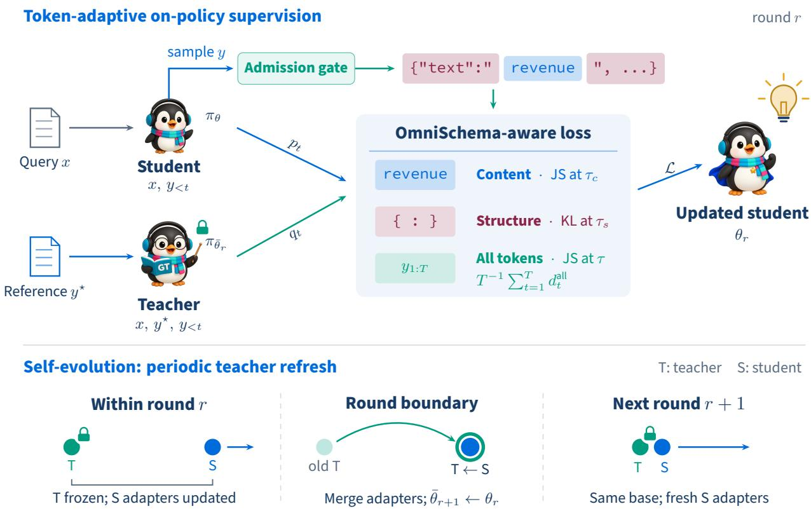  
Figure 6. OSAD combines token-adaptive on-policy supervision with teacher refresh at each round boundary. Admitted student rollouts provide shared prefixes for a LoRA-trained student and a frozen, reference-conditioned teacher. The objective combines content-specific JS divergence at $\tau _ { c } ,$ structure-specific forward KL divergence at $\tau _ { s } ,$ and an all-token JS term at �. Within each round, only the student’s adapters are updated. At the round boundary, the learned adapters are merged into the base weights to initialize the next teacher and student; the student receives fresh adapters, while only the teacher conditions on the reference. The lower panel illustrates the update and refresh mechanism rather than a measured model-state distance.

Here, ${ \mathcal { B } } ^ { + }$ contains all admitted rollout instances in the global minibatch across data-parallel ranks; updates are skipped when this global collection is empty. For an absent role, its weighted loss and coeficient are omitted from the numerator and denominator, respectively. The all-token mean weights response positions equally, while role averaging controls the additional supervision independently of role length. Averaging over rollouts gives each admitted response equal weight. The role-weight schedule is given in App. C.2.

Self-evolution through teacher refresh. Token-adaptive supervision remains tied to the starting checkpoint if the teacher stays fixed throughout training. At each round boundary, OSAD merges the learned adapters into the student’s base weights to obtain $\theta _ { r } ,$ which initializes the next teacher and student:

$$
\bar { \theta } _ { r + 1 } \longleftarrow \mathrm { s t o p g r a d } ( \theta _ { r } ) , \qquad \theta _ { \mathrm { i n i t } } ^ { ( r + 1 ) }  \bar { \theta } _ { r + 1 } .\tag{6}
$$

Here, stopgrad blocks gradients, and $\theta _ { \mathrm { i n i t } } ^ { ( r + 1 ) }$ denotes the next student’s initial base weights, to which fresh low-rank adapters are added. Teacher parameters are fixed within each round and refreshed between rounds, while reference conditioning remains exclusive to the teacher. This alternation updates both the parser and its supervision on a fixed source pool. We run six rounds of OSAD. App. C provides the training settings and pseudocode (Alg. 1); Subsec. 5.7 evaluates the successive checkpoints.

Table 1. Evaluation protocol. Size is the number of evaluated samples. Every benchmark is scored with its oficial code (the LEGATO protocol for PDMX-Synth), except OmniParsingBench, which we score with our own toolkit (App. D). Baselines: re-scored means that every system is run and scored by us with the same code; leaderboard means that baseline numbers are taken from the oficial public leaderboard. ∗ChemDFM-X scores on ChemOCR are taken from TinyChemVL [41]; LEGATO scores on PDMX-Synth are taken from its original report [8] (Tab. 12).
<table><tr><td colspan="2">Benchmark</td><td>Split / task</td><td>Size</td><td>Reported metric</td><td>Baselines</td></tr><tr><td rowspan="2">OmniDocBench v1.6 [42] PureDocBench</td><td></td><td>full set</td><td>1,651</td><td>Overall, Edit, CDM, TEDS</td><td>leaderboard</td></tr><tr><td>[43]</td><td>clean, degraded, recaptured</td><td>1,475×3</td><td>per-track Overall, Avg3</td><td>leaderboard</td></tr><tr><td rowspan="5">OmniParsingBench [11]</td><td rowspan="5"></td><td>natural image</td><td>1,000</td><td>Overall: parse rate × mean</td><td></td></tr><tr><td>chart, geometry</td><td>1,000</td><td></td><td>re-scored</td></tr><tr><td>audio</td><td>938</td><td>of Perception and</td><td></td></tr><tr><td>natural video (general)</td><td>550</td><td>Cognition</td><td></td></tr><tr><td>text-rich video</td><td>250</td><td></td><td></td></tr><tr><td>Video-MME-v2</td><td>[44]</td><td>without subtitles</td><td>3,200</td><td>group score, L1–L3</td><td>leaderboard</td></tr><tr><td>ChemOCR</td><td>[45]</td><td>molecule → SMILES</td><td>990</td><td>Avg. Sim., Tani@1.0</td><td>re-scored*</td></tr><tr><td>PDMX-Synth</td><td>[46,8]</td><td>score → ABC</td><td>800</td><td>CER, SER, LER</td><td>re-scored*</td></tr></table>

## 5 Evaluation

We evaluate a single checkpoint under a single inference configuration and organize the evaluation around two questions: what this checkpoint achieves across modalities, and how the two ideas behind the model, the text-initialized unified encoder and self-evolving post-training, contribute. Subsec. 5.1 describes the benchmarks, baselines, and protocol, and Subsec. 5.2–5.6 report the results on each benchmark. Subsec. 5.7 then studies the two principles of the encoder, one set of shared weights and initialization from a language model, in a controlled setting, and measures the contribution of self-evolving post-training on the final model.

## 5.1 Setup

Benchmarks and baselines. Tab. 1 lists every benchmark with its size, its metric, and the source of the baseline numbers. OmniDocBench v1.6 [42] evaluates page-level document parsing; its Overall score averages text accuracy (1 edit distance), formula CDM, and table TEDS. PureDocBench [43] evaluates identical pages in clean, digitally degraded, and physically recaptured tracks, which isolates the cost of input degradation; it reports an Overall score per track and their mean, Avg<sub>3</sub>. OmniParsingBench [11] evaluates parsing of natural images, charts, geometry, audio, natural video, and text-rich video; each split is scored by a Perception component over grounded fields, including localization, element extraction, OCR, and automatic speech recognition (ASR), and by a Cognition component from multiple-choice questions that an LLM judge answers by reading only the parse. Overall is the per-split leaderboard score: the mean of Perception and Cognition multiplied by the post-repair parse rate (Tab. 5–10). On OmniParsingBench, every system is run and scored by us: we compare with the parsing-specialized Logics-Parsing-Omni, the open-weight generalists Qwen3-Omni-30B-A3B [10] and Qwen3.5-397B-A17B [66], and the API models Gemini-3-Pro [62] and GPT-5.4 [67]; Qwen3.5 and GPT-5.4 are evaluated only on image splits because neither model accepts audio input. Video-MME-v2 [44] evaluates general video understanding with 3,200 multiple-choice questions arranged in groups of four; its group score rewards answering the related questions of a group consistently, and it is also reported for three capability levels (L1–L3). We use its setting without subtitles, in which models receive visual frames only. ChemOCR [45] evaluates chemical structure recognition from molecule images to SMILES, scored by the mean Tanimoto similarity of molecular fingerprints (Avg. Sim.) and the exact fingerprint-match rate (Tani@1.0). PDMX-Synth [46, 8] evaluates optical music recognition from rendered score images to ABC notation, scored by character, symbol, and line error rates (CER, SER, and LER). For OmniDocBench, PureDocBench, and Video-MME-v2, the baseline numbers are taken from the oficial leaderboards; on ChemOCR and PDMX-Synth, we run every baseline with the oficial evaluator, except ChemDFM-X [7] and LEGATO [8], whose scores come from TinyChemVL [41] and LEGATO[8], respectively.

Table 2. Performance comparison of Youtu-Parsing-Omni with other document parsing models and proprietary models on OmniDocBench v1.6. Bold and underline: best and second best in each column. †Proprietary model.
<table><tr><td>Model</td><td></td><td>Params</td><td>Overall↑</td><td>Text Edit↓</td><td>Formula CDM↑</td><td>TEDS↑</td><td>TEDS-S↑</td><td>Read. Order Edit↓</td></tr><tr><td colspan="7">Multi-stage specialists</td></tr><tr><td>TeleOCR</td><td>[47]</td><td>1.2B</td><td>96.91</td><td>0.0267</td><td>96.59</td><td>96.82</td><td>98.18</td><td>0.1184</td></tr><tr><td>PaddleOCR-VL-1.6</td><td>[6]</td><td>0.9B</td><td>96.34</td><td>0.0326</td><td>97.53</td><td>94.76</td><td>97.10</td><td>0.1278</td></tr><tr><td>MinerU2.5-Pro</td><td>[20]</td><td>1.2 B</td><td>95.75</td><td>0.0360</td><td>97.45</td><td>93.42</td><td>95.92</td><td>0.1200</td></tr><tr><td>GLM-OCR</td><td>[48]</td><td>0.9B</td><td>95.22</td><td>0.0440</td><td>97.18</td><td>92.83</td><td>95.39</td><td>0.1330</td></tr><tr><td>PaddleOCR-VL-1.5</td><td>[49]</td><td>0.9B</td><td>94.93</td><td>0.0380</td><td>96.89</td><td>91.67</td><td>94.37</td><td>0.1300</td></tr><tr><td>Youtu-Parsing</td><td>[4]</td><td>2.5B</td><td>93.74</td><td>0.0440</td><td>93.63</td><td>92.02</td><td>95.00</td><td>0.1160</td></tr><tr><td>Dolphin-v2</td><td>[50]</td><td>3B</td><td>89.50</td><td>0.0690</td><td>91.01</td><td>84.40</td><td>87.44</td><td>0.1500</td></tr><tr><td>MonkeyOCR-pro-3B [51]</td><td></td><td>3B</td><td>88.57</td><td>0.0740</td><td>88.74</td><td>84.35</td><td>88.62</td><td>0.1890</td></tr><tr><td colspan="7">End-to-end specialists</td><td></td><td></td></tr><tr><td>OvisOCR2</td><td>[52]</td><td>0.8B</td><td>96.47</td><td>0.0265</td><td>97.49</td><td>94.58</td><td>96.98</td><td>0.1120</td></tr><tr><td>HunyuanOCR-1.5</td><td>[53]</td><td>1B</td><td>94.74</td><td>0.0390</td><td>94.50</td><td>93.67</td><td>94.71</td><td>0.1290</td></tr><tr><td>Qianfan-OCR</td><td>[54]</td><td>4B</td><td>93.90</td><td>0.0400</td><td>95.08</td><td>90.53</td><td>93.31</td><td>0.1300</td></tr><tr><td>Logics-Parsing-v2 FireRed-OCR</td><td>[55]</td><td>4B</td><td>93.33</td><td>0.0410</td><td>95.65</td><td>88.42</td><td>91.98</td><td>0.1370</td></tr><tr><td>OpenDoc-0.1B</td><td>[56]</td><td>2B</td><td>93.26</td><td>0.0370</td><td>95.44</td><td>88.04</td><td>91.06</td><td>0.1310</td></tr><tr><td>dots.ocr</td><td>[57]</td><td>0.1 B</td><td>90.67</td><td>0.0490</td><td>93.02</td><td>83.88</td><td>87.45</td><td>0.1400</td></tr><tr><td>DeepSeek-OCR 2</td><td>[58]</td><td>3B</td><td>90.77</td><td>0.0480</td><td>89.95</td><td>87.18</td><td>90.58</td><td>0.1380</td></tr><tr><td>HunyuanOCR</td><td>[24]</td><td>3B 1B</td><td>90.25 89.95</td><td>0.0500</td><td>91.84</td><td>83.89</td><td>87.75</td><td>0.1440</td></tr><tr><td>OCRVerse</td><td>[59] [60]</td><td>4B</td><td>88.60</td><td>0.0880 0.0630</td><td>87.68 89.61</td><td>91.01</td><td>93.23</td><td>0.1710</td></tr><tr><td>General VLMs</td><td></td><td></td><td></td><td></td><td></td><td>82.44</td><td>86.27</td><td>0.1630</td></tr><tr><td colspan="9"></td></tr><tr><td>Ovis2.6-30B-A3B</td><td>[61]</td><td>30 B-A3 B</td><td>93.70</td><td>0.0350</td><td>95.17</td><td>89.44</td><td>92.40</td><td>0.1350</td></tr><tr><td>Gemini-3-Pro†</td><td>[62]</td><td></td><td>92.91</td><td>0.0640</td><td>95.99</td><td>89.15</td><td>92.96</td><td>0.1650</td></tr><tr><td>Qwen3-VL-235B</td><td>[63]</td><td>235 B-A22 B</td><td>89.78</td><td>0.0630</td><td>92.55</td><td>83.07</td><td>86.75</td><td>0.1660</td></tr><tr><td>GPT-5.2†</td><td>[64]</td><td></td><td>86.59</td><td>0.1140</td><td>88.21</td><td>82.95</td><td>87.93</td><td>0.1930</td></tr><tr><td>InternVL3.5-241B</td><td>[65]</td><td>241 B-A28 B</td><td>83.76</td><td>0.1300</td><td>89.95</td><td>74.35</td><td>79.78</td><td>0.2150</td></tr><tr><td colspan="2">Youtu-Parsing-Omni</td><td>5B</td><td>96.96</td><td>0.0271</td><td>96.80</td><td>96.79</td><td>98.20</td><td>0.1104</td></tr></table>

Protocol. OmniDocBench, PureDocBench, Video-MME-v2, ChemOCR, and PDMX-Synth are scored with their oficial evaluation code or protocol. OmniParsingBench is released without a complete evaluation toolkit, so we implement one from the metric definitions of the benchmark (App. D) and re-score every system with it on one internal leaderboard. These numbers, for our model and for every baseline, are thus comparable with each other, but not directly with those reported by the benchmark authors. The toolkit repairs schema violations before scoring, so that formatting errors are not charged as content errors, and it uses corrected ground truth for a small number of verified annotation errors. We set aside the camera-video subset because of annotation issues and exclude 136 samples with unavailable media, leaving 3,738 of 3,874 samples.

## 5.2 OmniDocBench v1.6

We first investigate whether broadening a model’s capabilities compromises its depth in document parsing, a domain in which specialized models are particularly strong.

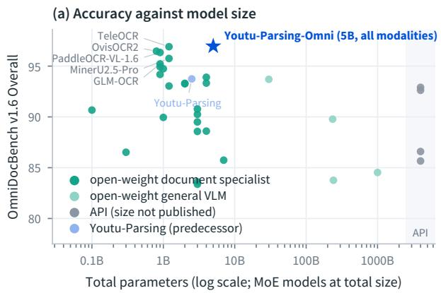

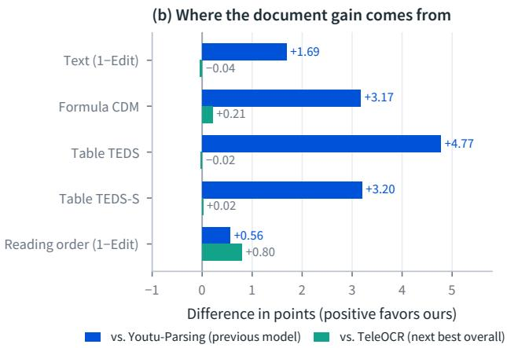  
Figure 7. Youtu-Parsing-Omni is the only model above 96 on OmniDocBench v1.6 that also parses images, audio, and video, and its gain over Youtu-Parsing comes mostly from tables and formulas. (a) OmniDocBench v1.6 Overall against total parameters (teal: open-weight), with API systems in a strip at the right; the document specialists at our level have 0.8–1.2 B parameters. (b) Per-metric diference to Youtu-Parsing [4], our previous model, and to TeleOCR [47], the next-best system overall; edit distances are shown as 1 Edit so that a positive diference always favors Youtu-Parsing-Omni.

The results indicate otherwise: while supporting a substantially broader range of input modalities and tasks, a single omni-modal model retains performance on par with specialized document parsers. On OmniDocBench v1.6, Youtu-Parsing-Omni achieves the highest Overall score of 96.96 (Tab. 2). More importantly, this result does not rely on an isolated advantage in any single metric, but instead reflects balanced parsing performance: the diferences from TeleOCR on text, formulas, and tables are all within 0.21 points, while Youtu-Parsing-Omni attains the best reading-order accuracy (Fig. 7b). Compared with Youtu-Parsing, the improvements are concentrated on tables and formulas, with gains of 4.8 TEDS and 3.2 CDM, respectively. Both content types require the model to recover their structure accurately and serialize it correctly. This pattern suggests that the new model improves not only visual recognition, but also the organization of recognized content into coherent, structured outputs. Notably, this specialist-level document parsing performance is delivered by the same model that processes natural images, audio, and video across ten tasks (Fig. 7a). Thus, the broader modality coverage is achieved without weakening document understanding or fine-grained parsing capabilities.

## 5.3 PureDocBench

We evaluate the model’s robustness to degradation introduced during acquisition on PureDocBench, which comprises clean, digitally degraded, and physically recaptured inputs. Youtu-Parsing-Omni achieves the highest Avg among end-to-end models (76.29; Tab. 3) and outperforms every end-to-end specialist on all three tracks. Its consistent lead over end-to-end specialists across both clean and degraded conditions indicates that the advantage stems from robust parsing rather than specialization to a particular acquisition condition. Compared with Youtu-Parsing, Youtu-Parsing-Omni gains approximately 8 points on each of the three tracks. The gains span all three component metrics and are more pronounced for formulas and tables, indicating that the model better preserves its ability to parse structured content under degradation rather than merely improving text recognition. Nevertheless, most systems exhibit a marked performance decline on physically recaptured inputs, indicating that distortions and artifacts introduced during real-world acquisition remain a major challenge for document parsing.

Table 3. Comparison with existing document parsing models and proprietary models on PureDocBench under clean and degraded conditions. Numbers are from the public leaderboard [43]. †Proprietary model. Bold and underline: best and second best of each Overall column.
<table><tr><td rowspan="2"></td><td rowspan="2"></td><td rowspan="2"></td><td colspan="4">Clean</td><td colspan="4">Digitally degraded</td><td colspan="5">Physically recaptured</td></tr><tr><td>Overall↑ Text Edit↓</td><td></td><td>Formula CDM↑ Table TEDS↑</td><td></td><td></td><td></td><td></td><td>Overall↑ Text Edit↓ Formula CDM↑ Table TEDS↑</td><td></td><td>Overall↑ Text Edit↓ Formula CDM↑</td><td></td><td>Table TEDS↑</td><td>Avg3 ↑</td></tr><tr><td colspan="10">Model Multi-stage specialists</td><td colspan="7"></td></tr><tr><td>TeleOCR</td><td>[47]</td><td>1.2B</td><td>86.90</td><td>0.111</td><td>81.01</td><td>91.09</td><td>77.47</td><td>0.206</td><td>72.59</td><td>80.45</td><td>70.85</td><td>0.302</td><td>65.11</td><td></td><td></td><td>78.41</td></tr><tr><td>dots.mocr</td><td>[68]</td><td>3B</td><td>76.27</td><td>0.151</td><td>66.23</td><td>77.65</td><td>73.16</td><td>0.198</td><td>64.32</td><td>74.95</td><td></td><td>61.73</td><td>0.312</td><td>54.39</td><td>77.66 61.97</td><td>70.39</td></tr><tr><td>MinerU2.5-Pro</td><td>[20]</td><td>1.2B</td><td>75.87</td><td>0.222</td><td>65.14</td><td>84.68</td><td>71.77</td><td>0.272</td><td>61.79</td><td></td><td>80.73</td><td>62.56</td><td>0.375</td><td>52.70</td><td>72.47</td><td>70.07</td></tr><tr><td>Youtu-Parsing</td><td>[4]</td><td>2.5B</td><td>75.02</td><td>0.230</td><td>67.34</td><td>80.74</td><td>69.66</td><td>0.270</td><td>61.44</td><td>74.49</td><td></td><td>60.29</td><td>0.360</td><td>52.20</td><td>64.69</td><td>68.32</td></tr><tr><td>PaddleOCR-VL-1.5</td><td>[49]</td><td>0.9B</td><td>73.01</td><td>0.266</td><td>63.53</td><td>82.12</td><td>66.73</td><td>0.339</td><td>58.03</td><td>76.07</td><td></td><td>60.50</td><td>0.398</td><td>54.00</td><td>67.33</td><td>66.75</td></tr><tr><td>GLM-OCR</td><td>[48]</td><td>0.9B</td><td>68.65</td><td>0.314</td><td>57.89</td><td>79.44</td><td>63.06</td><td>0.383</td><td>53.23</td><td>74.21</td><td></td><td>58.31</td><td>0.433</td><td>50.34</td><td>67.83</td><td>63.34</td></tr><tr><td>Dolphin-v2</td><td>[50]</td><td>3B</td><td>65.90</td><td>0.342</td><td>59.80</td><td>72.12</td><td>60.24</td><td>0.393</td><td>52.20</td><td>67.86</td><td></td><td>44.92</td><td>0.553</td><td>39.98</td><td>50.04</td><td>57.02</td></tr><tr><td>MonkeyOCR-pro-3B</td><td>[51]</td><td>3B</td><td>62.23</td><td>0.346</td><td>48.46</td><td>72.83</td><td>57.40</td><td>0.397</td><td>45.57</td><td></td><td>66.32</td><td>46.49</td><td>0.511</td><td>38.18</td><td>52.43</td><td>55.37</td></tr><tr><td>MonkeyOCR-pro-1.2B [51]</td><td></td><td>1.2B</td><td>61.09</td><td>0.358</td><td>47.43</td><td>71.60</td><td>55.72</td><td>0.416</td><td>43.91</td><td></td><td>64.83</td><td>43.82</td><td>0.556</td><td>36.94</td><td>50.07</td><td>53.54</td></tr><tr><td colspan="3">End-to-end specialists</td><td></td><td></td><td></td><td></td><td></td><td></td><td></td><td></td><td></td><td></td><td></td><td></td><td></td><td></td></tr><tr><td>OvisOCR2</td><td>[52]</td><td>0.8B</td><td>81.55</td><td></td><td></td><td></td><td>77.09</td><td></td><td></td><td></td><td></td><td>66.56</td><td></td><td></td><td></td><td>75.06</td></tr><tr><td>FD-RL</td><td>[69]</td><td></td><td>78.38</td><td>0.193</td><td>68.21</td><td>86.22</td><td>76.33</td><td>0.214</td><td>67.16</td><td></td><td>83.22</td><td>67.04</td><td>0.298</td><td>58.82</td><td>72.08</td><td>73.92</td></tr><tr><td>Logics-Parsing-v2</td><td>[55]</td><td>4B</td><td>76.35</td><td>0.213</td><td>67.67</td><td>82.67</td><td>73.85</td><td>0.248</td><td>67.33</td><td></td><td>79.02</td><td>67.64</td><td>0.304</td><td>61.65</td><td>71.64</td><td>72.61</td></tr><tr><td>OCRVerse</td><td>[60]</td><td></td><td>73.18</td><td>0.273</td><td>63.78</td><td>83.09</td><td>71.36</td><td>0.302</td><td>63.95</td><td></td><td>80.36</td><td>63.66</td><td>0.363</td><td>57.03</td><td>70.30</td><td>69.40</td></tr><tr><td>FireRed-OCR</td><td>[56]</td><td></td><td>70.81</td><td>0.287</td><td>63.86</td><td>77.23</td><td>68.49</td><td>0.319</td><td>62.64</td><td></td><td>74.77</td><td>57.42</td><td>0.415</td><td>51.60</td><td>62.16</td><td>65.57</td></tr><tr><td>dots.ocr</td><td>[58]</td><td></td><td>72.01</td><td>0.248</td><td>61.37</td><td>79.51</td><td>65.95</td><td>0.307</td><td>56.67</td><td></td><td>71.86</td><td>55.68</td><td>0.403</td><td>47.70</td><td>59.63</td><td>64.55</td></tr><tr><td>olmOCR-2-7B</td><td>[19]</td><td></td><td>69.36</td><td>0.284</td><td>56.89</td><td>79.59</td><td>65.87</td><td>0.318</td><td>54.57</td><td></td><td>74.81</td><td>56.10</td><td>0.417</td><td>48.79</td><td>61.25</td><td>63.78</td></tr><tr><td>HunyuanOCR</td><td>[59]</td><td>7B 1B</td><td>65.61</td><td>0.269</td><td>55.74</td><td>68.02</td><td>61.49</td><td>0.308</td><td>51.62</td><td></td><td>63.68</td><td>54.58</td><td>0.421</td><td>48.30</td><td>57.54</td><td>60.56</td></tr><tr><td>olmOCR-7B</td><td>[70]</td><td>7B</td><td>62.56</td><td>0.388</td><td>58.69</td><td>67.77</td><td>57.84</td><td>0.436</td><td>55.44</td><td></td><td>61.66</td><td>47.30</td><td>0.542</td><td>46.26</td><td>49.80</td><td>55.90</td></tr><tr><td>OpenDoc-0.1B</td><td>[57]</td><td>0.1B 4B</td><td>60.28</td><td>0.411</td><td>53.09</td><td>68.86</td><td>52.46</td><td>0.501</td><td>48.41</td><td></td><td>59.04</td><td>44.27</td><td>0.547</td><td>38.46</td><td>49.06</td><td>52.34</td></tr><tr><td>Qianfan-OCR</td><td>[54]</td><td></td><td>57.22</td><td>0.370</td><td>49.79</td><td>58.83</td><td>50.85</td><td>0.438</td><td>44.41</td><td></td><td>51.96</td><td>45.06</td><td>0.494</td><td>39.08</td><td>45.53</td><td>51.04</td></tr><tr><td>DeepSeek-OCR 2</td><td>[24]</td><td></td><td>55.53</td><td>0.354</td><td>46.00</td><td>56.01</td><td>49.41</td><td>0.412</td><td></td><td>40.78</td><td>48.67</td><td>43.60</td><td>0.486</td><td>37.30</td><td>42.06</td><td>49.51</td></tr><tr><td>DeepSeek-OCR</td><td>[71] [72]</td><td></td><td>53.50 47.14</td><td>0.419 0.454</td><td>45.39 38.35</td><td>57.06 48.46</td><td>46.95 41.82</td><td>0.478 0.486</td><td></td><td>39.99 31.90</td><td>48.64</td><td>40.48 37.21</td><td>0.537 0.559</td><td>34.04 32.65</td><td>41.12 34.87</td><td>46.98 42.06</td></tr><tr><td colspan="10">OCRFlux-3B General VLMs</td><td colspan="7">42.17</td></table>

Table 4. Comparison with open-weight and proprietary models on each split of OmniParsingBench. Scores are the per-split Overall (Subsec. 5.1); higher is better. Bold and underline: best and second best in each column. Avg. is the average over five columns, in which chart and geometry enter together as one graphics column. All systems are scored with the same toolkit. Perception and Cognition are in Tab. 5–10.
<table><tr><td>Model</td><td></td><td>Chart</td><td>Geometry</td><td>Nat. image</td><td>Audio</td><td>Nat. video</td><td>Text-rich video</td><td>Avg.</td></tr><tr><td colspan="9">Proprietary / API</td></tr><tr><td>Gemini-3-Pro</td><td>[62]</td><td>92.79</td><td>85.43</td><td>69.73</td><td>76.74</td><td>74.82</td><td>76.80</td><td>77.44</td></tr><tr><td>GPT-5.4</td><td>[67]</td><td>90.92</td><td>81.16</td><td>60.50</td><td>一</td><td></td><td></td><td></td></tr><tr><td colspan="9">Open-weight</td></tr><tr><td>Logics-Parsing-Omni</td><td>[11]</td><td>94.65</td><td>76.34</td><td>67.53</td><td>75.58</td><td>67.34</td><td>65.36</td><td>72.26</td></tr><tr><td>Qwen3-Omni-30B-A3B</td><td>[10]</td><td>87.07</td><td>58.60</td><td>59.35</td><td>75.23</td><td>65.19</td><td>59.59</td><td>66.44</td></tr><tr><td>Qwen3.5-397B-A17B</td><td>[66]</td><td>93.51</td><td>72.16</td><td>63.87</td><td></td><td></td><td></td><td></td></tr><tr><td>I Youtu-Parsing-Omni</td><td></td><td>95.02</td><td>74.33</td><td>62.84</td><td>78.08</td><td>74.18</td><td>75.62</td><td>75.08</td></tr></table>

## 5.4 OmniParsingBench

Overall results. We next ask whether a single encoder can serve images, audio, and video at a competitive level, and where any advantage appears. Under our evaluation toolkit, Youtu-Parsing-Omni is the strongest open-weight model on OmniParsingBench, with an average of 75.08 against 72.26 for Logics-Parsing-Omni; among the models evaluated on every split, only the API model Gemini-3-Pro scores higher (77.44; Tab. 4, Fig. 1b). It leads the other open-weight models on all three temporal splits (audio, natural video, and text-rich video) and attains the highest chart score of all systems (95.02). The advantage, however, is not uniform across splits. Relative to Logics-Parsing-Omni, Youtu-Parsing-Omni leads by 2.5 points on audio, 6.8 on natural video, and 10.3 on text-rich video (6.5 on average), whereas it trails by 2.8 points on average on the two static splits (natural images and graphics), mainly on natural images ( 4.7) and geometry ( 2.0). These group means follow the leaderboard weighting, combining chart and geometry into one graphics score before averaging. Relative to Gemini-3-Pro, it is on par on the temporal splits (75.96 against 76.12 on average) but trails on the static ones (73.76 against 79.42). Logics-Parsing-Omni pairs a 1.1 B two-tower front end with a 30 B mixture-of-experts (MoE) decoder that activates about 3 B parameters per token: fewer active parameters than our dense 5 B model, but about six times as many in total. The contrast between static and temporal splits is consistent with encoding all modalities on a shared timeline (Sec. 2), whose benefit should be largest where a parse must align events in time and across modalities. Overall, with a single encoder, Youtu-Parsing-Omni is the strongest open-weight model on OmniParsingBench, and its advantage is concentrated on the temporal splits.

Table 5. Detailed evaluation results on the Natural Image module of OmniParsingBench. Perception Avg. is the mean of the three Content columns (Entity, Know., and Text). Overall is the mean of Perception and Cognition multiplied by the parse rate. Parse rate (%) is the fraction of outputs successfully parsed after repair. Bold and underline: best and second best in each column.
<table><tr><td rowspan="3">Model</td><td rowspan="3"></td><td rowspan="3">Overall Parse rate</td><td colspan="7">Perception</td><td colspan="10">Cognition</td></tr><tr><td colspan="3">Location</td><td colspan="3">Content</td><td rowspan="2">Avg.</td><td rowspan="2"></td><td rowspan="2">Theme Emot. Scene</td><td rowspan="2"></td><td rowspan="2"> Count</td><td rowspan="2">Attr.</td><td rowspan="2">Loc.</td><td rowspan="2">Text</td><td rowspan="2">Style Comp. Avg.</td><td rowspan="2"></td></tr><tr><td>Entity</td><td>Know.</td><td>Text</td><td></td><td>Entity Know.</td></tr><tr><td>Gemini-3-Pro</td><td>69.73</td><td>100.00</td><td>67.37</td><td>83.16</td><td>72.54</td><td>63.70</td><td>32.89</td><td>48.59</td><td>48.39</td><td>98.94</td><td>99.02</td><td>96.62</td><td>77.15</td><td>91.48</td><td>88.83</td><td>83.76 96.68</td><td></td><td>87.17</td><td>91.07</td></tr><tr><td>Qwen3-Omni-30B-A3B</td><td>59.35</td><td>99.30</td><td>62.78</td><td>82.48</td><td>50.71</td><td>59.03</td><td>16.71</td><td>30.00</td><td>35.25</td><td>98.13</td><td>95.00</td><td>94.05</td><td>70.79</td><td>82.30</td><td>76.83</td><td>80.21</td><td>85.04</td><td>76.26</td><td>84.29</td></tr><tr><td>Logics-Parsing-Omni</td><td>67.53</td><td>100.00</td><td>66.77</td><td>89.84</td><td>67.61</td><td>64.05</td><td>21.39</td><td>44.37</td><td>43.27</td><td>98.41</td><td>99.02</td><td>98.87</td><td>79.12</td><td>93.67</td><td>87.59</td><td>81.73</td><td>98.89</td><td>88.78</td><td>91.79</td></tr><tr><td>I Youtu-Parsing-Omni</td><td>62.84</td><td>100.00</td><td>74.60</td><td>96.26</td><td>52.11</td><td>68.39</td><td>13.90</td><td>30.28</td><td>37.52</td><td>95.23</td><td>99.02</td><td>96.34</td><td>72.48</td><td>89.02</td><td>85.46</td><td>74.11</td><td>96.12</td><td>85.57</td><td>88.15</td></tr></table>

Table 6. Detailed evaluation results on the Graphics – Chart module of OmniParsingBench. Parse rate (%) is the fraction of outputs successfully parsed after repair. Bold and underline: best and second best in each column.
<table><tr><td rowspan="2">Model</td><td rowspan="2"></td><td rowspan="2">Overall Parse rate</td><td colspan="3">Perception</td><td colspan="4">Cognition</td></tr><tr><td>Stat. Charts (F1) Struct. Diagrams (F1) Avg.</td><td></td><td></td><td></td><td>OCR &amp; Data Visual Elements Logical Reasoning Avg. Acc.</td><td></td><td></td></tr><tr><td>Gemini-3-Pro</td><td>92.79</td><td>100.00</td><td>92.42</td><td>99.27</td><td>95.85</td><td>99.29</td><td>82.24</td><td>87.67</td><td>89.74</td></tr><tr><td>Qwen3-Omni-30B-A3B</td><td>87.07</td><td>100.00</td><td>79.79</td><td>94.47</td><td>87.13</td><td>95.77</td><td>79.91</td><td>85.39</td><td>87.02</td></tr><tr><td>Logics-Parsing-Omni</td><td>94.65</td><td>100.00</td><td>93.26</td><td>95.78</td><td>94.52</td><td>99.12</td><td>93.46</td><td>91.78</td><td>94.79</td></tr><tr><td>Youtu-Parsing-Omni</td><td>95.02</td><td>99.80</td><td>97.16</td><td>97.82</td><td>97.49</td><td>99.12</td><td>91.59</td><td>88.07</td><td>92.93</td></tr></table>

Table 7. Detailed evaluation results on the Graphics – Geometry module of OmniParsingBench. Perception Avg. weights the Positioning, Existence, and Relation group means by 0.3, 0.3, and 0.4, respectively. Parse rate (%) is the fraction of outputs successfully parsed after repair. Bold and underline: best and second best in each column.
<table><tr><td rowspan="3">Model</td><td rowspan="3">Overall Parse rate</td><td rowspan="3"></td><td colspan="8">Perception</td><td rowspan="2"></td><td colspan="5">Cognition</td></tr><tr><td colspan="2">Positioning Coord. Radius</td><td colspan="4">Existence</td><td colspan="2">Relation</td><td rowspan="2"> $\operatorname { A v g } .$ </td><td rowspan="2">Basic Elements</td><td rowspan="2">Geometric Relations</td><td rowspan="2">Quantitative Relations</td><td rowspan="2"> $\operatorname { A v g } .$ </td></tr><tr><td></td><td></td><td></td><td></td><td>Point Line/Arc Circle Membership</td><td></td><td>Geo. Quant.</td><td></td></tr><tr><td>Gemini-3-Pro</td><td>85.43</td><td>99.80</td><td>81.60</td><td>42.56</td><td>99.02</td><td>89.64</td><td>98.61</td><td>63.09</td><td>80.70</td><td>82.93</td><td>77.63</td><td>90.30</td><td>93.49</td><td></td><td></td><td>93.57</td></tr><tr><td>Qwen3-Omni-30B-A3B</td><td>58.60</td><td>96.60</td><td>24.58</td><td>15.86</td><td>91.18</td><td>78.69</td><td>92.86</td><td>56.57</td><td>35.19</td><td>29.94</td><td>43.04</td><td></td><td>86.61</td><td>71.93</td><td>96.91 76.34</td><td>78.29</td></tr><tr><td>Logics-Parsing-Omni</td><td>76.34</td><td>100.00</td><td>41.80</td><td>40.16</td><td>98.79</td><td>75.32</td><td>65.28</td><td>79.89</td><td>64.24</td><td>56.14</td><td>60.32</td><td></td><td>95.90</td><td>86.35</td><td>94.85</td><td>92.37</td></tr><tr><td>Youtu-Parsing-Omni</td><td>74.33</td><td>100.00</td><td>56.42</td><td>55.34</td><td>97.35</td><td>75.26</td><td>94.44</td><td>94.31</td><td>46.77</td><td>49.59</td><td>63.14</td><td></td><td>88.36</td><td>76.45</td><td>91.75</td><td>85.52</td></tr></table>

Natural images. Youtu-Parsing-Omni leads in entity localization and plain-entity recognition (Tab. 5). Knowledge recognition is weaker (13.90 versus 21.39 for Logics-Parsing-Omni), possibly reflecting our smaller total parameter budget (e.g., Logics-Parsing-Omni uses a 30 B-A3 B decoder). Counting remains challenging across models, with all Count scores below 80 despite strong Theme and Scene scores.

Graphics chart and geometry. Youtu-Parsing-Omni achieves the highest chart Perception (97.49) and Overall (95.02) scores in the breakdown (Tab. 6), with its clearest advantage in statistical-chart extraction. In terms of Cognition score, our method is lower than Logics-Parsing-Omni (92.93 versus 94.79), with the gap concentrated in visual-element and logical-reasoning questions. This is mainly because our captions tend to provide globalized descriptions and weaken the semantic descriptions of color and position, since such information contains limited efective content and is prone to introducing semantic errors. For geometry (Tab. 7), Youtu-Parsing-Omni also exceeds Logics-Parsing-Omni in Perception (63.14 versus 60.32), with gains in positioning, circle detection, and membership. Geometric relations remain weaker in both Perception (46.77 versus 64.24) and Cognition (76.45 versus 86.35). Together, these results suggest that richer descriptions of graphical elements and their relationships could improve how the parses support downstream questions.

Table 8. Detailed evaluation results on the Audio module of OmniParsingBench. Parse rate (%) is the fraction of outputs successfully parsed after repair. Bold and underline: best and second best in each column.
<table><tr><td rowspan="2">Model</td><td rowspan="2"></td><td rowspan="2">Overall Parse rate</td><td colspan="4">Perception</td><td colspan="3">Cognition</td></tr><tr><td>Time</td><td>Key</td><td>ASR</td><td>Avg.</td><td>Info. Ext.</td><td>Rec.</td><td>Avg.</td></tr><tr><td>Gemini-3-Pro</td><td>76.74</td><td>99.89</td><td>51.53</td><td>61.30</td><td>84.38</td><td>65.74</td><td>97.32</td><td>78.47</td><td>87.90</td></tr><tr><td>Qwen3-Omni-30B-A3B</td><td>75.23</td><td>100.00</td><td>35.02</td><td>67.29</td><td>84.57</td><td>62.29</td><td>96.43</td><td>79.90</td><td>88.17</td></tr><tr><td>Logics-Parsing-Omni</td><td>75.58</td><td>100.00</td><td>44.78</td><td>46.36</td><td>83.56</td><td>58.23</td><td>96.88</td><td>89.00</td><td>92.94</td></tr><tr><td>Youtu-Parsing-Omni</td><td>78.08</td><td>100.00</td><td>53.89</td><td>59.48</td><td>77.94</td><td>63.77</td><td>91.96</td><td>92.82</td><td>92.39</td></tr></table>

Table 9. Detailed evaluation results on the Natural Video module of OmniParsingBench. Parse rate (%) is the fraction of outputs successfully parsed after repair. Bold and underline: best and second best in each column.
<table><tr><td rowspan="3">Model</td><td rowspan="3"></td><td rowspan="3">Overall Parse rate</td><td colspan="5">Perception</td><td colspan="5">Cognition</td></tr><tr><td>Time Key</td><td></td><td></td><td></td><td>ASR Visual Avg.</td><td colspan="2">Visual</td><td colspan="2">Audio-Visual</td><td rowspan="2">Avg.</td></tr><tr><td></td><td></td><td></td><td></td><td></td><td>Object/ Attribute</td><td></td><td>Event Emot.</td><td>Caus. Rsn.</td><td></td></tr><tr><td>Gemini-3-Pro</td><td>74.82</td><td>100.00</td><td>59.47</td><td>43.94</td><td>84.06</td><td>44.80</td><td>58.07</td><td>85.11</td><td>88.24</td><td>96.45</td><td>96.49</td><td>91.57</td></tr><tr><td>Qwen3-Omni-30B-A3B</td><td>65.19</td><td>100.00</td><td>35.08</td><td>29.96</td><td>62.46</td><td>38.80</td><td>41.58</td><td>80.85</td><td>89.08</td><td>90.53</td><td>94.74</td><td>88.80</td></tr><tr><td>Logics-Parsing-Omni</td><td>67.34</td><td>100.00</td><td>34.62</td><td>31.04</td><td>83.55</td><td>28.31</td><td>44.38</td><td>88.65</td><td>84.87</td><td>94.67</td><td>92.98</td><td>90.30</td></tr><tr><td>Youtu-Parsing-Omni</td><td>74.18</td><td>100.00</td><td>63.68</td><td>41.40</td><td>67.80</td><td>45.82</td><td>54.67</td><td>92.91</td><td>86.55</td><td>98.82</td><td>96.49</td><td>93.69</td></tr></table>

Table 10. Detailed evaluation results on the Text-Rich Video module of OmniParsingBench. Perception OCR measures on-screen text transcription. Cognition Avg. equally weights the mean of the seven parsing dimensions and the mean of Core, Outline, and Deep. Parse rate (%) is the fraction of outputs successfully parsed after repair. Bold and underline: best and second best in each column.
<table><tr><td rowspan="3">Model</td><td rowspan="3">Overall Parse rate</td><td rowspan="3"></td><td colspan="4">Perception</td><td colspan="10">Cognition</td></tr><tr><td colspan="3">Time OCR</td><td>Avg.</td><td>Audio</td><td colspan="3">Visual</td><td colspan="2">Audio-Visual</td><td colspan="3">In-Depth Str. Cap.</td><td rowspan="2">Avg.</td></tr><tr><td></td><td></td><td></td><td></td><td>Info. Ext.</td><td>Object</td><td>OCR</td><td>Attr.&amp; States</td><td>Event</td><td>Info. Syn.</td><td>Caus. Rsn. Core</td><td>Outline</td><td>Deep</td><td>Avg.</td></tr><tr><td>Gemini-3-Pro</td><td>76.80</td><td>100.00</td><td>61.56</td><td>42.50</td><td>77.61</td><td>60.56</td><td>97.41</td><td>73.83 92.68</td><td>62.50</td><td>84.25</td><td>98.05</td><td>100.00</td><td>100.00</td><td>98.67</td><td>98.73</td><td>99.13 93.05</td></tr><tr><td>Qwen3-Omni-30B-A3B</td><td>59.59</td><td>98.40</td><td>13.94</td><td>26.83 49.39</td><td>30.06</td><td>93.42</td><td>74.76</td><td>88.18</td><td>55.94</td><td>80.95</td><td>92.57</td><td>99.51</td><td>100.00</td><td>97.15</td><td>98.37 98.51</td><td>91.06</td></tr><tr><td>Logics-Parsing-Omni</td><td>65.36</td><td>100.00</td><td>23.05</td><td>52.68</td><td>34.28 36.67</td><td>96.55</td><td>71.96</td><td>95.61</td><td>75.69</td><td>88.19</td><td>96.10</td><td>100.00</td><td>100.00</td><td>97.93 98.93</td><td>98.96</td><td>94.06</td></tr><tr><td>Youtu-Parsing-Omni</td><td>75.62</td><td>100.00</td><td>50.70</td><td>42.67</td><td>76.52</td><td>56.63</td><td>98.71</td><td>78.50 95.12</td><td>75.69</td><td>88.98</td><td>97.56</td><td>100.00</td><td>100.00</td><td>98.33</td><td>97.33</td><td>98.56 94.60</td></tr></table>

Audio. Youtu-Parsing-Omni’s lead over Logics-Parsing-Omni comes from more accurate temporal localization and event keywords, with gains of 9.1 and 13.1 points, respectively (Tab. 8). These improvements compensate for an ASR score of 77.94, the lowest among the compared models, revealing a stronger ability to locate and describe acoustic events than to transcribe speech relative to the baselines. With Cognition close to Logics-Parsing-Omni (92.39 versus 92.94), the highest Overall score (78.08) is chiefly supported by these perceptual gains.

Natural and text-rich video. Across both natural and text-rich video settings, Youtu-Parsing-Omni achieves the best Overall performance among open-weight models by virtue of its powerful temporally grounded parsing and robust semantic preservation. In natural videos (Tab. 9), it obtains a superior temporal localization score of 63.68, outperforming Gemini-3-Pro, Logics-Parsing-Omni, and Qwen3-Omni-30B-A3B by 4.21, 29.06, and 28.60 points, respectively, while reaching the highest Cognition average of 93.69 across all baselines, with leading results in object and attribute understanding (92.91), audio-visual emotion understanding (98.82), and joint-best audio-visual causal reasoning (96.49). Notably, even with a lower ASR score (67.80) than Gemini-3-Pro (84.06), its Overall score of 74.18 surpasses Logics-Parsing-Omni by 6.84 points and approaches the proprietary Gemini-3-Pro within only 0.64 points, demonstrating that accurate temporal structural parsing efectively compensates for speech transcription weaknesses and maintains high-level semantic fidelity. In more challenging text-rich videos (Tab. 10), the model’s advantages are further strengthened, yielding an Overall score of 75.62 that expands the lead over Logics-Parsing-Omni to 10.26 points, driven by substantial improvements in temporal localization (50.70 versus 23.05) and speech transcription (76.52 versus 34.28). It also retains the highest Cognition average (94.60) with state-of-the-art audio information extraction (98.71) and object understanding (78.50), while matching the best audio-visual causal reasoning score (100.00). Consistent superior Cognition results across both video splits, evaluated purely based on parsed outputs, verify that our unified temporal modeling paradigm efectively preserves multimodal semantics for downstream understanding, confirming its efectiveness in achieving both temporally precise and semantically reliable video parsing.

Table 11. Comparison with open-weight models on Video-MME-v2 without subtitles. Baseline numbers are taken from the oficial leaderboard [44]. Higher is better; bold and underline: best and second best in each column.
<table><tr><td colspan="2">Model</td><td colspan="4">Video-MME-v2 without subtitles</td></tr><tr><td></td><td></td><td>Group score</td><td>L1</td><td>L2</td><td>L3</td></tr><tr><td>Qwen3-Omni-30B-A3B-Think</td><td>[10]</td><td>12.6</td><td>15.8</td><td>12.3</td><td>11.0</td></tr><tr><td>Qwen3-VL-4B-Think</td><td>[63]</td><td>11.6</td><td>15.0</td><td>11.3</td><td>9.8</td></tr><tr><td>Qwen3.5-4B-Think</td><td>[66]</td><td>11.6</td><td>14.9</td><td>11.1</td><td>9.9</td></tr><tr><td>InternVL3.5-8B-Instruct</td><td>[65]</td><td>11.4</td><td>14.8</td><td>10.8</td><td>9.8</td></tr><tr><td>Qwen3-Omni-30B-A3B-Instruct [10]</td><td></td><td>10.9</td><td>15.0</td><td>10.2</td><td>8.9</td></tr><tr><td>InternVL3.5-4B-Instruct</td><td>[65]</td><td>9.9</td><td>13.5</td><td>9.2</td><td>8.2</td></tr><tr><td colspan="2">IYoutu-Parsing-Omni</td><td>11.5</td><td>20.0</td><td>10.4</td><td>9.2</td></tr></table>

## 5.5 Video-MME-v2

Training centered on parsing may come at the expense of the general video understanding required for question answering. We examine this on Video-MME-v2 (Tab. 11) in the setting without subtitles. Our model receives 64 visual frames; baseline scores are taken from the oficial leaderboard under each system’s reported configuration.

At the level of the group score, general video understanding is largely preserved. Without a thinking mode, Youtu-Parsing-Omni performs on par with larger non-thinking models and comes within 0.1 points of the 4 B thinking models. The most comparable baseline is Qwen3-Omni-30B-A3B-Instruct, which is also an omni-modal model evaluated without thinking and has about six times as many total parameters; Youtu-Parsing-Omni scores higher than it on the group score and on each of the three levels.

L1 score. The level-wise results indicate that this outcome stems mainly from L1, i.e., information aggregation across frames. For the baselines, L1 varies little with either model size or inference mode: it lies within a 2.3-point range from InternVL3.5-4B-Instruct to Qwen3-Omni-30B-A3B-Think, and enabling thinking in Qwen3-Omni raises it by only 0.8 points. Youtu-Parsing-Omni exceeds every non-thinking baseline on L1 by at least 5 points, a margin that neither additional parameters nor thinking yields among the compared models. We attribute this margin primarily to the parsing objective, which requires the model to locate and transcribe the visual content of each frame exhaustively and thus directly exercises cross-frame aggregation.

L2 and L3 scores. On L2 and L3, which target temporal understanding and complex reasoning, Youtu-Parsing-Omni performs comparably to the non-thinking baselines and shows no comparable advantage. Its gap to Qwen3-Omni-30B-A3B-Think on these levels (1.9 and 1.8 points) is close to the improvement that thinking brings to Qwen3-Omni itself (2.1 points on each), whereas the same change contributes less than one point on L1. This suggests that the remaining deficit arises from multi-step reasoning over the extracted evidence rather than from perception, and that an explicit reasoning mode, which yields a gain of similar size for Qwen3-Omni, may help close it. It may also explain why the large lead on L1 yields only a modest lead in group score, since the group-based metric requires consistent answers across related questions, many of which involve higher-level reasoning.

Table 12. Comparison with existing specialized, general, and proprietary models on ChemOCR and PDMX-Synth. Left: ChemOCR (1,000 molecules; 990 scored after excluding 10 invalid references). Right: PDMX-Synth (800 score images). Bold and underline: best and second best in each column. ∗ChemDFM-X [7] scores on ChemOCR are taken from TinyChemVL [41]; LEGATO scores on PDMX-Synth are taken from its original report [8].
<table><tr><td colspan="2">Model</td><td>Params</td><td>Avg. Sim.↑</td><td>Tani@1.0↑</td></tr><tr><td colspan="2">DeepSeek-OCR 2 [24]</td><td>3B</td><td>74.9</td><td>49.6</td></tr><tr><td colspan="2">ChemDFM-X* [7]</td><td>13B</td><td>70.9</td><td>36.5</td></tr><tr><td colspan="2">GPT-40 [76]</td><td></td><td>36.8</td><td>3.4</td></tr><tr><td colspan="2">Qwen2.5-VL-7B [77]</td><td>7B</td><td>25.5</td><td>0.4</td></tr><tr><td colspan="2">InternVL2.5-4B [78]</td><td>4B</td><td>4.4</td><td>0.0</td></tr><tr><td colspan="2">I Youtu-Parsing-Omni</td><td>5B</td><td>74.6</td><td>54.2</td></tr></table>

<table><tr><td>Model</td><td>CER↓</td><td>SER↓</td><td>LER↓</td></tr><tr><td>GOT-OCR2.0 [79]</td><td>93.98</td><td>98.54</td><td>97.76</td></tr><tr><td>Logics-Parsing-Omni [11]</td><td>72.44</td><td>81.93</td><td>81.34</td></tr><tr><td>Gemini-3-Pro [62]</td><td>54.26</td><td>68.10</td><td>82.33</td></tr><tr><td>GPT-5.6 [75]</td><td>45.02</td><td>54.74</td><td>87.52</td></tr><tr><td>LEGATO* [8]</td><td>23.30</td><td>25.80</td><td>31.70</td></tr><tr><td>I Youtu-Parsing-Omni</td><td>22.73</td><td>26.73</td><td>33.20</td></tr></table>

In short, parsing-centric training preserves general video understanding and specifically improves cross-frame information aggregation, while higher-level temporal reasoning remains limited in the absence of a thinking mode.

## 5.6 ChemOCR and PDMX-Synth

ChemOCR and PDMX-Synth test whether a general parser can emit an exact formal language (SMILES and ABC notation) rather than a plausible description, and the two benchmarks separate the systems in diferent ways (Tab. 12).

ChemOCR. On chemical structures, Youtu-Parsing-Omni’s advantage is in exact RDK-fingerprint agreement rather than average fingerprint similarity. On ChemOCR, it attains the highest exact fingerprint-match rate (Tani@1.0) among the compared models, 54.2 against 49.6 for DeepSeek-OCR 2, while its average Tanimoto similarity (Avg. Sim.) is marginally lower (74.6 against 74.9). A higher average fingerprint similarity does not necessarily imply that a greater number of predictions share the same fingerprint. In common scenarios, the latter is considered to be more practically meaningful, so we regard Tani@1.0 as the main metric.

PDMX-Synth. On typeset sheet music, Youtu-Parsing-Omni attains the lowest character error rate of all compared systems, 22.73 CER, edging out the specialized LEGATO [8] (23.30) and remaining second to it at the symbol and line levels (26.73 against 25.80 SER, 33.20 against 31.70 LER). The margin over the other general systems is of a diferent order: the strongest of them reach 45–54 CER (GPT-5.6 and Gemini-3-Pro), and the remaining parsers lie at 72–94 CER. Taken together, Youtu-Parsing-Omni leads every compared model on ChemOCR’s Tani@1.0 metric and matches a dedicated optical-music model in character-level transcription of typeset sheet music, far ahead of the other general systems.

## 5.7 Ablation Study

Having established what the checkpoint achieves, we now examine how the two ideas behind the model contribute: the text-initialized unified encoder and OSAD. We study the two principles of the encoder (Sec. 2) in a setting that uses general multimodal data and no parsing data. This setting pairs a Qwen3-4B decoder with an encoder of the Qwen3-0.6B architecture (0.4 B without its embedding layer and LM head). General multimodal performance is summarized by Avg-6, the mean of MMBench [82] (English and Chinese averaged), MMStar [83], MMMU-VAL [84], HallusionBench [85], AI2D [86], and OCRBench [87] (scaled by 1 10). Fig. 8 summarizes the two encoder studies, and App. E provides additional vision and ASR curves for these runs.

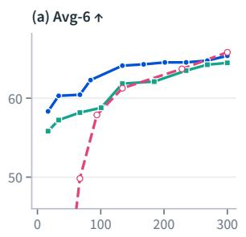

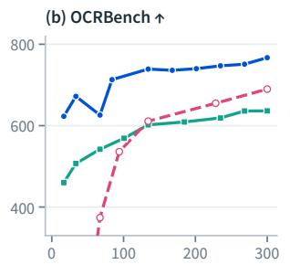

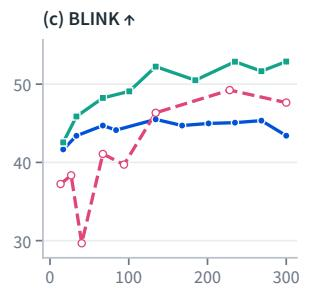  
Stage-1 tokens (B)

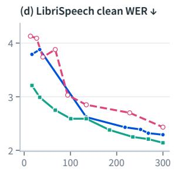  
Figure 8. Encoder architecture and initialization studies. (a) General multimodal (Avg-6); (b) OCRBench; (c) BLINK; (d) LibriSpeech test-clean WER. Blue, green, and pink denote the text-initialized unified encoder, randomly initialized unified encoder, and pre-trained SigLIP-2 [80] and SenseVoice-small [81] towers, respectively.

Unified encoder versus separate towers. With two thirds of the perception parameters and no second tower, a randomly initialized unified encoder trails pre-trained SigLIP-2 [80] and SenseVoice-small [81] towers by 1.3 points on Avg-6 at 300 B Stage 1 tokens (Fig. 8a). At the same budget, it trails on OCRBench by 53.4 points (Fig. 8b) but achieves a lower word error rate (WER) on LibriSpeech test-clean, 2.14 against 2.43 (Fig. 8d). Text-LM initialization substantially reduces the vision gap: at the same endpoint, the text-initialized encoder comes within 0.4 points of the towers on Avg-6 and surpasses them by 77.2 points on OCRBench. These results suggest that initialization accounts for an important part of the vision gap.

Efect of text-LM initialization. At matched training budgets, initializing the shared block from Qwen3- 0.6B-Base rather than from scratch gives the encoder a reading advantage that persists throughout the plotted range (Fig. 8b). The two vision branches run identical Stage 0 and Stage 1 schedules and difer only in this initialization. The initialized encoder leads on OCRBench at every checkpoint evaluated in both branches; at 300 B tokens, its advantage is 130.6 points (767.0 against 636.4). It reaches 672 early in training, a score the scratch encoder never attains within the plotted range. On Avg-6, the benefit is mainly one of sample eficiency: the initialized encoder reaches 64.1 with half the Stage 1 tokens needed by the scratch encoder to reach a comparable score, and it leads by 0.9 points at 300 B tokens (65.37 against 64.48; Fig. 8a). The advantage is concentrated on reading: at the same 300 B budget, the scratch encoder leads on 8 of the 16 vision benchmarks, most clearly on BLINK ( 9.5, 52.89 against 43.41; Fig. 8c), which tests spatial and relational perception. This dissociation is consistent with the second principle of the encoder (Sec. 2): weights that already map context to symbols help perception output symbols, not reason about space. Because parsing depends on reading more than on any other capability, this is the encoder result most relevant to our task.

Contribution of OSAD. OSAD provides most of the improvement beyond SFT, contributing 1.75 of the 1.99 points gained on OmniDocBench v1.6 (88%), compared with 0.24 from RLVR (Fig. 9). Its six rounds raise the Overall score from 95.21 to 96.96 (Fig. 9), with gains at every round. This continued refinement is consistent with the self-evolving design, which refreshes supervision as the parser learns. The refinement targets content accuracy within structured outputs: a schema-valid parse can still misread words, formula symbols, or table-cell values. OSAD provides reference-conditioned feedback at these content positions while separately supervising JSON keys and delimiters. For pages combining text, formulas, and tables, this couples precise transcription with consistent serialization, providing direct supervision for local errors that sequence-level rewards capture only indirectly.

(b) Incremental gains

(a) Post-training performance  
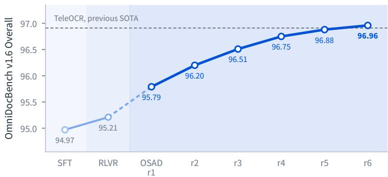

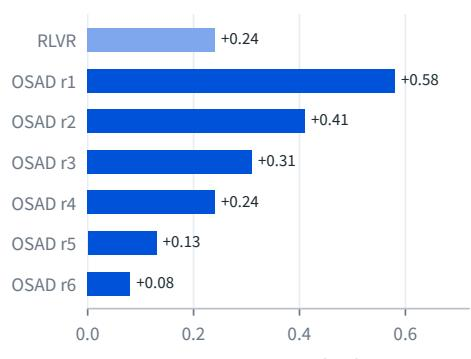  
Figure 9. OSAD supplies 1.75 of the 1.99 points gained after SFT (88%), with positive but diminishing increments. OmniDocBench v1.6 Overall (higher is better). (a) Score after SFT, RLVR, and each OSAD round; the dashed line marks TeleOCR, the strongest other system (96.91). (b) Gain over the preceding checkpoint.

## 6 Related Work

## 6.1 Parsing as a Perception Interface for Agents

Retrieval-augmented generation [1] and tool-using agents [2] motivate reusable interfaces between external evidence and language-model reasoning. For multimodal inputs, this interface may consist of extracted content, visual embeddings, or grounded structured records. ColPali [88] and visual retrieval systems such as VisRAG and M3DocRAG [89, 90] retrieve directly from document images, while Pix2Struct [91] uses screenshot parsing to learn representations for visual language understanding. MMLongBench-Doc [92] evaluates understanding across long multimodal documents, and OSWorld [3] and TheAgentCompany [93] place perception within interactive computer and workplace tasks. These settings motivate interfaces that retain both semantic content and its source location. OmniSchema serves this purpose through a common representation of entities, relations, and spatial or temporal anchors across documents, images, audio, and video.

## 6.2 Omni-Modal Parsing and Perception Encoders

Document parsing. Document understanding spans OCR-based pipelines and models that generate structured outputs directly from images. Donut [94] established an OCR-free encoder-decoder approach, while systems such as MinerU and PaddleOCR [95, 96] organize recognition and layout analysis into specialized components. Recent parsers explore diferent allocations of these computations: MinerU2.5 [5] separates low-resolution layout analysis from high-resolution recognition; dots.ocr and MonkeyOCR [58, 51] integrate layout and content prediction; and Youtu-Parsing [4] decodes regions in parallel from shared encoder features. MinerU2.5-Pro and PaddleOCR-VL [20, 97, 6] further improve document parsing through data and training refinements. GOT-OCR2.0 and DeepSeek-OCR [79, 71] also emphasize visual encoding tailored to text recognition and document compression. Our work extends this encoder-centric approach to grounded parsing across visual and auditory inputs.

Omni-modal models and structured parsing. Omni-modal language models integrate vision and audio for multimodal understanding and generation [9, 10, 98, 99, 12, 100, 101]. A common architecture uses separate vision and audio encoders, followed by fusion in the language model. Qwen2.5-Omni, for example, uses TMRoPE to align audio and video tokens through temporal positional encoding [9]. Logics-Parsing-Omni [11] develops an explicit omni-modal parsing framework that connects detection, recognition, and interpretation through evidence grounding, and introduces OmniParsingBench, which we adopt. Building on this task formulation, Youtu-Parsing-Omni combines a shared output schema with a unified perception encoder, Youtu-Omni-Encoder, placing audio-visual temporal alignment and selective cross-modal interaction before the decoder.

Shared representations and unified encoders. Multimodal alignment and encoder sharing address complementary aspects of perception. ImageBind [102] aligns six modalities in a common embedding space using image-paired data. Architectures such as VATT [13], Omnivore [103], and TVLT [14] instead explore shared Transformer computation across diferent combinations of visual, auditory, textual, and depth inputs. Meta-Transformer [104] and OneLLM [105] extend parameter sharing across modalities with modalityspecific input processing. Youtu-Omni-Encoder targets grounded parsing, including native-resolution pages, with a text-initialized shared backbone and a common temporal positional encoding for audio and video. Cross-modal attention is confined to selected layers and local windows, combining shared computation with explicit temporal interaction.

Language-model initialization for perception. Pre-trained language-model weights provide a complementary starting point to visual or contrastive pre-training. FPT [106] studies transfer from text Transformers to non-text tasks, and frozen language-model blocks can enrich visual representations [107]. TrOCR [108] uses pre-trained text components for recognition, while encoder-free models such as Fuyu, EVE, and Mono-InternVL [109, 110, 111] process image patches within the language-model architecture. DeepSeek-OCR 2 [24] is particularly relevant: its visual encoder incorporates a Qwen2-initialized Transformer with bidirectional visual attention and causal query tokens for learned reading order. We apply text initialization to a separate perception backbone shared by vision and audio, preserving a distinct decoder and evaluating the initialization against an otherwise identical encoder trained from scratch (Subsec. 5.7).

## 6.3 Post-Training for Structured Parsing

Verifiable rewards. Reinforcement learning extends parsing supervision from reference sequences to model-generated outputs. GRPO [18] provides a group-relative optimization framework, and OCR systems instantiate task-specific rewards: olmOCR-2 [19] uses programmatic unit tests, while MinerU2.5-Pro and PaddleOCR-VL-1.6 incorporate reinforcement learning into their training pipelines [20, 6]. Our schema-routed RLVR combines shared validity checks with task-specific content scores under one policy. The subsequent distillation stage supplies token-level feedback for structured outputs whose heterogeneous fields are dificult to supervise with a single scalar reward.

On-policy and reference-conditioned distillation. Training on learner-generated trajectories addresses the mismatch between reference prefixes and the states encountered at inference [16, 17]. GKD [21] applies teacher feedback to student-generated sequences and permits diferent distribution-matching objectives; MiniLLM [39] develops on-policy optimization of a reverse-KL distillation objective. A separate line of work transfers information available only during training: learning with privileged information and generalized distillation formalize this setting [23, 112], while context distillation internalizes the benefits of additional instructions or reasoning context [113]. OPSD [22] brings these ideas together by using the same model as teacher and student under diferent contexts, with reference-conditioned token targets evaluated on student rollouts. OSAD builds directly on this construction and uses the output schema to adapt supervision to token roles, assigning diferent divergences to content and structure within a shared all-token objective.

Self-distillation and teacher evolution. Born-again networks [114] and Noisy Student [115] improve models through successive teacher-student generations, while Mean Teacher and DINO [116, 117] update a teacher through an exponential moving average of student parameters. These approaches establish teacher evolution as a general mechanism for refining supervision. OSAD combines periodic teacher refresh with reference-conditioned on-policy targets: the teacher remains frozen within each round, then inherits the trained student’s checkpoint for the next round. This design couples schema-aware token supervision with a supervision source that incorporates the student’s accumulated learning, as described in Subsec. 4.2.3.

## 7 Limitations and Conclusion

Limitations. Compared with its predecessor Youtu-Parsing [4], Youtu-Parsing-Omni does not yet implement inference acceleration. Youtu-Parsing reuses shared encoder features across the regions of a page and applies token- and query-level parallel decoding, whereas Youtu-Parsing-Omni decodes end-to-end and autoregressively with a larger decoder. We therefore expect its throughput on dense structured content such as tables to be lower. We will bring parallel decoding and related acceleration techniques to Youtu-Parsing-Omni in future work.

Conclusion. We presented Youtu-Parsing-Omni, an omni-modal parser that converts documents, images, audio, and video into structured records grounded in space and time. Its design rests on one encoderfor every modality and one schemafor every task. The encoder, Youtu-Omni-Encoder, replaces separate vision and audio towers with one text-initialized Transformer, in which visual and acoustic tokens share a space-time positional encoding and interact within short audio-visual windows. The schema, OmniSchema, casts the outputs of all ten tasks into one grounded format, which allows a single self-evolving post-training procedure, OSAD, to use the same token-role-based objective across tasks. Together, the two components let a single 5 B-parameter checkpoint serve all ten parsing tasks with one inference configuration. Youtu-Parsing-Omni achieves the highest OmniDocBench v1.6 score among all compared systems (96.96) and leads all open-weight models on OmniParsingBench (75.08).

## Contributions

Core Contributors Yunhang Shen<sup>†</sup> Zhangquan Chen<sup>†</sup> Xiaotian Li<sup>†</sup> Zhongpeng Cai<sup>†</sup> Qing Zhou Zekai Zhang Kun Zhang Zezhong Wu Jian Hu Haihan Gao Heting Gao Xin Li Yinsong Liu Deqian Jiang Di Yin Haoyu Cao<sup>#</sup> Xing Sun<sup>\*</sup>

Contributors Bing Liu Yanqiu Qu Yunfei Wu Kun Yin Zhixiang Wei Yongxiang Hua Qianyu Li Xiaoxing Hu Peiyuan Zhang Lijiang Li Dong Xu Zhenchuan Yang Yiliang Jiang

<sup>†</sup>Equal contribution <sup>#</sup>Project lead <sup>\*</sup>Corresponding author

## References

[1] Patrick Lewis, Ethan Perez, Aleksandra Piktus, et al. Retrieval-Augmented Generation for Knowledge-Intensive NLP Tasks. In Conference on Neural Information Processing Systems (NeurIPS), 2020.

[2] Shunyu Yao, Jefrey Zhao, Dian Yu, et al. ReAct: Synergizing Reasoning and Acting in Language Models. In International Conference on Learning Representations (ICLR), 2023.

[3] Tianbao Xie, Danyang Zhang, Jixuan Chen, et al. OSWorld: Benchmarking Multimodal Agents for Open-Ended Tasks in Real Computer Environments. In Conference on Neural Information Processing Systems (NeurIPS), 2024.

[4] Kun Yin, Yunfei Wu, Bing Liu, et al. Youtu-Parsing: Perception, Structuring and Recognition Via High-Parallelism Decoding. ArXiv, 2026.

[5] Junbo Niu, Zheng Liu, Zhuangcheng Gu, et al. MinerU2.5: A Decoupled Vision-Language Model for Eficient High-Resolution Document Parsing. ArXiv, 2025.

[6] Zelun Zhang, Hongen Liu, Suyin Liang, et al. PaddleOCR-VL-1.6: Expanding The Frontier of Document Parsing with Under-Optimized Region Refinement and Progressive Post-Training. ArXiv, 2026.

[7] Zihan Zhao, Bo Chen, Jingpiao Li, et al. ChemDFM-X: Towards Large Multimodal Model for Chemistry. Science China Information Sciences, 2024.

[8] Guang Yang, Victoria Ebert, Nazif Tamer, et al. LEGATO: Large-Scale End-to-End Generalizable Approach to Typeset OMR. ArXiv, 2025.

[9] Jin Xu, Zhifang Guo, Jinzheng He, et al. Qwen2.5-Omni Technical Report. ArXiv, 2025.

[10] Jin Xu, Zhifang Guo, Hangrui Hu, et al. Qwen3-Omni Technical Report. ArXiv, 2025.

[11] Xin An, Jingyi Cai, Xiangyang Chen, et al. Logics-Parsing-Omni Technical Report. ArXiv, 2026.

[12] Chaoyou Fu, Haojia Lin, Xiong Wang, et al. VITA-1.5: Towards GPT-4o Level Real-Time Vision and Speech Interaction. ArXiv, 2025.

[13] Hassan Akbari, Liangzhe Yuan, Rui Qian, et al. VATT: Transformers for Multimodal Self-Supervised Learning from Raw Video, Audio and Text. In Conference on Neural Information Processing Systems (NeurIPS), 2021.

[14] Zineng Tang, Jaemin Cho, Yixin Nie, et al. TVLT: Textless Vision-Language Transformer. In Conference on Neural Information Processing Systems (NeurIPS), 2022.

[15] Detao Bai, Shimin Yao, Weixuan Chen, et al. OmniEncoder: See, Hear, and Feel Continuous Motion like Humans with One Encoder. ArXiv, 2026.

[16] Stéphane Ross, Geofrey J. Gordon, and J. Andrew Bagnell. a Reduction of Imitation Learning and Structured Prediction to No-Regret Online Learning. In Journal of Machine Learning Research (JMLR), 2011.

[17] Samy Bengio, Oriol Vinyals, Navdeep Jaitly, et al. Scheduled Sampling for Sequence Prediction with Recurrent Neural Networks. Conference on Neural Information Processing Systems (NeurIPS), 2015.

[18] Zhihong Shao, Peiyi Wang, Qihao Zhu, et al. DeepSeekMath: Pushing The Limits of Mathematical Reasoning in Open Language Models. ArXiv, 2024.

[19] Jake Poznanski, Luca Soldaini, and Kyle Lo. olmOCR 2: Unit Test Rewards for Document OCR. ArXiv, 2025.

[20] Bin Wang, Tianyao He, Linke Ouyang, et al. MinerU2.5-Pro: Pushing The Limits of Data-Centric Document Parsing at Scale. ArXiv, 2026.

[21] Rishabh Agarwal, Nino Vieillard, Yongchao Zhou, et al. on-Policy Distillation of Language Models: Learning from Self-Generated Mistakes. In International Conference on Learning Representations (ICLR), 2024.

[22] Siyan Zhao, Zhihui Xie, Mengchen Liu, et al. Self-Distilled Reasoner: On-Policy Self-Distillation for Large Language Models. ArXiv, 2026.

[23] Vladimir Vapnik and Akshay Vashist. a New Learning Paradigm: Learning Using Privileged Information. Neural Networks, 2009.

[24] Haoran Wei, Yaofeng Sun, and Yukun Li. DeepSeek-OCR 2: Visual Causal Flow. ArXiv, 2026.

[25] Junru Lu, Jiarui Qin, Lingfeng Qiao, et al. Youtu-LLM: Unlocking The Native Agentic Potential for Lightweight Large Language Models. ArXiv, 2026.

[26] Peng Wang, Shuai Bai, Sinan Tan, et al. Qwen2-VL: Enhancing Vision-Language Model’s Perception of The World at Any Resolution. ArXiv, 2024.

[27] Biao Zhang and Rico Sennrich. Root Mean Square Layer Normalization. In Conference on Neural Information Processing Systems (NeurIPS), 2019.

[28] Noam Shazeer. GLU Variants Improve Transformer. ArXiv, 2020.

[29] Joshua Ainslie, James Lee-Thorp, Michiel de Jong, et al. GQA: Training Generalized Multi-Query Transformer Models From Multi-Head Checkpoints. In Conference on Empirical Methods in Natural Language Processing (EMNLP), 2023.

[30] Alex Henry, Prudhvi Raj Dachapally, Shubham Pawar, et al. Query-Key Normalization for Transformers. In Conference on Empirical Methods in Natural Language Processing (EMNLP), 2020.

[31] Jianlin Su, Yu Lu, Shengfeng Pan, et al. RoFormer: Enhanced Transformer with Rotary Position Embedding. ArXiv, 2021.

[32] Tri Dao, Daniel Y. Fu, Stefano Ermon, et al. FlashAttention: Fast and Memory-Eficient Exact Attention With IO-Awareness. Conference on Neural Information Processing Systems (NeurIPS), 2022.

[33] David Weininger. SMILES, a Chemical Language and Information System: 1: Introduction to Methodology and Encoding Rules. Journal of Chemical Information and Computer Sciences, 1988.

[34] Abcnotation. Abc Home, 2021. URL https://abcnotation.com/https://abcnotation.com.

[35] An Yang, Anfeng Li, Baosong Yang, et al. Qwen3 Technical Report. ArXiv, 2025.

[36] Zhixiang Wei, Yi Li, Zhehan Kan, et al. Youtu-VL: Unleashing Visual Potential via Unified Vision-Language Supervision. ArXiv, 2026.

[37] Yunhang Shen, Chaoyou Fu, Shaoqi Dong, et al. Long-VITA: Scaling Large Multi-Modal Models to 1 Million Tokens with Leading Short-Context Accuracy. ArXiv, 2025.

[38] Zuwei Long, Yunhang Shen, Chaoyou Fu, et al. VITA-Audio: Fast Interleaved Cross-Modal Token Generation For Eficient Large Speech-Language Model. ArXiv, 2025.

[39] Yuxian Gu, Li Dong, Furu Wei, et al. MiniLLM: On-Policy Distillation of Large Language Models. ArXiv, 2023.

[40] Edward J. Hu, Yelong Shen, Phillip Wallis, et al. LoRA: Low-Rank Adaptation of Large Language Models. ArXiv, 2021.

[41] Xuanle Zhao, Shuxin Zeng, Xinyuan Cai, et al. TinyChemVL: Advancing Chemical Vision-Language Models via Eficient Visual Token Reduction and Complex Reaction Tasks. In AAAI Conference on Artificial Intelligence (AAAI), 2026.

[42] Linke Ouyang, Yuan Qu, Hongbin Zhou, et al. OmniDocBench: Benchmarking Diverse PDF Document Parsing With Comprehensive Annotations. In IEEE/CVF Conference on Computer Vision and Pattern Recognition (CVPR), 2025.

[43] Zhiheng Li, Zongyang Ma, Jiaxian Chen, et al. How Far Is Document Parsing from Solved? Pure-DocBench: A Source-Traceable Benchmark Across Clean, Degraded, and Real-World Settings. ArXiv, 2026.

[44] Chaoyou Fu, Haozhi Yuan, Yuhao Dong, et al. Video-MME-V2: Towards The Next Stage in Benchmarks for Comprehensive Video Understanding. ArXiv, 2026.

[45] Junxian Li, Di Zhang, Xunzhi Wang, et al. ChemVLM: Exploring The Power of Multimodal Large Language Models in Chemistry Area. In AAAI Conference on Artificial Intelligence (AAAI), 2025.

[46] Phillip Long, Zachary Novack, Taylor Berg-Kirkpatrick, et al. PDMX: A Large-Scale Public Domain MusicXML Dataset for Symbolic Music Processing. In International Conference on Acoustics, Speech and Signal Processing (ICASSP), 2025.

[47] Peng Cai, Zhaofan Zou, Shifa Liu, et al. TeleOCR: Navigating Document Parsing Across Digital and Camera-Captured Documents. ArXiv, 2026.

[48] Shuaiqi Duan, Yadong Xue, Weihan Wang, et al. GLM-OCR Technical Report. ArXiv, 2026.

[49] Cheng Cui, Ting Sun, Suyin Liang, et al. PaddleOCR-VL-1.5: Towards a Multi-Task 0.9B VLM for Robust in-The-Wild Document Parsing. ArXiv, 2026.

[50] Hao Feng, Shu Wei, Xiang Fei, et al. Dolphin: Document Image Parsing via Heterogeneous Anchor Prompting. In Annual Meeting of The Association for Computational Linguistics (ACL), 2025.

[51] Zhang Li, Yuliang Liu, Qiang Liu, et al. MonkeyOCR: Document Parsing with a Structure-Recognition-Relation Triplet Paradigm. ArXiv, 2026.

[52] Shiyin Lu, Yinglun Li, Yu Xia, et al. OvisOCR2 Technical Report. ArXiv, 2026.

[53] Gengluo Li, Xingyu Wan, Shangpin Peng, et al. HunyuanOCR-1.5: Making Lightweight OCR VLMs Faster and Better. ArXiv, 2026.

[54] Daxiang Dong, Mingming Zheng, Dong Xu, et al. Qianfan-OCR: A Unified End-to-End Model for Document Intelligence. ArXiv, 2026.

[55] Xiangyang Chen, Shuzhao Li, Xiuwen Zhu, et al. Logics-Parsing Technical Report. ArXiv, 2025.

[56] Hao Wu, Haoran Lou, Xinyue Li, et al. FireRed-OCR Technical Report. ArXiv, 2026.

[57] FVL Lab. OpenOCR: An Open-Source Toolkit for General-OCR Research And Applications, 2026. URL https://github.com/Topdu/OpenOCR.

[58] Yumeng Li, Guang Yang, Hao Liu, et al. dots.ocr: Multilingual Document Layout Parsing in a Single Vision-Language Model. ArXiv, 2025.

[59] Hunyuan Vision Team. HunyuanOCR Technical Report. ArXiv, 2025.

[60] Yufeng Zhong, Lei Chen, Xuanle Zhao, et al. OCRVerse: Towards Holistic OCR in End-to-End Vision-Language Models. ArXiv, 2026.

[61] Shiyin Lu, Yang Li, Yu Xia, et al. Ovis2.5 Technical Report. ArXiv, 2025.

[62] Sundar Pichai, Koray Kavukcuoglu, and Demis Hassabis. Gemini 3: Introducing The Latest Gemini AI Model from Google, 2025. URL https://blog.google/products-and-platforms/products/gemi ni/gemini-3/.

[63] Shuai Bai, Yuxuan Cai, Ruizhe Chen, et al. Qwen3-VL Technical Report. ArXiv, 2025.

[64] OpenAI. Introducing GPT-5.2 | OpenAI, 2026. URL https://openai.com/index/introducing-g pt-5-2/.

[65] Weiyun Wang, Zhangwei Gao, Lixin Gu, et al. InternVL3.5: Advancing Open-Source Multimodal Models in Versatility, Reasoning, and Eficiency. ArXiv, 2025.

[66] Qwen Team. Qwen3.5: Towards Native Multimodal Agents, 2026. URL https://qwen.ai/blog?id= qwen3.5.

[67] OpenAI. Introducing GPT-5.4 | OpenAI, 2026. URL https://openai.com/index/introducing-g pt-5-4/.

[68] Handong Zheng, Yumeng Li, Kaile Zhang, et al. Multimodal OCR: Parse Anything from Documents. ArXiv, 2026.

[69] Yufeng Zhong, Lei Chen, Zhixiong Zeng, et al. Reading or Reasoning? Format Decoupled Reinforcement Learning for Document OCR. IEEE/CVF Conference on Computer Vision and Pattern Recognition (CVPR), 2026.

[70] Jake Poznanski, Aman Rangapur, Jon Borchardt, et al. olmOCR: Unlocking Trillions of Tokens in PDFs with Vision Language Models. ArXiv, 2025.

[71] Haoran Wei, Yaofeng Sun, and Yukun Li. DeepSeek-OCR: Contexts Optical Compression. ArXiv, 2025.

[72] ChatDOC team. chatdoc-Com/OCRFlux, 2026. URL https://github.com/chatdoc-com/OCRFlux/.

[73] Google DeepMind. Gemini 3.1 Pro - Model Card — Google DeepMind, 2026. URL https://deepmi nd.google/models/model-cards/gemini-3-1-pro/.

[74] Kimi Team. Kimi K2.6 | Leading Open-Source Model in Coding & Agent, 2026. URL https: //www.kimi.ai/ai-models/kimi-k2-6.

[75] OpenAI. GPT-5.6: Frontier Intelligence That Scales with Your Ambition, 2026. URL https://openai .com/index/gpt-5-6/.

[76] OpenAI. GPT-4o System Card. ArXiv, 2024.

[77] Shuai Bai, Keqin Chen, Xuejing Liu, et al. Qwen2.5-VL Technical Report. ArXiv, 2025.

[78] Zhe Chen, Weiyun Wang, Yue Cao, et al. Expanding Performance Boundaries of Open-Source Multimodal Models with Model, Data, and Test-Time Scaling. ArXiv, 2024.

[79] Haoran Wei, Chenglong Liu, Jinyue Chen, et al. General OCR Theory: Towards OCR-2.0 via a Unified End-to-End Model. ArXiv, 2024.

[80] Michael Tschannen, Alexey Gritsenko, Xiao Wang, et al. SigLIP 2: Multilingual Vision-Language Encoders with Improved Semantic Understanding, Localization, and Dense Features. ArXiv, 2025.

[81] Keyu An, Qian Chen, Chong Deng, et al. FunAudioLLM: Voice Understanding and Generation Foundation Models for Natural Interaction Between Humans And LLMs. ArXiv, 2024.

[82] Yuan Liu, Haodong Duan, Yuanhan Zhang, et al. MMBench: Is Your Multi-Modal Model an All-Around Player? In European Conference on Computer Vision (ECCV), 2024.

[83] Lin Chen, Jinsong Li, Xiaoyi Dong, et al. Are We on The Right Way for Evaluating Large Vision-Language Models? ArXiv, 2024.

[84] Xiang Yue, Yuansheng Ni, Kai Zhang, et al. MMMU: A Massive Multi-Discipline Multimodal Understanding And Reasoning Benchmark for Expert AGI. ArXiv, 2023.

[85] Tianrui Guan, Fuxiao Liu, Xiyang Wu, et al. Hallusionbench: An Advanced Diagnostic Suite for Entangled Language Hallucination and Visual Illusion in Large Vision-Language Models. In IEEE/CVF Conference on Computer Vision and Pattern Recognition (CVPR), 2024.

[86] Aniruddha Kembhavi, Mike Salvato, Eric Kolve, et al. a Diagram Is Worth a Dozen Images. European Conference on Computer Vision (ECCV), 2016.

[87] Yuliang Liu, Zhang Li, Biao Yang, et al. on The Hidden Mystery of OCR in Large Multimodal Models. ArXiv, 2023.

[88] Manuel Faysse, Hugues Sibille, Tony Wu, et al. ColPali: Eficient Document Retrieval with Vision Language Models. In International Conference on Learning Representations (ICLR), 2025.

[89] Shi Yu, Chaoyue Tang, Bokai Xu, et al. VisRAG: Vision-Based Retrieval-Augmented Generation on Multi-Modality Documents. In International Conference on Learning Representations (ICLR), 2025.

[90] Jaemin Cho, Debanjan Mahata, Ozan Irsoy, et al. M3DocRAG: Multi-Modal Retrieval Is What You Need for Multi-Page Multi-Document Understanding. ArXiv, 2024.

[91] Kenton Lee, Mandar Joshi, Iulia Turc, et al. Pix2Struct: Screenshot Parsing as Pretraining for Visual Language Understanding. In Proceedings of Machine Learning Research (PMLR), 2023.

[92] Yubo Ma, Yuhang Zang, Liangyu Chen, et al. MMLongBench-Doc: Benchmarking Long-Context Document Understanding with Visualizations. In Conference on Neural Information Processing Systems (NeurIPS), 2024.

[93] Frank F. Xu, Yufan Song, Boxuan Li, et al. TheAgentCompany: Benchmarking LLM Agents on Consequential Real World Tasks. In Conference on Neural Information Processing Systems (NeurIPS), 2025.

[94] Geewook Kim, Teakgyu Hong, Moonbin Yim, et al. OCR-Free Document Understanding Transformer. In European Conference on Computer Vision (ECCV), 2022.

[95] Bin Wang, Chao Xu, Xiaomeng Zhao, et al. MinerU: An Open-Source Solution for Precise Document Content Extraction. ArXiv, 2024.

[96] Cheng Cui, Ting Sun, Manhui Lin, et al. PaddleOCR 3.0 Technical Report. ArXiv, 2025.

[97] Cheng Cui, Ting Sun, Suyin Liang, et al. PaddleOCR-VL: Boosting Multilingual Document Parsing via A 0.9B Ultra-Compact Vision-Language Model. ArXiv, 2025.

[98] Baichuan Inc. Baichuan-Omni-1.5 Technical Report. ArXiv, 2025.

[99] Junbo Cui, Bokai Xu, Chongyi Wang, et al. MiniCPM-O 4.5: Towards Real-Time Full-Duplex Omni-Modal Interaction. ArXiv, 2026.

[100] Qingpei Guo, Kaiyou Song, Zipeng Feng, et al. M2-Omni: Advancing Omni-MLLM for Comprehensive Modality Support with Competitive Performance. ArXiv, 2025.

[101] Inclusion Ai and Ant Group. Ming-Omni: A Unified Multimodal Model for Perception and Generation. ArXiv, 2025.

[102] Rohit Girdhar, Alaaeldin El-Nouby, Zhuang Liu, et al. ImageBind: One Embedding Space to Bind Them All. In IEEE/CVF Conference on Computer Vision and Pattern Recognition (CVPR), 2023.

[103] Rohit Girdhar, Mannat Singh, Nikhila Ravi, et al. Omnivore: A Single Model for Many Visual Modalities. In IEEE/CVF Conference on Computer Vision and Pattern Recognition (CVPR), 2022.

[104] Yiyuan Zhang, Kaixiong Gong, Kaipeng Zhang, et al. Meta-Transformer: A Unified Framework for Multimodal Learning. ArXiv, 2023.

[105] Jiaming Han, Kaixiong Gong, Yiyuan Zhang, et al. OneLLM: One Framework to Align All Modalities with Language. In IEEE/CVF Conference on Computer Vision and Pattern Recognition (CVPR), 2024.

[106] Kevin Lu, Aditya Grover, Pieter Abbeel, et al. Pretrained Transformers as Universal Computation Engines. In AAAI Conference on Artificial Intelligence (AAAI), 2022.

[107] Ziqi Pang, Ziyang Xie, Yunze Man, et al. Frozen Transformers in Language Models Are Efective Visual Encoder Layers. In International Conference on Learning Representations (ICLR), 2024.

[108] Minghao Li, Tengchao Lv, Jingye Chen, et al. TrOCR: Transformer-Based Optical Character Recognition With Pre-Trained Models. In AAAI Conference on Artificial Intelligence (AAAI), 2023.

[109] Rohan Bavishi, Erich Elsen, Curtis Hawthorne, et al. Fuyu-8B: A Multimodal Architecture for AI Agents, 2023. URL https://www.adept.ai/blog/fuyu-8b.

[110] Haiwen Diao, Yufeng Cui, Xiaotong Li, et al. Unveiling Encoder-Free Vision-Language Models. In Conference on Neural Information Processing Systems (NeurIPS), 2024.

[111] Gen Luo, Xue Yang, Wenhan Dou, et al. Mono-InternVL: Pushing The Boundaries of Monolithic Multimodal Large Language Models with Endogenous Visual Pre-Training. In IEEE/CVF Conference on Computer Vision and Pattern Recognition (CVPR), 2025.

[112] David Lopez-Paz, Léon Bottou, Bernhard Schölkopf, et al. Unifying Distillation and Privileged Information. In International Conference on Learning Representations (ICLR), 2016.

[113] Charlie Snell, Dan Klein, and Ruiqi Zhong. Learning by Distilling Context. ArXiv, 2022.

[114] Tommaso Furlanello, Zachary C. Lipton, Michael Tschannen, et al. Born-Again Neural Networks. In International Conference on Machine Learning (ICML), 2018.

[115] Qizhe Xie, Minh Thang Luong, Eduard Hovy, et al. Self-Training with Noisy Student Improves ImageNet Classification. In IEEE/CVF Conference on Computer Vision and Pattern Recognition (CVPR), 2020.

[116] Antti Tarvainen and Harri Valpola. Mean Teachers Are Better Role Models: Weight-Averaged Consistency Targets Improve Semi-Supervised Deep Learning Results. In Conference on Neural Information Processing Systems (NeurIPS), 2017.

[117] Mathilde Caron, Hugo Touvron, Ishan Misra, et al. Emerging Properties in Self-Supervised Vision Transformers. In IEEE International Conference on Computer Vision (ICCV), 2021.

[118] Ahmed Masry, Do Xuan Long, Jia Qing Tan, et al. ChartQA: A Benchmark for Question Answering About Charts With Visual and Logical Reasoning. In Annual Meeting of The Association for Computational Linguistics (ACL), 2022.

[119] Nitesh Methani, Pritha Ganguly, Mitesh M. Khapra, et al. PlotQA: Reasoning over Scientific Plots. In IEEE Winter Conference on Applications of Computer Vision (WACV), 2020.

[120] Shankar Kantharaj, Rixie Tifany Ko Leong, Xiang Lin, et al. Chart-to-Text: A Large-Scale Benchmark for Chart Summarization. In Annual Meeting of The Association for Computational Linguistics (ACL), 2022.

[121] Sunghwan Kim, Jie Chen, Tiejun Cheng, et al. PubChem 2023 Update. Nucleic Acids Research, 2023.

[122] Anna Gaulton, Louisa J. Bellis, A. Patricia Bento, et al. ChEMBL: A Large-Scale Bioactivity Database for Drug Discovery. Nucleic Acids Research, 2012.

[123] Nicolas Carion, Laura Gustafson, Yuan-Ting Hu, et al. SAM 3: Segment Anything with Concepts. ArXiv, 2026.

[124] Sanyuan Chen, Yu Wu, Chengyi Wang, et al. BEATS: Audio Pre-Training with Acoustic Tokenizers. In Proceedings of Machine Learning Research (PMLR), 2023.

[125] Florian Schmid, Tobias Morocutti, Francesco Foscarin, et al. Efective Pre-Training of Audio Transformers for Sound Event Detection. In International Conference on Acoustics, Speech and Signal Processing (ICASSP), 2025.

[126] Jort F Gemmeke, Daniel P W Ellis, Dylan Freedman, et al. Audio Set: An Ontology and Human-Labeled Dataset for Audio Events. In International Conference on Acoustics, Speech and Signal Processing (ICASSP), 2017.

[127] Jiangyu Han, Federico Landini, Johan Rohdin, et al. Leveraging Self-Supervised Learning for Speaker Diarization. In International Conference on Acoustics, Speech and Signal Processing (ICASSP), 2025.

[128] Armand Joulin, Edouard Grave, Piotr Bojanowski, et al. Bag of Tricks for Eficient Text Classification. Conference of The European Chapter of The Association for Computational Linguistics (EACL), 2016.

[129] Vineel Pratap, Andros Tjandra, Bowen Shi, et al. Scaling Speech Technology to 1,000+ Languages. Journal ofMachine Learning Research (JMLR), 2023.

[130] DeepSeek-AI. DeepSeek-V2: A Strong, Economical, and Eficient Mixture-of-Experts Language Model. ArXiv, 2024.

[131] Bin Wang, Zhuangcheng Gu, Guang Liang, et al. UniMERNet: A Universal Network for Real-World Mathematical Expression Recognition. ArXiv, 2024.

[132] Xu Zhong, Elaheh ShafieiBavani, and Antonio Jimeno Yepes. Image-Based Table Recognition: Data, Model, and Evaluation. In European Conference on Computer Vision (ECCV), 2020.

[133] Fangyu Liu, Julian Martin Eisenschlos, Francesco Piccinno, et al. DEPLOT: One-Shot Visual Language Reasoning by Plot-to-Table Translation. In Annual Meeting of The Association for Computational Linguistics (ACL), 2023.

[134] RDKit Contributors. rdkit/rdkit: The Oficial Sources for The RDKit Library, 2026. URL https: //github.com/rdkit/rdkit.

## Appendix

The main text is self-contained; the appendix gives the complete specification behind it.

<table><tr><td></td><td>Contents</td><td>Page</td></tr><tr><td>A</td><td>Data: output fields per task and the complete annotation pipelines</td><td>31</td></tr><tr><td>B</td><td>Architecture: complete configuration and component details, including variants the final model does not use</td><td>33</td></tr><tr><td>C</td><td>Post-training: reward implementation, rollout sampling, and the OSAD round schedule</td><td>37</td></tr><tr><td>D</td><td>Evaluation protocol: metric definitions and the evaluation set</td><td>38</td></tr><tr><td>E</td><td>Additional encoder ablation curves</td><td>41</td></tr><tr><td>F</td><td>Qualitative examples</td><td>44</td></tr></table>

## A Data

Tab. 13–16 list the annotation fields for document, natural image, audio, and video parsing, respectively. For general-purpose data, we reuse the training data of Youtu-LLM [25], Youtu-VL [36], Long-VITA [37], VITA-1.5 [12], and VITA-Audio [38].

## A.1 Document Parsing

Table 13. Annotation fields of the document parsing dataset and their semantics.
<table><tr><td>Field</td><td>Scope</td><td>Semantics</td></tr><tr><td>id</td><td>element</td><td>Unique element identifier.</td></tr><tr><td>category</td><td>element</td><td>Element type: text, table, formula, code, caption, header, footer, title, chemical, score, chart, flowchart, figure, seal, or</td></tr><tr><td>bbox</td><td>element</td><td>geometric. Bounding box of the element in page coordinates.</td></tr><tr><td>content.text</td><td>element</td><td>Transcription for text-like elements, code, chemical structures,</td></tr><tr><td>content.latex</td><td>formula</td><td>and ABC notation. Formula transcription in LATFX.</td></tr><tr><td>content.otsl</td><td>table</td><td>Table structure and content in OTSL.</td></tr><tr><td>content.markdown</td><td>chart</td><td>Structured chart data in Markdown.</td></tr><tr><td>content.mermaid</td><td>flowchart</td><td>Nodes and directed relations in Mermaid.</td></tr><tr><td>content.geometric</td><td>geometric</td><td>Geometric primitives and relations.</td></tr><tr><td>content.caption</td><td></td><td>visual element Description of a chart, flowchart, figure, or geometric dia-</td></tr><tr><td>attributes.language element</td><td></td><td>gram. Language of the element content.</td></tr><tr><td>reading_order</td><td>page</td><td>Ordered list of element identifiers.</td></tr><tr><td>global_description</td><td>page</td><td>Page-level caption, narrative, language, and semantic tag.</td></tr></table>

The document data consist of two parts: full pages for layout and content parsing, and dedicated data for specialized elements. For full pages, public document datasets are typically annotated for a single sub-task and contain label noise, so we re-annotate them with expert models and vision-language models (VLMs). Pages that pass consistency checks and a vote among annotators with diferent architectures are retained directly; of the pages on which the annotators disagree, about 10% are corrected by human experts and added back to the corpus. Synthetic pages are rendered from layout templates of magazines, papers, textbooks, manuals, and advertisements, so their labels are exact by construction. For specialized elements, source tables of public chart datasets [118, 119, 120] are serialized to Markdown, and flowcharts, mind maps, and architecture diagrams generated from sampled graphs are serialized to Mermaid. Molecules from PubChem [121] and ChEMBL [122] are rendered into 1.0 M pairs of images and SMILES [33] strings, geometric figures are produced by a procedural generator with primitives and relations aligned to pixels by construction, and music scores from PDMX [46] are converted to ABC and rendered with varied engines, fonts, and layouts.

## A.2 Natural Image Parsing

Each image is annotated in three stages: captioning, entity verification, and localization. We first prompt a VLM to write a short caption restricted to the subject, the scene, and the action, followed by a longer narrative conditioned on that caption and the image. Next, a large language model (LLM) extracts the entities named in the caption and the narrative, and a second VLM checks whether each entity is visible in the image. If any caption entity is hallucinated, the sample is discarded; hallucinated narrative entities are instead removed, the narrative is rewritten from the remaining entities, and the entity lists of the caption and the narrative are merged. Finally, each remaining entity is localized independently by SAM-3 [123] and by a VLM. When the IoU of the two boxes exceeds a threshold, their intersection is kept; otherwise, an LLM selects the box whose region caption matches the entity. The region captions, kept as content.caption, and the scene phrase global\_description.scene are also generated by a VLM. The text inside each box is transcribed by Youtu-Parsing [4] and by a general-purpose OCR engine; when the two transcripts disagree, the element is discarded. An empty text records that neither OCR system returned text, rather than guaranteeing that the region contains none.

## A.3 Audio Parsing

The audio data consist of in-house audiobooks, podcasts, and conversations. Each clip is first segmented: a BEATs [124] tagger trained with PretrainedSED [125] labels every frame with an AudioSet [126] class, and the resulting vocal and nonvocal regions are split into segments of at most 30 s and packed into chunks of about 60 s, each of which forms one training sample. Speech is then attributed and transcribed: DiariZen [127] assigns clip-level speaker identities, three ASR systems with diferent architectures transcribe each turn, and the transcript with the smallest total pairwise WER is retained, while the largest pairwise WER is recorded as a disagreement score. The language of each segment is identified from the transcript by fastText [128] and from the audio by MMS-LID [129], and word timestamps are obtained by MMS forced alignment. The timbre, delivery, and environment captions (timbre\_caption, instruct\_caption, and env\_caption) are generated by an audio-language model, and the scene caption and the chunk-level global\_description by an LLM. For fine-tuning, a chunk is retained only if the two language identifiers agree and its disagreement score does not exceed 0.1. For reinforcement learning, we further discard chunks whose four ofline rollouts receive uniformly high, uniformly low, or identical scores from an audio-language judge; this judge is used only for this ofline filtering, and online training uses the rule-based verifiable reward of Equ. 2.

Table 14. Annotation fields of the natural image parsing dataset and their semantics.
<table><tr><td>Field</td><td>Scope</td><td>Semantics</td></tr><tr><td>id</td><td></td><td>element Unique element identifier.</td></tr><tr><td>category</td><td></td><td>element Element type, fixed to entity.</td></tr><tr><td>bbox</td><td></td><td>element Bounding box of a salient object.</td></tr><tr><td>tag</td><td></td><td>element A word naming the object inside the bounding box.</td></tr><tr><td>content.text</td><td></td><td>element OCR result inside the bounding box; &quot;&quot; when the annotation pipeline returns no text.</td></tr><tr><td>content.caption</td><td></td><td>element Precise and concise caption of the region inside the bounding box.</td></tr><tr><td>global_description.caption</td><td>image</td><td>Precise and concise caption of the image.</td></tr><tr><td>global_description.narrative image</td><td></td><td>Detailed description of the image, within 100 characters.</td></tr><tr><td>global_description.scene</td><td>image</td><td>Short phrase describing where the image takes place.</td></tr></table>

Table 15. Annotation fields of the audio parsing dataset and their semantics.
<table><tr><td>Field</td><td>Scope</td><td>Semantics</td></tr><tr><td>id</td><td>segment</td><td>Unique segment identifier.</td></tr><tr><td>kind</td><td>segment</td><td>Segment type: vocal or nonvocal.</td></tr><tr><td>audio.asr_text</td><td>vocal segment</td><td>Verbatim transcription of the speech in the segment.</td></tr><tr><td>audio.speaker_id</td><td>vocal segment</td><td>Speaker identifier, consistent across the chunk.</td></tr><tr><td>audio.timbre_caption</td><td>vocal segment</td><td>Voice timbre: gender, age, pitch, breathiness, etc.</td></tr><tr><td>audio.instruct_caption vocalsegment</td><td></td><td>Speech delivery characteristics: emotion, pace, prosody, etc.</td></tr><tr><td>audio.scene_caption</td><td>vocal segment</td><td>Mid-level scene context: time, location, activity, etc.</td></tr><tr><td>language</td><td>vocal segment</td><td>Language of the segment (zh/en/unk).</td></tr><tr><td>audio.env_caption</td><td></td><td>nonvocal segment Description of the background acoustic environment.</td></tr><tr><td>audio.acoustic_events</td><td>segment</td><td>Closed-set acoustic-event labels (e.g., Human Voice, Music).</td></tr><tr><td>start/end_timestamp</td><td>segment</td><td>Segment boundaries relative to the chunk onset (HH: MM: SS).</td></tr><tr><td>global_description</td><td>entire chunk</td><td>Holistic description aggregating information across seg-</td></tr></table>

## A.4 Video Parsing

Each video is first segmented by a VLM, at event and scene changes for natural video and at slide, page, and interface transitions for text-rich video. The VLM then annotates the visual fields of each segment; in parallel, an ASR system transcribes the corresponding audio, a speaker diarization model assigns speaker IDs that remain consistent across the entire video, and an acoustic event tagger labels its acoustic events; the visual and audio annotations are aligned only through the segment timestamps. Finally, an LLM summarizes the segments into the global\_description and, for text-rich video, into the structured\_report.

## B Architecture Details

This appendix lists every architectural setting (Tab. 17) and specifies the components of Youtu-Omni-Encoder that go beyond a standard Transformer, together with two rotary variants that the final model does not use.

Table 16. Annotation fields of the video parsing dataset and their semantics.
<table><tr><td>Field</td><td></td><td>Scope Category Semantics</td><td></td></tr><tr><td>id</td><td>segment shared</td><td></td><td>Unique segment identifier.</td></tr><tr><td>subtype</td><td>video</td><td>shared</td><td>Video type: natural_video or text_rich_video.</td></tr><tr><td>start/end_timestamp</td><td>segment shared</td><td></td><td>Temporal boundaries relative to video onset.</td></tr><tr><td>visual.elements</td><td>segment shared</td><td></td><td>Salient objects and on-screen text; each item has a category (object or text)</td></tr><tr><td>visual.atomic_actions</td><td>segment shared</td><td></td><td>and, for text, an ocr_type (e.g., title). Fine-grained actions within the segment.</td></tr><tr><td>visual.object_actor_interactions segment shared</td><td></td><td></td><td>Interactions between actors and objects.</td></tr><tr><td>visual.camera_motion</td><td>segment shared</td><td></td><td>Camera motion at two granularities (l1: coarse, l2: fine).</td></tr><tr><td>visual.event_description</td><td>segment shared</td><td></td><td>Summary of the segment-level visual event.</td></tr><tr><td>audio.speaker_id</td><td>segment shared</td><td></td><td>Speaker identifier, consistent across the</td></tr><tr><td>audio.asr_text</td><td>segment shared</td><td></td><td>video. Transcription of speech in the segment.</td></tr><tr><td>audio.acoustic_events</td><td>segment shared</td><td></td><td>Acoustic-event labels of the segment audio.</td></tr><tr><td>global_description</td><td>video</td><td>shared</td><td>Global scene, narrative, caption, and</td></tr><tr><td>structured_report</td><td>video</td><td>shared</td><td>semantic tag. Markdown report of text-centric content for text-rich video; an empty string (&quot;&quot;)</td></tr></table>

## B.1 Model Specification

Tab. 17 gives the complete configuration of the encoder, the stems, the projector, the decoder, and the sequence settings.

Encoder paradigms of representative parsers. Tab. 18 compares the perception front ends of representative parsers: every other parser in the table uses a separate encoder per modality, whereas Youtu-Parsing-Omni covers all three modalities with one encoder.

## B.2 Youtu-Omni-Encoder

## B.2.1 Modality Stems

Both stems are thin: they only turn raw signals into tokens of the shared-block width � and together hold less than 3% of the encoder parameters. The vision stem is a single linear map from each 16 16 patch, taken at native resolution under a token budget [26], to one token, with no convolution, absolute position table or class token, so all spatial information enters through RoPE (Subsec. 2.2). The audio stem applies three 3  3, stride-2 convolutions with GELU to the log-mel spectrogram, so each 1 s window of 100 mel frames becomes 100 8 = 13 tokens, i.e., 13 audio tokens per second. It then folds the remaining frequency bins into the channels and projects them to width � with a bias-free linear map, so that audio tokens have exactly the layout the shared block expects.

Table 17. Complete configuration of Youtu-Parsing-Omni.
<table><tr><td>Component</td><td>Quantity</td><td>Value</td></tr><tr><td rowspan="5"></td><td>layers L hidden size d</td><td>28 1,024</td></tr><tr><td></td><td></td></tr><tr><td>FFN hidden size  $d _ { \mathrm { { f f n } } }$ </td><td>3,072</td></tr><tr><td>query heads H  $/ \mathrm { \ K V }$  groups  $H _ { k v }$ </td><td>16 / 8</td></tr><tr><td>head dimension  $d _ { h }$  attention</td><td>128 GQA, bidirectional, packed</td></tr><tr><td rowspan="5"></td><td>normalization</td><td>RMSNorm, ε = 10−6</td></tr><tr><td>activation</td><td>SwiGLU</td></tr><tr><td></td><td>64</td></tr><tr><td>rotary slots  $d _ { \mathrm { { r o t } } }$  axis set  $\mathcal { A }$ </td><td></td></tr><tr><td>axis split  $( d _ { T } , d _ { H } , d _ { W } )$ </td><td>{T, H, W}; chunked segments (21,21,22)</td></tr><tr><td rowspan="9"></td><td>base b</td><td> $1 0 ^ { 4 }$ </td></tr><tr><td></td><td></td></tr><tr><td>vision patch size p</td><td>16</td></tr><tr><td>mel bins F / frame rate  $f _ { \mathrm { m e l } }$ </td><td>128 / 100 Hz (25 ms window, 10 ms hop)</td></tr><tr><td>audio convolutions</td><td>3× stride-2,  $C _ { a } = 5 1 2$  channels</td></tr><tr><td>audio window  $n _ { w }$ </td><td>100 mel frames (1 s)</td></tr><tr><td>audio token rate  $r _ { a }$ </td><td>13 per second ([100/8] per window)</td></tr><tr><td>merge factors  $\left( m _ { v } , m _ { a } \right)$ </td><td>(2,2)</td></tr><tr><td>merge normalization</td><td>RMSNorm over  $k _ { \mu } d$ </td></tr><tr><td rowspan="5">Projector</td><td>projector hidden  $d _ { \mathrm { p r o j } }$ </td><td>2,560</td></tr><tr><td>projector output  $d _ { \mathrm { l m } }$ </td><td>2,560</td></tr><tr><td></td><td>40, all dense</td></tr><tr><td>layers  $L _ { \mathrm { l m } }$  hidden size</td><td>2,560</td></tr><tr><td> $d _ { \mathrm { l m } }$ </td><td></td></tr><tr><td rowspan="7">LLM decoder</td><td>FFN hidden size</td><td>9,728</td></tr><tr><td>attention</td><td>MLA, causal, packed</td></tr><tr><td>heads  $H _ { \mathrm { l m } }$ </td><td>32</td></tr><tr><td> $( r _ { q } , r _ { k v } )$ </td><td>(1536,512)</td></tr><tr><td> $( d ^ { \dot { C } } , d ^ { R } , d ^ { V } )$ </td><td>(128, 64, 128)</td></tr><tr><td>normalization / activation</td><td>RMSNorm, ε = 10−6 / SwiGLU</td></tr><tr><td>RoPE</td><td>1D, base 1.6 × 106, no scaling</td></tr><tr><td rowspan="2">Sequence</td><td>context length</td><td>128 k tokens</td></tr><tr><td>video fusion layers</td><td>13, 14, 27, 28 of 28 (1-indexed)</td></tr></table>

Table 18. Every other representative parser uses a separate encoder per modality, and only Logics-Parsing-Omni covers all three modalities, with two towers; Youtu-Parsing-Omni covers them with one encoder. Modality-specific: every modality has its own encoder; Unified: one encoder with shared weights for all modalities. End-to-end: a page or clip is parsed in one forward pass rather than by a layout-then-recognition pipeline.
<table><tr><td rowspan="2">Model</td><td rowspan="2">Encoder paradigm</td><td rowspan="2"></td><td colspan="2">Perception</td><td rowspan="2">Language model</td><td colspan="5">Parsing capability</td><td rowspan="2">Params</td></tr><tr><td>Vision</td><td>Audio</td><td>Doc.</td><td>Image</td><td></td><td>Audio Video</td><td>End-to-end</td></tr><tr><td>MinerU2.5-Pro</td><td>[20]</td><td>Modality-specific</td><td>ViT 0.6 B</td><td></td><td>Qwen2-0.5B</td><td>√</td><td></td><td></td><td></td><td></td><td>1.2 B</td></tr><tr><td>PaddleOCR-VL-1.6</td><td>[6]</td><td>Modality-specific</td><td>ViT 0.4 B</td><td></td><td>ERNIE-4.5-0.3B</td><td>√</td><td></td><td></td><td></td><td></td><td>0.9B</td></tr><tr><td>TeleOCR</td><td>[47]</td><td>Modality-specific</td><td>ViT 0.6 B</td><td></td><td>Qwen3-0.6B</td><td>V</td><td></td><td></td><td></td><td></td><td>1.2B</td></tr><tr><td>DeepSeek-OCR 2</td><td>[24]</td><td>Modality-specific</td><td>LLM 0.5 B</td><td></td><td>DeepSeek-3B-MoE</td><td>√</td><td></td><td></td><td></td><td></td><td>3B</td></tr><tr><td>Youtu-Parsing</td><td>[4]</td><td>Modality-specific</td><td>ViT 0.4 B</td><td></td><td>Youtu-LLM-2B</td><td>√</td><td></td><td></td><td></td><td></td><td>2.5B</td></tr><tr><td>Ovis2.6-30B-A3B</td><td>[61]</td><td>Modality-specific</td><td>ViT 0.4 B</td><td></td><td>Qwen3-30B-A3B</td><td>√</td><td>√</td><td></td><td>√</td><td>√</td><td>30 B-A3 B</td></tr><tr><td>Logics-Parsing-Omni [11]</td><td></td><td>Modality-specific</td><td>ViT 0.5 B</td><td>AuT 0.6 B</td><td>Qwen3-30B-A3B</td><td>√</td><td>√</td><td>√</td><td>√</td><td>√</td><td>30 B-A3 B</td></tr><tr><td>Youtu-Parsing-Omni</td><td></td><td>Unified</td><td>Youtu-Omni-Encoder 0.4 B</td><td></td><td>3 Youtu-LLM-4.5B</td><td>√</td><td>√</td><td>√</td><td>√</td><td>√</td><td>5B</td></tr></table>

## B.2.2 Shared Transformer Block

The shared block is a standard bias-free pre-norm Transformer (RMSNorm [27], SwiGLU FFN [28], groupedquery attention [29] with QK-Norm [30]) without a final normalization layer, since the merger supplies its own. It departs from a language-model decoder in two ways: attention is bidirectional, and rotary embeddings are read from a per-token angle matrix, which makes the axis-factorized scheme of Subsec. 2.2 expressible and lets the same token be rotated diferently in diferent layers on the video path (Subsec. 2.2).

## B.2.3 Positional Encoding

Sharing one block across modalities makes positional encoding the central design question: a single frequency budget of $d _ { \mathrm { r o t } } = d _ { h } / 2$ rotary slots, with $d _ { h }$ the per-head dimension of the shared block, has to express 2D image geometry, 1D audio time and, for fused video, the correspondence between the two.

A plain 2D-vision / 1D-audio RoPE [31] would place video frames and their audio under incomparable positional encodings, with no frame index and with audio time occupying the slots that vision uses for height.

Chunked axis-factorized RoPE. We instead partition the rotary budget across a set of semantic axes : each axis $A \in { \mathcal { A } }$ receives a contiguous segment of $d _ { A }$ slots with its own inverse-frequency table, and the angle row $\Phi [ s ]$ of token � concatenates the per-axis contributions:

$$
{ \mit \Phi } [ s ] = \big \| _ { A \in { \mathcal { R } } } x _ { s } ^ { ( A ) } \phi ^ { ( A ) } , \qquad \phi _ { k } ^ { ( A ) } = b _ { A } ^ { - k / d _ { A } } , \ k = 0 , \ldots , d _ { A } - 1 , \qquad \sum _ { A \in { \mathcal { A } } } d _ { A } = d _ { \mathrm { r o t } } ,\tag{7}
$$

where $x _ { s } ^ { ( A ) }$ is the position index of token � along axis � and $b _ { A }$ its rotary base. Because each segment is normalized by its own width $d _ { A }$ , every axis spans the full frequency range regardless of how many slots it owns. Youtu-Parsing-Omni uses $\mathcal { \bar { A } } = \{ T , \bar { H } , W \}$ with a common base and $\breve { ( } d _ { T } , d _ { H } , d _ { W } ) = ( 2 1 , 2 1 \bar { , } 2 2 )$ at $d _ { \mathrm { r o t } } = 6 4 ( \mathrm { F i g . 4 } ) _ { i }$ ; vision tokens take � from the frame index and $( h , w )$ from the patch grid, while audio tokens take � from the time ofset and set $h = w = 0 ,$ , so both modalities share one time axis (Subsec. 2.2).

Unused variants. The formulation admits two variants that the final model does not use. First, an explicit modality axis � with a categorical positional encoding (image, audio, video frame, video audio) gave no gain with $d _ { M } = 4$ in preliminary runs, since the two stems already produce readily separable features. Second, an interleaved layout, in the style of the interleaved M-RoPE of Qwen3-VL [63], lets �, �, and � share one full-length frequency table through a stride-3 assignment, so that each axis covers the whole spectrum without per-axis renormalization. Because the per-axis normalization of Equ. 7 already gives every axis the full frequency range, the two layouts difer only in where each axis samples that range; the interleaved variant is a drop-in replacement, but preliminary runs favored the chunked layout for videos of up to 64 frames. Stage 3 training uses up to 512 frames, while inference uses 64 frames.

## B.2.4 Token Merger and Projector

Down-sampling acts after the shared block, so attention runs at full resolution while the decoder receives fewer tokens. Vision tokens are merged by concatenating each $2 \times 2$ block within a frame along the feature axis (4 fewer tokens, e.g., 196 decoder tokens for a 448 448 image), which is nearly free because adjacent patches are highly redundant. Each modality then applies RMSNorm to the merged features, followed by a bias-free two-layer GELU MLP that maps them to the decoder width, so they enter the decoder as ordinary input embeddings.

## B.3 Language Model

The encoder’s tokens are consumed by a decoder that we pre-train for text. It is a dense 40-layer Transformer of width 2,560 with multi-head latent attention (MLA) [130], which compresses the key-value cache for long outputs, and with 1D rotary positions of base $1 . 6 \times 1 0 ^ { 6 }$ and a 128 k context. Its pre-training follows the recipe of Youtu-LLM-2B [25], scaled to 4.5 B parameters. The decoder retains 1D positions because the encoder already encodes spatial and temporal structure; this lets us reuse the text checkpoint and its long-context recipe unchanged.

## C Post-Training Details

This appendix supplements Subsec. 4.2 with reward implementation, rollout sampling, distributed loss reduction, and the six-round training schedule.

## C.1 Schema-Routed RLVR

The reward in Equ. 2 combines two factors: shared well-formedness Ω and schema-specific content accuracy core<sub>�</sub>. We describe their components below and optimize the resulting reward with GRPO [18], using group-mean-centered rewards as advantages.

Well-formedness (Ω). Ω combines three components: (i)format validity (Fmt), which averages checks for decoding after repair, decoding without repair, correctly typed required fields, and absence of undeclared fields; (ii) repetition $( P _ { \mathrm { r e p e a t } } )$ , which penalizes excess top-level units, repeated field-scoped 16-grams, and looping relative to the reference; and (iii) incomplete coverage $( P _ { \mathrm { u n d e r } } )$ , which penalizes shortfalls in unit counts, semantic content, and available category or temporal fields. Each penalty takes the largest violation across its checks, with task-specific thresholds estimated from clean rollouts. Undecodable outputs and outputs without a primary payload receive zero reward.

Content accuracy (core<sub>�</sub>). The content factor combines a grounded-field score $\Pi _ { \nu }$ with a description score $\Gamma _ { \nu }$ When the reference includes descriptions, core $\begin{array} { r } { \mathbf { \Lambda } _ { \nu } = ( \prod _ { \nu } + \bar { \Gamma _ { \nu } } ) / 2 ; } \end{array}$ otherwise, $\begin{array} { r } { \mathbf { c o r e } _ { \nu } = \Pi _ { \nu } } \end{array}$ . For the document and image tasks used in RLVR, the grounded-field scorer is selected as follows: (i) charts andflowcharts use ${ \mathrm { R M S } } – F _ { 1 }$ and Mermaid $F _ { 1 } ,$ respectively (App. D.1.3); (ii) documents average sequence similarity over reference-present text, formula, table, and reading-order categories; (iii) natural images combine entity text similarity and box IoU with weights 0.7 and 0.3, renormalized over available annotations; and (iv) other structured fields use sequence similarity for geometric expressions and normalized SMILES, and text similarity for OCR and music transcriptions. The description score $\Gamma _ { \nu }$ averages text similarity over reference-present descriptive fields. For both entity and description scoring, text similarity is the mean of token-set $F _ { 1 }$ and normalized character-sequence similarity after lowercasing and whitespace normalization. This training reward is distinct from the LLM-judged CaptionQA accuracy used to evaluate Cognition on OmniParsingBench (App. D.1.3).

## C.2 OmniSchema-Aware On-Policy Distillation

Starting from the RLVR checkpoint, OSAD replaces sequence-level rewards with the token-level supervision defined in Subsec. 4.2.3. Alg. 1 summarizes the training loop; below we specify its sampling, batch reduction, and round schedule.

Sampling and loss reduction. We sample one response per query with sampling temperature $T _ { \mathrm { s a m p } } = 0 . 3 5$ nucleus cutof 0.9, and top-� = 50. This sampling temperature is distinct from the distillation temperatures in Equ. 3 and Equ. 4. The admission gate then admits a response to the loss only if it passes JSON-validity, schema-conformance, box-syntax, and repetition checks; rejected rollouts are masked in place rather than repaired. To make the global averaging in Equ. 5 explicit, let $\mathcal { B } _ { k } ^ { + }$ be the admitted rollout instances on data-parallel rank �, with count $n _ { k } = | \mathcal { B } _ { k } ^ { + } |$ and loss sum $\begin{array} { r } { s _ { k } = \sum _ { y \in \mathcal { B } _ { k } ^ { + } } \mathcal { L } _ { \mathrm { r o w } } ( y ) } \end{array}$ . For a nonzero global count $\begin{array} { r } { N = \sum _ { k } n _ { k } } \end{array}$ , the objective is

$$
\mathscr { L } = \frac { \sum _ { k } s _ { k } } { N } .
$$

This is a mean over admitted instances, not an unweighted mean of per-rank means when admission counts difer. A rank with no admitted rollout contributes zero to both sums in this expression. An update is skipped only when � = 0.

Round schedule. The first round starts from the RLVR checkpoint; subsequent rounds use the preceding student’s checkpoint according to Equ. 6. The content and structure weights $\left( \alpha _ { c } , \alpha _ { s } \right)$ are 0.50, 0.10 in round 1, 0.60, 0.10 in round 2, and 0.80, 0.08 in rounds $3 \mathrm { - } 6 ,$ progressively emphasizing content supervision. The learning rate is $2 \times 1 0 ^ { - 7 }$ for rounds 1–2 and $1 . 5 \times 1 0 ^ { - 7 }$ for rounds 3–6.

## D Evaluation Details

This appendix defines the metrics of every benchmark, describes the evaluation toolkit we implement for OmniParsingBench, and lists the resulting evaluation set.

## D.1 Metric Definitions

## D.1.1 OmniDocBench

OmniDocBench v1.6 [42] evaluates document parsing on pages annotated with text blocks, formulas, tables, and reading order. We follow the oficial evaluation: each output is converted to Markdown, and the oficial pipeline matches predicted and reference text blocks, formulas, and tables one-to-one before computing the metrics below. Text Edit is the normalized edit distance between matched predicted and reference text. CDM [131] renders the predicted and reference LAT X formulas and reports the character-level $F _ { 1 }$ of the rendered images. TEDS [132] is a similarity based on the tree edit distance between the predicted and reference HTML tables, and TEDS-S ignores cell text. Reading Order Edit is the normalized edit distance between the predicted component order and the ground-truth reading order.

Algorithm 1. OSAD with self-evolution.   
Require: RLVR policy $\theta _ { 0 } ;$ data $\mathcal { D } = \{ ( x , y ^ { \star } ) \} ,$ ; rounds $K = 6 ;$ round settings $\mathcal { H } _ { r } = \{ \eta _ { r } , \tau _ { r } , \tau _ { c , r } , \tau _ { s , r } , \alpha _ { c , r } , \alpha _ { s , r } \}$   
1: $\bar { \theta } _ { 1 }  \theta _ { 0 }$   
2: for $r = 1 , \ldots , K$ do   
3: freeze the teacher $\pi _ { \bar { \theta } _ { r } } .$ ; initialize the student base weights from ${ \bar { \theta } _ { r } }$ and add fresh low-rank adapters   
4: for each global minibatch ${ \mathcal { B } } \subset { \mathcal { D } } ,$ , partitioned across data-parallel ranks do   
5: sample one rollout $y \sim \pi _ { \theta } ( \cdot |$ <sup>�</sup>) per prompt at sampling temperature $T _ { \mathrm { s a m p } } = 0 . 3 5$   
6: ${ \mathcal { B } } ^ { + }$ admitted rollout instances pooled across ranks; $\begin{array} { r } { \breve { N } \gets | \mathscr { B } ^ { + } | ; } \end{array}$ skip this minibatch if $N = 0$   
7: score each $y \in { \mathcal { B } } ^ { + }$ : student on $x ,$ teacher on $[ y ^ { \star } ; x ]$ ⊲ Equ. 3   
8: assign schema roles � and $\scriptstyle { S ( y ) ; }$ compute the all-token and role-specific terms of $\mathcal { L } _ { \mathrm { r o w } } ( y )$ ⊲ Subsec. 4.2.3   
9: update the adapters on the global objective $\begin{array} { r } { \mathcal { L } = N ^ { - 1 } \sum _ { y \in \mathcal { B } ^ { + } } \mathcal { L } _ { \mathrm { r o w } } ( y ) } \end{array}$ with learning rate $\eta _ { r }$   
10: end for   
11: merge the learned adapters into the student base weights to obtain $\theta _ { r }$   
12: $\bar { \theta } _ { r + 1 }$ ← stopgrad(<sup>�</sup>�)   
13: end for   
14: return $\theta _ { K }$

## D.1.2 PureDocBench

PureDocBench [43] evaluates the robustness of document parsing to image degradation. Every page is generated from an HTML/CSS source, which also provides the structured ground truth, and is rendered in three matched versions: a clean rendering, a digitally degraded version, and a physically recaptured version (printed on paper and photographed). Because the three tracks share identical content and reference answers, score diferences isolate the efect of the image condition. All component metrics—Text Edit, Formula CDM, Table TEDS, and Reading Order Edit—are computed exactly as on OmniDocBench (App. D.1.1), with Overall defined per track as the mean of 1 Text Edit 100, Formula CDM, and Table TEDS; Avg is the mean of the three track Overalls.

## D.1.3 OmniParsingBench

OmniParsingBench [11] evaluates structured parsing on five splits: natural images, graphics (charts and geometric figures), audio, natural video, and text-rich video. Each split is scored by two components. Perception measures the accuracy of the grounded fields of a parse, such as localization, element extraction, OCR, and ASR, against the ground truth. Cognition is measured by multiple-choice questions (CaptionQA) that an LLM judge answers by reading only the parse. Dimension accuracies are aggregated using the split-specific rules below; text-rich video first averages dimensions within the parsing and report groups, then averages the two group scores. We use Qwen3-235B-A22B for all LLM judging in this benchmark, including Cognition and model-based Perception grader components. Overall is the mean of Perception and Cognition multiplied by the post-repair parse rate. Because the benchmark is released without a complete evaluation toolkit, we implement these metrics following the benchmark definitions. Before scoring, every output is converted to a common representation and schema repair is applied. Outputs that remain unparseable are excluded from the component metrics and penalized through the parse rate; successfully repaired outputs are included. For each task �, let the parse rate $r _ { t } \in [ 0 , 1 ]$ be the fraction of outputs that are parseable after repair if necessary:

$$
r _ { t } = \frac { N _ { \mathrm { p a r s e d } , t } } { N _ { \mathrm { t o t a l } , t } } , \qquad O _ { t } = r _ { t } \frac { P _ { t } + C _ { t } } { 2 } .\tag{8}
$$

Natural image. Perception evaluates the localization and recognition of three kinds of targets: plain entities, knowledge entities, and text regions. Predicted and reference targets of each kind are matched separately by the Hungarian algorithm at IoU $\ge 0 . 5 .$ . The identity of each matched entity is then verified by an LLM judge, and a matched text region is counted as correct when its normalized similarity exceeds 0.7 or when the judge finds the reference text in the caption. Each Perception component is the recall after these checks. Cognition covers the dimensions $\mathcal { D } _ { \mathrm { i m g } } = \{ \mathrm { { \bar { t h e m e } } , \ }$ emotion, scene, count, attributes, location, text, style, composition}:

$$
\begin{array} { r } { P _ { \mathrm { i m g } } = \mathrm { A v g } ( p _ { \mathrm { p l a i n } } , p _ { \mathrm { k n o w l e d g e } } , p _ { \mathrm { t e x t } } ) , \quad C _ { \mathrm { i m g } } = \mathrm { A v g } _ { d \in \mathcal { D } _ { \mathrm { i m g } } } c _ { d } , \quad O _ { \mathrm { i m g } } = r _ { \mathrm { i m g } } \mathrm { A v g } ( P _ { \mathrm { i m g } } , C _ { \mathrm { i m g } } ) . } \end{array}\tag{9}
$$

Graphics. Charts and geometric figures are scored separately and then averaged. For charts, RMS-�<sub>1</sub> [133] scores statistical charts by optimally matching table entries on header and value similarity, and Mermaid $F _ { 1 }$ scores structural diagrams by averaging the $F _ { 1 }$ of labeled nodes and labeled edges. Chart Cognition covers OCR and data, visual elements, and logical reasoning:

$$
P _ { \mathrm { c h a r t } } = \mathrm { A v g } ( p _ { \mathrm { r m s } } , p _ { \mathrm { m e r m a i d } } ) , \quad C _ { \mathrm { c h a r t } } = \mathrm { A v g } ( c _ { \mathrm { o c r / d a t a } } , c _ { \mathrm { v i s u a l } } , c _ { \mathrm { l o g i c } } ) , \quad O _ { \mathrm { c h a r t } } = r _ { \mathrm { c h a r t } } = \frac { P _ { \mathrm { c h a r t } } + C _ { \mathrm { c h a r t } } } { 2 } .\tag{10}
$$

For geometric figures, predictions are canonicalized and scored on positioning, existence of primitives, and relations, and geometry Cognition covers basic elements, geometric relations, and quantitative relations:

$$
P _ { \mathrm { g e o } } = 0 . 3 p _ { \mathrm { p o s } } + 0 . 3 p _ { \mathrm { p r i m } } + 0 . 4 p _ { \mathrm { r e l } } , \quad C _ { \mathrm { g e o } } = \mathrm { A v g } ( c _ { \mathrm { b a s i c } } , c _ { \mathrm { r e l a t i o n } } , c _ { \mathrm { q u a n t } } ) , \quad O _ { \mathrm { g e o } } = r _ { \mathrm { g e o } } \frac { P _ { \mathrm { g e o } } + C _ { \mathrm { g e o } } } { 2 } .\tag{11}
$$

Graphics Perception and Cognition average the corresponding chart and geometry components; Graphics Overall averages their separately computed, parse-rate-adjusted Overall scores:

$$
P _ { \mathrm { g r a p h i c s } } = \mathrm { A v g } ( P _ { \mathrm { c h a r t } } , P _ { \mathrm { g e o } } ) , \quad C _ { \mathrm { g r a p h i c s } } = \mathrm { A v g } ( C _ { \mathrm { c h a r t } } , C _ { \mathrm { g e o } } ) , \quad O _ { \mathrm { g r a p h i c s } } = \mathrm { A v g } ( O _ { \mathrm { c h a r t } } , O _ { \mathrm { g e o } } ) .\tag{12}
$$

Audio. Perception combines segmentation, event labeling, and transcription. Predicted and reference segments are matched one-to-one by temporal IoU, and Time $F _ { 1 }$ is averaged over the IoU thresholds {0<sup>.</sup>3<sup>,</sup> 0<sup>.</sup>5<sup>,</sup> 0<sup>.</sup>7}. Key $F _ { 1 }$ compares the event labels of overlapping segments. The concatenated transcript is scored by WER or CER, which is converted to a score by $\bar { p } _ { \mathrm { a s r } } = \bar { 1 } 0 0 \left( 1 - \operatorname* { m i n } ( 1 , e _ { \mathrm { a s r } } ) \right)$ . Cognition covers information extraction and recognition:

$$
P _ { \mathrm { a u d i o } } = \mathrm { A v g } ( p _ { \mathrm { i n n e } } , p _ { \mathrm { k e y } } , p _ { \mathrm { a s r } } ) , \quad C _ { \mathrm { a u d i o } } = \mathrm { A v g } ( c _ { \mathrm { i n f o } } , c _ { \mathrm { r e c o g n i i o n } } ) , \quad O _ { \mathrm { a u d i o } } = r _ { \mathrm { a u d i o } } \mathrm { A v g } ( P _ { \mathrm { a u d i o } } , C _ { \mathrm { a u d i o } } ) .\tag{13}
$$

Natural video. Time $F _ { 1 }$ and the ASR score are computed as for audio. For Key $F _ { 1 } ,$ action and interaction phrases are matched semantically by an LLM, which also rates the descriptions of segment pairs at temporal IoU $J \ge 0 . 5$ from 0 to 5 to obtain $p _ { \mathrm { v i s u a l } } .$ Cognition covers the dimensions $\mathcal { D } _ { \mathrm { v i d } } = \{ \mathrm { o b j e c t } /$ attribute, event, emotion, audio-visual causality}:

$$
P _ { \mathrm { v i d e o } } = \mathrm { A v g } ( p _ { \mathrm { f u m e } } , p _ { \mathrm { k e y } } , p _ { \mathrm { a s r } } , p _ { \mathrm { v i s u a l } } ) , \quad C _ { \mathrm { v i d e o } } = \mathrm { A v g } _ { d \in \mathcal { D } _ { v d } } c _ { d } , \quad O _ { \mathrm { v i d e o } } = r _ { \mathrm { v i d e o } } \mathrm { A v g } ( P _ { \mathrm { v i d e o } } , C _ { \mathrm { v i d e o } } ) .\tag{14}
$$

Text-rich video. Time $F _ { 1 }$ is computed as for natural video, and the ASR score as for audio. For the OCR score, repeated adjacent screens are merged, and the ordered on-screen text is scored by one minus the clipped CER:

$$
P _ { \mathrm { t e x t v i d } } = \mathrm { A v g } ( p _ { \mathrm { t i m e } } , p _ { \mathrm { o c r } } , p _ { \mathrm { a s r } } ) .\tag{15}
$$

Cognition averages two groups of dimensions, named as in Tab. 10: the parsing dimensions $\mathcal { D } _ { \mathrm { p a r s e } } = \{ \mathrm { a u d i o }$ information extraction, objects, OCR, attributes and states, events, audio-visual information synthesis, causa reasoning} and the report dimensions $\mathcal { D } _ { \mathrm { r e p o r t } } =$ {core summary, outline, deep content}:

$$
\begin{array} { r l } & { C _ { \mathrm { p a r s e } } = \mathrm { A v g } _ { d \in \mathcal { D } _ { \mathrm { p a r s e } } } c _ { d } , \quad C _ { \mathrm { r e p o r t } } = \mathrm { A v g } _ { d \in \mathcal { D } _ { \mathrm { r e p o r t } } } c _ { d } , } \\ & { C _ { \mathrm { t e x t v i d } } = \mathrm { A v g } ( C _ { \mathrm { p a r s e } } , C _ { \mathrm { r e p o r t } } ) , \quad O _ { \mathrm { t e x t v i d } } = r _ { \mathrm { t e x t v i d } } \mathrm { A v g } ( P _ { \mathrm { t e x t v i d } } , C _ { \mathrm { t e x t v i d } } ) . } \end{array}\tag{16}
$$

The leaderboard Avg. is the equal-weight mean of the five split Overall scores:

$$
\mathrm { A v g } _ { \mathrm { l e a d e r b o a r d } } = \frac { O _ { \mathrm { i m g } } + O _ { \mathrm { g r a p h i c s } } + O _ { \mathrm { a u d i o } } + O _ { \mathrm { v i d e o } } + O _ { \mathrm { t e x t v i d } } } { 5 } .\tag{17}
$$

## D.1.4 ChemOCR

ChemOCR [45] evaluates optical chemical structure recognition on 1,000 image–SMILES pairs before scoring exclusions. A single predicted SMILES is extracted from each output. Following the oficial evaluator of ChemVLM [45], RDKit [134] parses the predicted and reference SMILES with MolFromSmiles, creates their default RDKFingerprint bit vectors, and computes Tanimoto similarity, $s _ { i } = | A _ { i } \cap B _ { i } | / | A _ { i } \cup B _ { i } | ,$ where $A _ { i }$ and $B _ { i }$ are the sets of active fingerprint bits. In practice, the oficial scorer excludes 10 samples with unparseable reference SMILES from the 1,000-sample benchmark. On the remaining � = 990 samples, we report Avg. $\mathrm { S i m . } = 1 0 0 \sum _ { i } s _ { i } / N$ and Tani@1. $0 = 1 0 0 \dot { \sum } _ { i } { \bf 1 } [ s _ { i } = 1 ] / N _ { }$ , which measure the overall similarity and the number of perfectly correct samples, respectively.

## D.1.5 PDMX-Synth

PDMX-Synth [8] evaluates full-page optical music recognition on 800 rendered score images paired with ABC transcriptions. Following LEGATO [8], we report the normalized ABC edit distance at the character, symbol, and line levels (CER, SER, and LER).

## D.2 Evaluation Set

The camera-video subset is excluded because of annotation issues; of the remaining 3,874 samples, 136 have unavailable media, which leaves 3,738 (Tab. 19). No sample IDs were added, and the Cognition labels of the retained samples are unchanged.

Table 19. OmniParsingBench sample counts within our evaluation scope. Natural video counts only the general subset.
<table><tr><td></td><td>Natural image</td><td>Graphics</td><td>Audio</td><td>Natural video</td><td>Text-rich video</td><td>Total</td></tr><tr><td>Original</td><td>1,000</td><td>1,000</td><td>1,014</td><td>601</td><td>259</td><td>3,874</td></tr><tr><td>Media excluded</td><td>0</td><td>0</td><td>76</td><td>51</td><td>9</td><td>136</td></tr><tr><td>Kept</td><td>1,000</td><td>1,000</td><td>938</td><td>550</td><td>250</td><td>3,738</td></tr></table>

## E Additional Encoder Ablation Curves

This section provides additional vision and ASR training curves for the two encoder studies in Subsec. 5.7.

Fig. 10 compares the randomly initialized unified encoder with separate pre-trained vision and speech towers. Fig. 11 compares text-LM initialization with training the unified encoder from scratch across vision and ASR benchmarks.

Across both figures, blue denotes the text-initialized unified encoder, green the randomly initialized unified encoder, and pink the pre-trained towers. Circular markers indicate evaluated checkpoints, and shaded bands indicate which branch performs better between the curves. The horizontal axis counts Stage 1 training tokens in billions. Higher vision scores and lower ASR WER or CER indicate better performance.

One omni encoder (0.4 B), Random init  
Two encoders: SigLIP2 (0.4 B) + SenseVoice-small (0.2 B), Pre-trained  
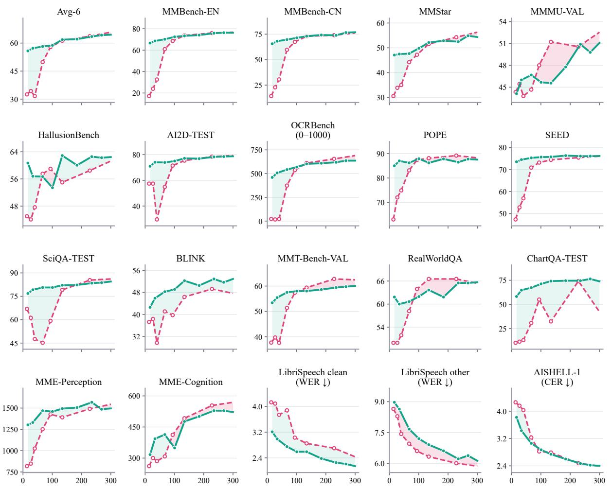  
Stage 1 training tokens (B)

Figure 10. Unified encoder versus separate towers. Green solid curves denote the randomly initialized unified encoder (0.4 B); pink dashed curves denote pre-trained SigLIP-2 [80] and SenseVoice-small [81] towers (0.6 B combined) with random projectors. Panels report individual vision benchmarks, the general multimodal average (Avg-6), and ASR error rates.

Omni encoder initialized from Qwen3-0.6B-Base Omni encoder trained from scratch  
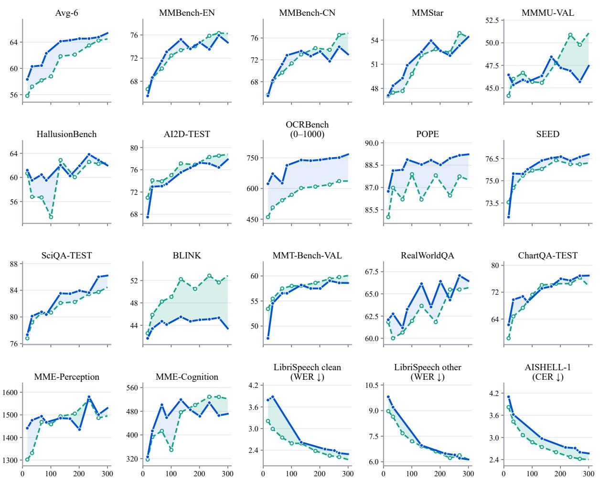  
Stage 1 training tokens (B)

Figure 11. Encoder initialization on vision and ASR benchmarks. Blue solid curves denote the encoder initialized from Qwen3-0.6B-Base, and green dashed curves denote the encoder trained from scratch. Shaded bands indicate the performance gap, colored by the better-performing branch. Lower WER and CER indicate better ASR performance.

## F Qualitative Examples

Each example in this appendix comprises the input, the parsed elements or segments, and the rendered parse.

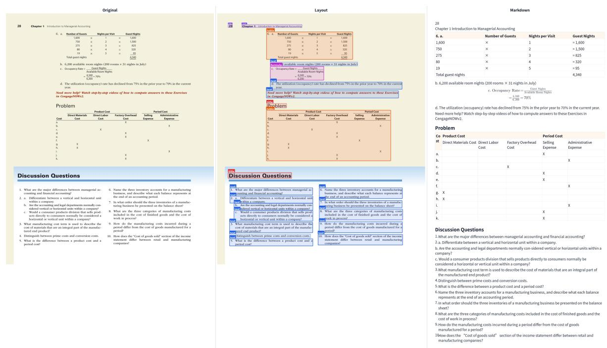  
Figure 12. Document. A conventional single-column page: the parse recovers one linear reading order over headings, body paragraphs, and inline elements.

  
Figure 13. Document. A newspaper page, the hardest layout class here: irregular multi-column blocks, headlines spanning several columns, captioned photographs, and articles that continue across blocks, all of which the parse has to segment and order.

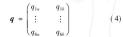  
表4 主成分分析结果整理

## Original

苏 畅，等：基于感性工学和主成分分析的车身色彩设计

## 3 主成分分析

运用主成分分析法，在多组感性词汇变量中提取出能够代表绝大部分感性信息的少量感性词留前3个主成分即可概括原始数据的绝大部分位为表4。

表3 解释的总方差
<table><tr><td rowspan="2">成分</td><td colspan="3">初始特征值</td><td colspan="3">提取平方和载入</td></tr><tr><td>合计</td><td></td><td>方差百 累计百 分比% 分比/%</td><td>合计</td><td>方差百 累计百 分比/% 分比/%</td><td></td></tr><tr><td></td><td>2.996</td><td>49.933</td><td>49.933</td><td>2.996</td><td>49.933 49.933</td><td></td></tr><tr><td>2</td><td>1.696</td><td>28.268</td><td>78.201</td><td>1.696</td><td>28.268 78.201</td><td></td></tr><tr><td></td><td>1.045</td><td>17.424</td><td>95.624</td><td>1.045</td><td>17.424 95.624</td><td></td></tr><tr><td></td><td>0.159</td><td>2.651</td><td>98.275</td><td></td><td></td><td></td></tr><tr><td></td><td>0.083</td><td>1.388</td><td>99.663</td><td></td><td></td><td></td></tr><tr><td></td><td>0.020</td><td></td><td>0.337 100.000</td><td></td><td></td><td></td></tr></table>

<table><tr><td>因子</td><td>词汇</td><td>主成分 特征值 载荷</td><td>解释变异 累计变异 量/%</td><td>量/%</td></tr><tr><td></td><td>商务的-休闲的 睿智的-迟缓的</td><td>0.898 2.996 49.933 0.947 0.723</td><td></td><td>49.933</td></tr><tr><td></td><td>优稚的-债信的 低词的-张扬的 豪华的-补素的</td><td>-0.852 0.871</td><td>1.69628.268</td><td>78.201</td></tr><tr><td></td><td>田园的-都市的</td><td></td><td></td><td>0.784 1.045 17.424</td><td>95.624</td></tr></table>

对照参考表2与表4，依据出现频率较多且是：休闲的、睿智的、低调的、朴索的、都市的;次要词汇则是：优雅的。这些词汇表示消费者对A级

将文中1.1节中整理出来的感性词汇以矩阵的形式表示，φ，为第一组第一个词汇(商务的)。qu为第一组第二个词汇(休闲的)。以此类推，本

从集合A中筛选出针对5个重要词汇的元素作为集合A°，同样从集合B中筛选出针对5个重

## 要词汇的元素作为集合矿

(6)

集合A"与B的所有元素按照样本顺序排列然后计算每个样本所得各个分值与3做差的绝对值之和C，见式(7)

C即为基于重要词汇的每个样本认可度的最终总得分，见表5。

<table><tr><td rowspan="2"></td><td colspan="5">重要同汇</td><td rowspan="2">测分</td></tr><tr><td>休闲的</td><td>朴索的</td><td>都市的</td><td>普智的</td><td>低调的</td></tr><tr><td></td><td></td><td>2.227</td><td></td><td></td><td>3.475</td><td>1.248</td></tr><tr><td></td><td></td><td>2.343</td><td>2.591</td><td>3.253</td><td>3.237</td><td>1.556</td></tr><tr><td></td><td>2.520</td><td>2.348</td><td>2.490</td><td></td><td>3.222</td><td>1.864</td></tr><tr><td></td><td></td><td></td><td>2.364</td><td>3.278</td><td></td><td>0.914</td></tr><tr><td></td><td>2.485</td><td>2.586</td><td></td><td></td><td></td><td>0.929</td></tr><tr><td></td><td>2.444</td><td>2.576</td><td></td><td></td><td></td><td>0.980</td></tr><tr><td></td><td></td><td>2.500</td><td>2.480</td><td></td><td>3.197</td><td>1.217</td></tr><tr><td></td><td></td><td></td><td>2.540</td><td></td><td></td><td>0.460</td></tr><tr><td></td><td>2.490</td><td>2.399</td><td></td><td></td><td></td><td>1.111</td></tr></table>

运用同样的方法可以获得不同年龄区间的受试者对A级车车身色影喜好的优先级，如表6所  
表6 不同年龄受试者的色彩样本优先级排序

<table><tr><td rowspan="2">样本</td><td colspan="3">年龄阶段</td></tr><tr><td>21 ~25 岁</td><td>31 –35 9</td><td>41 ~45 岁</td></tr><tr><td>1</td><td>1.248</td><td>1.266</td><td>1.229</td></tr><tr><td>2</td><td>1.556</td><td>1.516</td><td>1.463</td></tr><tr><td>1</td><td>1.864</td><td>1.345</td><td>1.531</td></tr><tr><td></td><td>0.914</td><td>0.882</td><td>0.572</td></tr><tr><td></td><td>0.929</td><td>0.953</td><td>0.946</td></tr><tr><td></td><td>0.980</td><td>1.021</td><td>0.916</td></tr><tr><td></td><td>1.217</td><td>1.255</td><td>1.163</td></tr><tr><td></td><td>0.460</td><td>0.431</td><td>0.723</td></tr><tr><td></td><td>1.111</td><td>1.128</td><td>1.036</td></tr></table>

由表6得出3个不同年龄段受试者对9个级车车身色彩样本的优先级排序.其中21\~25岁与31\~35岁年龄段的优先级排序由前到后依次

## ncader期刊

Layout  
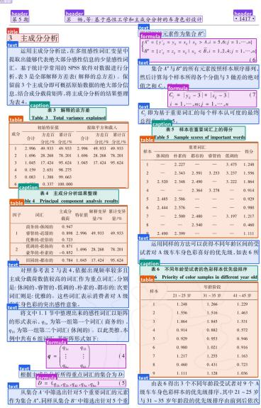

<table><tr><td rowspan="2"></td><td colspan="5">重要问汇</td><td rowspan="2">得分</td></tr><tr><td>休闲的</td><td>朴素的</td><td></td><td>都石的 睿智的</td><td>低调的</td></tr><tr><td></td><td></td><td>2.227</td><td></td><td></td><td>3.475</td><td>1.248</td></tr><tr><td></td><td></td><td>2.343</td><td>2.591</td><td>3.253</td><td>3.237</td><td>1.556</td></tr><tr><td></td><td>2.520</td><td>2.348</td><td>2.490</td><td></td><td>3.222</td><td>1.864</td></tr><tr><td></td><td></td><td></td><td>2.364</td><td>3.278</td><td></td><td>0.914</td></tr><tr><td></td><td>2.485</td><td>2.586</td><td></td><td></td><td></td><td>0.929</td></tr><tr><td></td><td>2.444</td><td>2.576</td><td></td><td></td><td></td><td>0.980</td></tr><tr><td></td><td></td><td>2.500</td><td>2.480</td><td></td><td>3.197</td><td>1.217</td></tr><tr><td></td><td></td><td></td><td>2.540</td><td></td><td></td><td>0.460</td></tr><tr><td></td><td>2.490</td><td>2.399</td><td></td><td></td><td></td><td>1.1II</td></tr></table>

<table><tr><td colspan="4"> Prcty of coe smples in different year old</td></tr><tr><td rowspan="2">排本</td><td colspan="3">年龄阶段</td></tr><tr><td>21~25 岁</td><td>31~35岁</td><td>41-45 岁</td></tr><tr><td>1</td><td>1.248</td><td>1.266</td><td>1.229</td></tr><tr><td>2</td><td>1.556</td><td>1.516</td><td>1.463</td></tr><tr><td>3</td><td>1.864</td><td>1.845</td><td>1.531</td></tr><tr><td>4</td><td>0.914</td><td>0.882</td><td>0.572</td></tr><tr><td>5</td><td>0.929</td><td>0.953</td><td>0.986</td></tr><tr><td></td><td>0.980</td><td>1.021</td><td>0.916</td></tr><tr><td></td><td>1.217</td><td>1.255</td><td>1.163</td></tr><tr><td></td><td>0.460</td><td>0.431</td><td>0.723</td></tr><tr><td>a</td><td>1.111</td><td>1.128</td><td>1.036</td></tr></table>

## Markdown

超星·期刊  
第5期  
苏畅,等:基于感性工学和主成分分析的车身色彩设计  
·1417·

## 3.主成分分析

运用主成分分析法，在多组感性词汇变量中提取出能够代表绝大部分感性信息的少量感性词汇。基于统计学常用的SPSS软件对数据进行分析,表3是全部解释方差表(解释的总方差)。保留前3个主成分即可概括原始数据的绝大部分信息,结合成分载荷矩阵，将主成分分析的结果整理为表4。

<table><tr><td rowspan="2">成 分</td><td colspan="3">初始特征值</td><td colspan="3">提取平方和载入</td></tr><tr><td>合计</td><td>方差百分比/%</td><td>累计百分比/%</td><td>合计</td><td>方差百分比/%</td><td>累计百分比/%</td></tr><tr><td>1</td><td>2.996</td><td>49.933</td><td>49.933</td><td>2.996</td><td>49.933</td><td>49.933</td></tr><tr><td>2</td><td>1.696</td><td>28.268</td><td>78.201</td><td>1.696</td><td>28.268</td><td>78.201</td></tr><tr><td>3</td><td>1.045</td><td>17.424</td><td>95.624</td><td>1.045</td><td>17.424</td><td>95.624</td></tr><tr><td>4</td><td>0.159</td><td>2.651</td><td>98.275</td><td></td><td></td><td></td></tr><tr><td>5</td><td>0.083</td><td>1.388</td><td>99.663</td><td></td><td></td><td></td></tr><tr><td>6</td><td>0.020</td><td>0.337</td><td>100.000</td><td></td><td></td><td></td></tr></table>

表4 主成分分析结果整理 Table 4 Principal component analysis results

<table><tr><td>因词汇 子</td><td>主成分载荷</td><td>特征值</td><td>解释变异量 1%</td><td>累计变异量 1%</td></tr><tr><td>1 俗的</td><td>商务的-休闲的睿智的-迟缓的优雅的-世0.9470.8980.723</td><td>2.996</td><td>49.933</td><td>49.933</td></tr><tr><td>2 低调的-张扬的豪华的-朴素的</td><td>0.871-0.852</td><td>1.696</td><td>28.268</td><td>78.201</td></tr><tr><td>3 田园的-都市的</td><td>0.784</td><td>1.045</td><td>17.424</td><td>95.624</td></tr></table>

对照参考表2与表4,依据出现频率较多且主成分载荷数值较高的词汇作为重点词汇，分别是：休闲的、睿智的、低调的、朴素的、都市的;次要词汇则是：优雅的。这些词汇表示消费者对A级车车身色彩的突出感性意象。将文中1.1节中整理出来的感性词汇以矩阵的形式表示。91为第一组第一个词汇(商务的)，91为第一组第二个词汇(休闲的)。以此类推，本例中共有6组词汇，其矩阵形式如下

根据主成分分析所得重点词汇的集合为D

从集合A'中筛选出针对5个重要词汇的元素作为集合A，同样从集合B'中筛选出针对5个重要词汇的元素作为集合B°：集合A"与B“的所有元素按照样本顺序排列，然后计算每个样本所很各个分值与3做差的绝对值之和，见式/7)

Cj即为基于重要词汇的每个样本认可度的最终总得分，见表5

表5 样本在重要词汇上的得分 Table 5 Sample scores of important words

<table><tr><td rowspan="2">样本</td><td colspan="5">重要词汇</td><td rowspan="2">得分</td></tr><tr><td>休闲的</td><td>朴素的</td><td>都市的</td><td>睿智的</td><td>低请的</td></tr><tr><td>1</td><td></td><td>2.227</td><td></td><td></td><td>3.475</td><td>1.248</td></tr><tr><td>2</td><td></td><td>2.343</td><td>2.591</td><td>3.253</td><td>3.237</td><td>1.556</td></tr><tr><td>3</td><td>2.520</td><td>2.348</td><td>2.490</td><td></td><td>3.222</td><td>1.864</td></tr><tr><td>4</td><td></td><td></td><td>2.364</td><td>3.278</td><td></td><td>0.914</td></tr><tr><td>5</td><td>2.485</td><td>2.586</td><td></td><td></td><td></td><td>0.929</td></tr><tr><td>6</td><td>2.444</td><td>2.576</td><td></td><td></td><td></td><td>0.980</td></tr><tr><td>7</td><td>一</td><td>2.500</td><td>2.480</td><td>一</td><td>3.197</td><td>1.217</td></tr><tr><td>8</td><td>一</td><td>一</td><td>2.540</td><td>一</td><td>一</td><td>0.460</td></tr><tr><td>9</td><td>2.490</td><td>2.399</td><td></td><td></td><td></td><td>1.111</td></tr></table>

运用同样的方法可以获得不同年龄区间的受试者对A级车车身色彩喜好的优先级，如表6所示。表6 不同年龄受试者的色彩样本优先级排序Table 6 Priority of color samples in different year old

<table><tr><td>样本</td><td colspan="3">年龄阶段</td></tr><tr><td></td><td>21~25岁</td><td>31~35岁</td><td>41~45岁</td></tr><tr><td>1</td><td>1.248</td><td>1.266</td><td>1.229</td></tr><tr><td>2</td><td>1.556</td><td>1.516</td><td>1.463</td></tr><tr><td>3</td><td>1.864</td><td>1.845</td><td>1.531</td></tr><tr><td>4</td><td>0.914</td><td>0.882</td><td>0.572</td></tr><tr><td>5</td><td>0.929</td><td>0.953</td><td>0.946</td></tr><tr><td>6</td><td>0.980</td><td>1.021</td><td>0.916</td></tr><tr><td>7</td><td>1.217</td><td>注组</td><td></td></tr><tr><td>8</td><td>0.460</td><td></td><td></td></tr><tr><td>9</td><td>1.111</td><td></td><td>1.036</td></tr></table>

先级排序由前到后依次

Figure 14. Document. A two-column page combining several element categories—text, formulas, tables, and figures. The parse has to assign every element to its column and serialize the two columns into a single reading order rather than interleaving them line by line.  
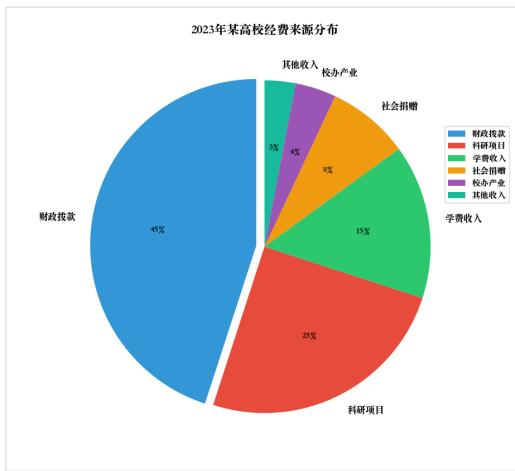

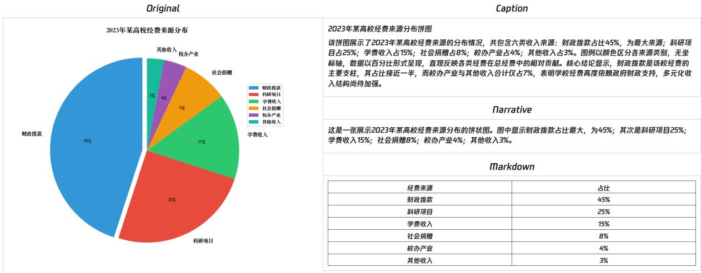

<table><tr><td rowspan=1 colspan=1>经费来源</td><td rowspan=1 colspan=1>占比</td></tr><tr><td rowspan=1 colspan=1>财政拨款</td><td rowspan=1 colspan=1>45%</td></tr><tr><td rowspan=1 colspan=1>科研项目</td><td rowspan=1 colspan=1>25%</td></tr><tr><td rowspan=1 colspan=1>学费收入</td><td rowspan=1 colspan=1>15%</td></tr><tr><td rowspan=1 colspan=1>社会捐赠</td><td rowspan=1 colspan=1>8%</td></tr><tr><td rowspan=1 colspan=1>校办产业</td><td rowspan=1 colspan=1>4%</td></tr><tr><td rowspan=1 colspan=1>其他收入</td><td rowspan=1 colspan=1>3%</td></tr></table>

Figure 15. Chart. Pie Chart of University Funding Sources.

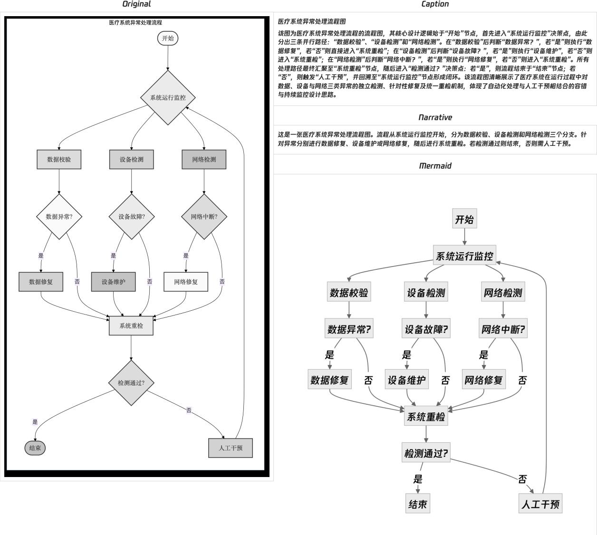

Figure 16. Flowchart. Anomaly-Handling Workflow of a Medical System.  
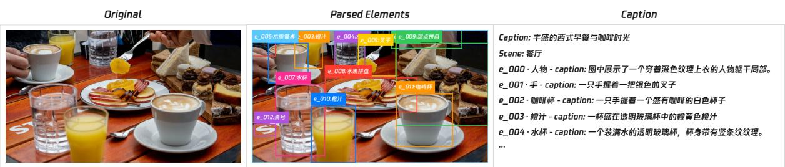  
Figure 17. Natural Image. Western Breakfast Spread with Cofee.

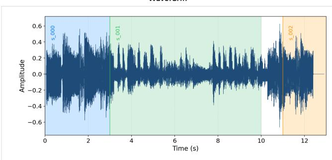

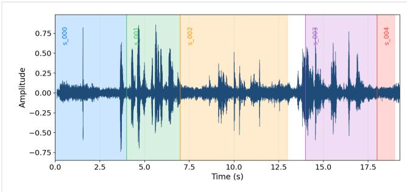

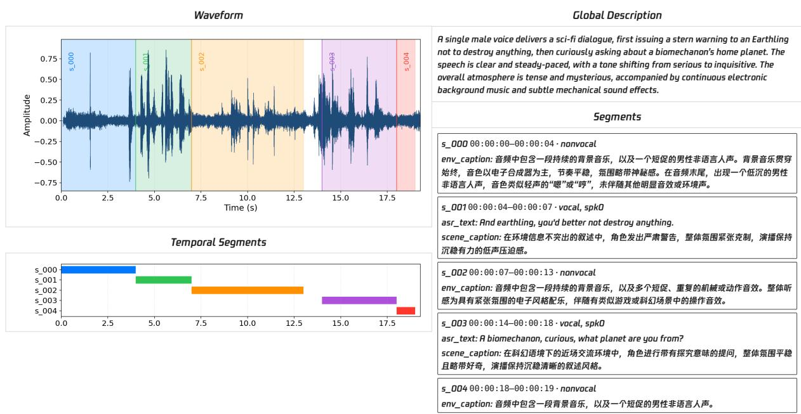  
Figure 18. Audio. Sci-Fi Dialogue with Mechanical Sound Efects.

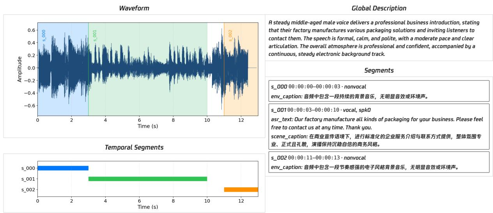  
Figure 19. Audio. Factory Packaging Services Introduction.

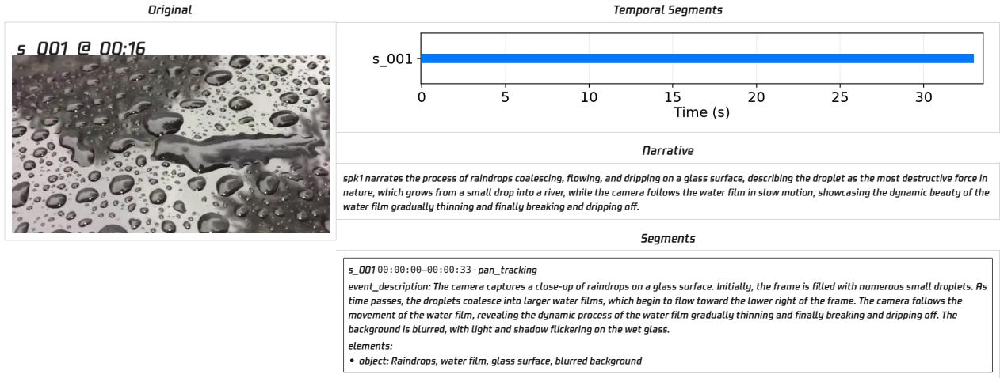  
Figure 20. Natural Video. Raindrops Coalescing on a Glass Surface.

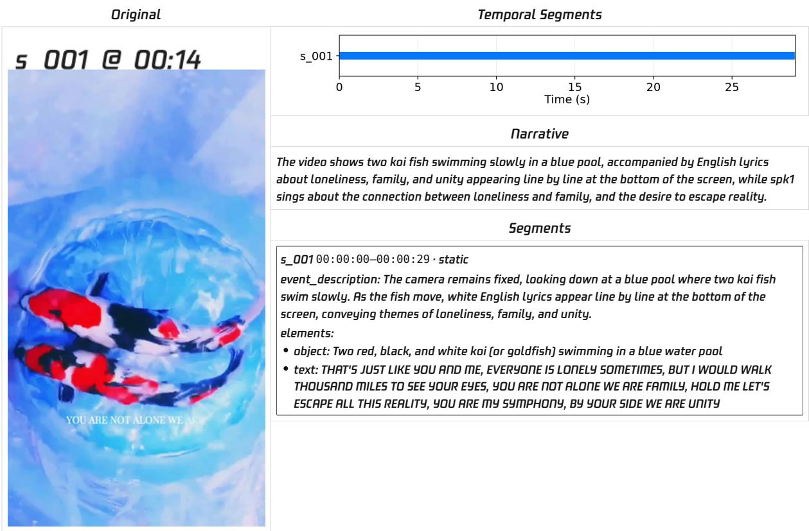  
Figure 21. Natural Video. Koi Fish Swimming in a Pool with Song Lyrics.

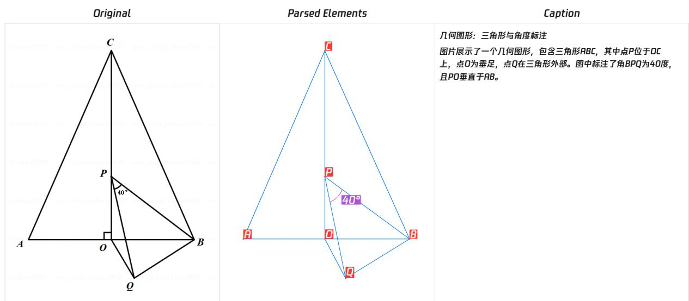  
Figure 22. Geometry. Triangle with Perpendicular Foot and Angle Annotation.

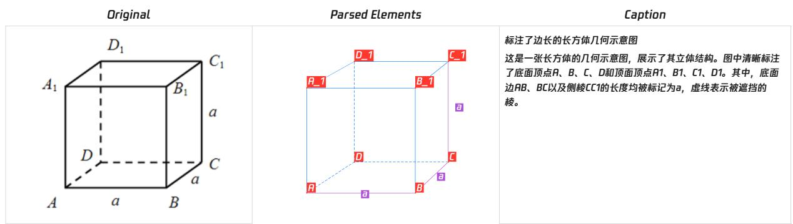  
Figure 23. Geometry. Cuboid with Labeled Vertices and Edge Lengths.

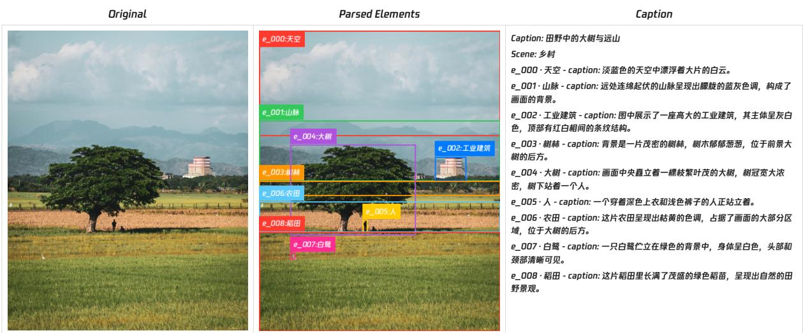  
Figure 24. Natural Image. Rural Landscape with a Large Tree and Distant Mountains.

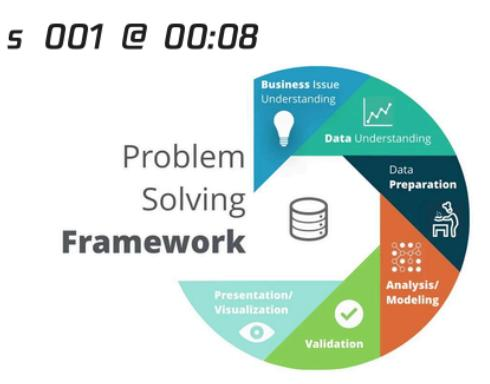

Original  
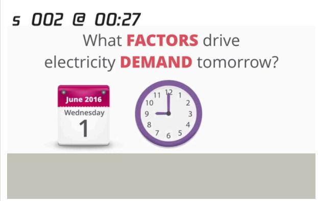

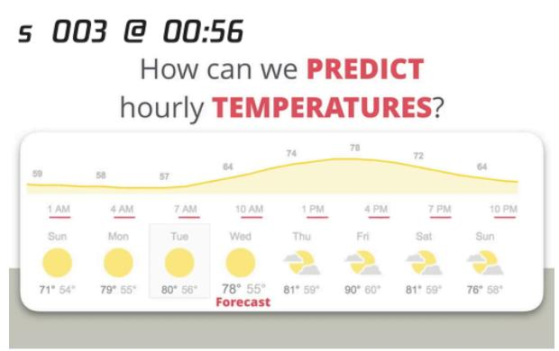

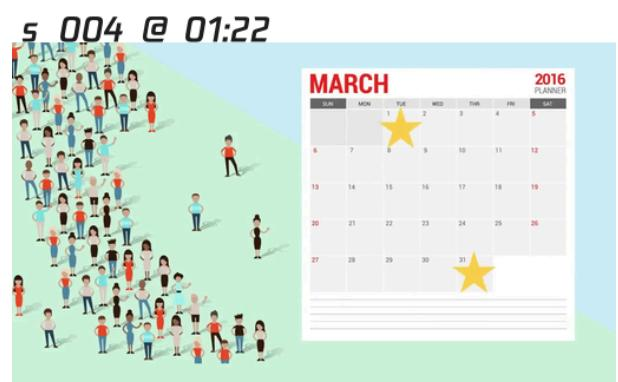

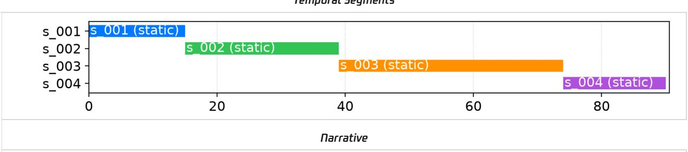  
<sup>event\_description:</sup> <sup>The</sup> <sup>screen</sup> <sup>displays</sup> <sup>a</sup> <sup>weather</sup> <sup>forecast</sup> <sup>interface</sup> <sup>with th</sup>The video uses a problem-solving framework to explain the process of data analysis. spk1 first introduces the importance of understanding data needs and available s\_001 <sup>00:00:00–00:00:15</sup> · st<sup>s\_001</sup> <sup>00:00:00–00:00:15</sup> <sup>·</sup> <sup>statictrend</sup> <sup>from</sup> <sup>1</sup> <sup>AM</sup> <sup>to</sup> <sup>10</sup> <sup>PM,</sup> <sup>with</sup> <sup>weather</sup> <sup>icons</sup> <sup>below</sup> <sup>indicating</sup> <sup>daily</sup> <sup>conditio</sup>data, then uses a calendar, clock, and thermometer to illustrate the factors afecting electricity demand, and finally uses a weather forecast interface and a calendar event<sup>Tuesd</sup>to demonstrate how to predict hourly temperatures and the importance of data understandi g  
text: [Problem Solving Framework, B<sup>text:</sup> <sup>[Problem</sup> <sup>Solving</sup> <sup>Framework,</sup> <sup>Business</sup> <sup>Issue</sup> <sup>Understanding,</sup> <sup>Data</sup> <sup>Understan78°</sup> <sup>55°,</sup> <sup>81°</sup> <sup>59°,</sup> <sup>90°</sup> <sup>60°,</sup> <sup>81°</sup> <sup>59°,</sup> <sup>76°</sup> <sup>58°,</sup> <sup>Forecast]Structured</sup> <sup>Report</sup>Figure 25. Text-Rich Video. Data Analysis Problem-Solving Framework. Frames, timeline, and narrative; the report and segments follow on the next page.

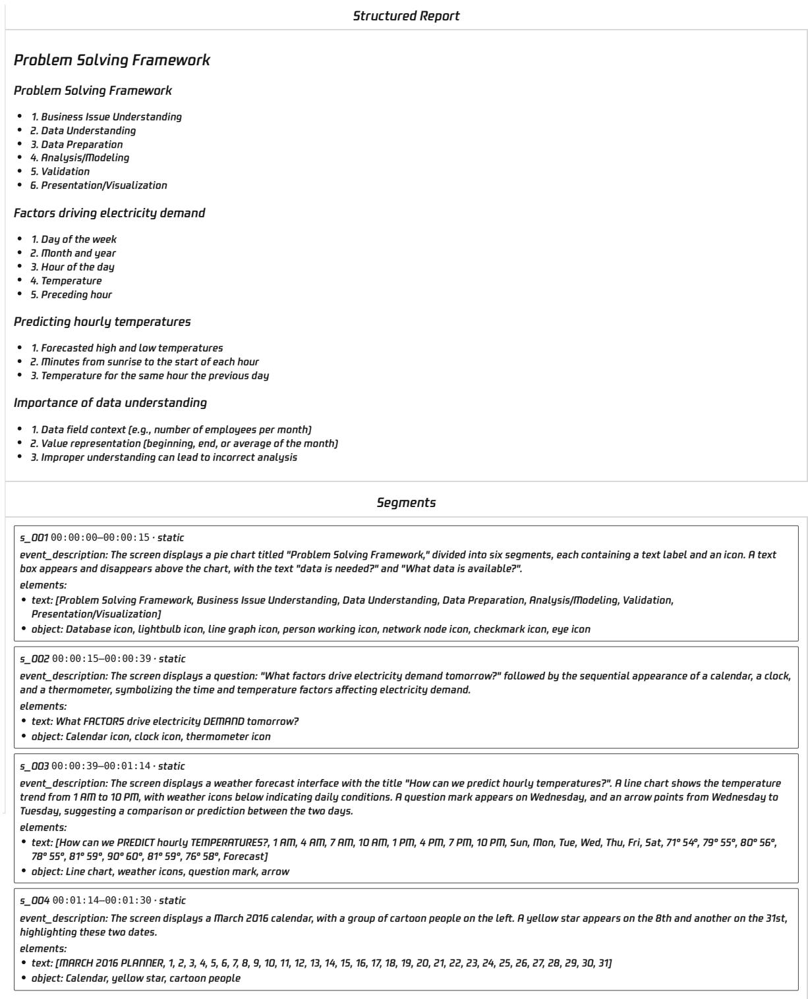  
Figure 25. Text-Rich Video. Data Analysis Problem-Solving Framework (continued).

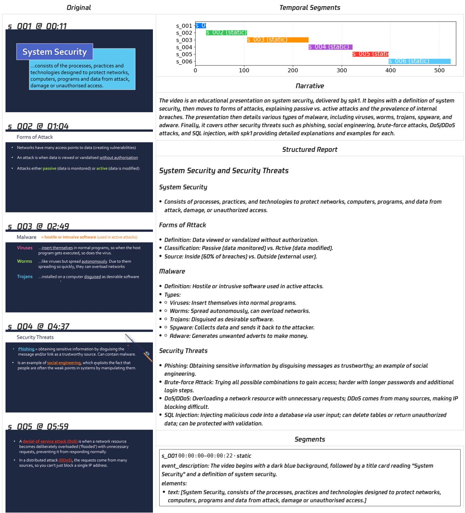  
Figure 26. Text-Rich Video. System Security Course on Attack Types and Threats. Frames, timeline, narrative, report, external sources, with a note that internal attacks account for about 60% oand the first segment; the last frame and the remaining segments follow on the next page.

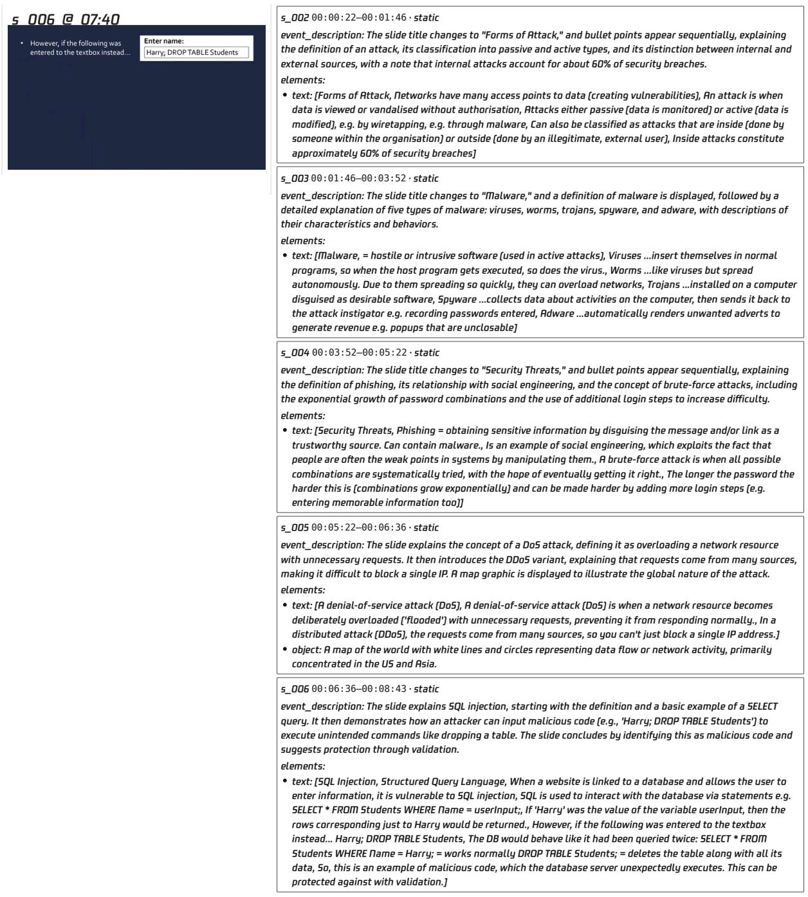  
Figure 26. Text-Rich Video. System Security Course on Attack Types and Threats (continued).